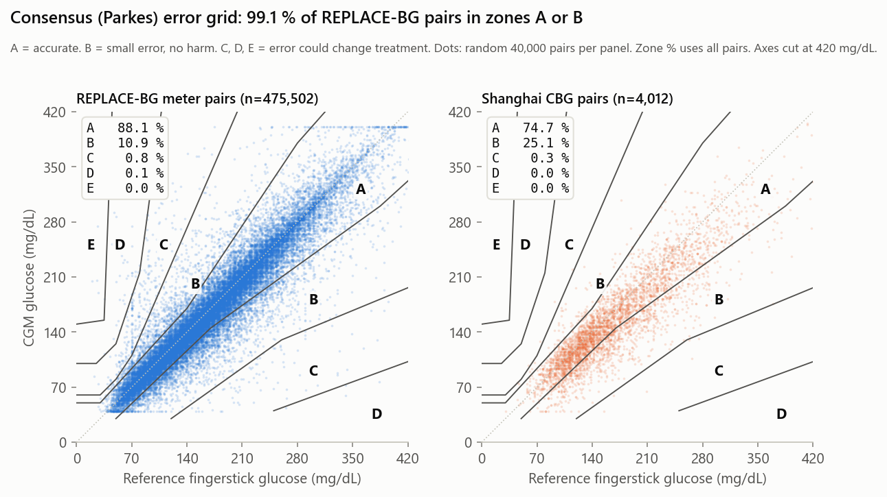

# Raw data check: plain-language results (2026-10-07)

Key terms used in this file:
- CGM = continuous glucose monitor. A sensor worn on the skin that reads glucose every few minutes.
- Fingerstick = a drop of blood tested on a hand-held meter. Reference glucose = a fingerstick reading we treat as the true value. Pair = one CGM reading matched to one fingerstick taken at nearly the same time.
- Hypoglycaemia = low blood sugar, below 70 mg/dL. Below 54 mg/dL is very low.
- Bias = average of (CGM minus reference). A minus sign means the sensor reads too low. MARD = the sensor's average percent error. Lower is better.
- T1DM / T2DM = type 1 / type 2 diabetes. HbA1c = a blood test for average sugar over about 3 months. Higher means worse control. About 7 % is good.

## What this means for the project
- Use REPLACE-BG as our main dataset. It has enough low-sugar pairs to answer our research question.
- Use Shanghai only as a second, smaller check. It is the only Abbott-type sensor we have. It has just 37 pairs below 70 mg/dL, so it cannot answer low-sugar questions on its own.
- We can do now: error by glucose range, error grids, drift over sensor wear days, error vs how fast glucose is changing, and the "decision flip" simulation (insulin pump dose logs exist).
- We cannot claim results for children, non-White, lower-income, or less-educated groups. Neither dataset covers them.
- Pitfall 1: group pairs by low fingerstick values and the sensor looks too HIGH. Group the same pairs by low CGM values and it looks too LOW. This is a maths effect, not a sensor fact. Report error against the average of the two readings, or use an error grid (see section 6). Figure 09 now groups bias by the average. Grouped that way, the sensor reads LOW below 70 mg/dL (REPLACE-BG: 5-11 % low).
- Pitfall 2: 7.4 % of REPLACE-BG CGM readings are from before the study started. Cut them out first.
- Pitfall 3: Shanghai files need cleaning first (odd column names, Chinese column names, a garbled folder name, 3 lock files).
- The data folder is 919 MB. Too big for a normal git push. It is already in `.gitignore`.

## The data we have
The `Uncommitted Data/Raw Data Dump/` folder is 919 MB. It is gitignored. It holds two of the three datasets named in the README for Project 1 (CGM accuracy vs reference glucose). OhioT1DM (the third) is not in the folder.

| Dataset | Who made it | What it is | Size |
|---|---|---|---|
| REPLACE-BG | Jaeb Center / T1D Exchange (US), public | Trial in 2015-16. 226 adults with type 1 diabetes. All wore a Dexcom G4 CGM for 26 weeks after a practice period. Some also did confirming fingersticks. | 30 text tables, 837 MB. 14.8 million CGM readings. |
| Shanghai T1DM / T2DM | Zhao et al. 2023, Figshare, public | 12 type 1 and 100 type 2 patients in Shanghai hospitals. Each wore a "flash" CGM (one you scan with a reader) for about 2 weeks. Also fingersticks, diet, insulin and lab tests. | 125 Excel files (one per patient visit) + 2 summary workbooks |

## 1. Headline findings
1. Both datasets pair CGM readings with fingersticks. Only REPLACE-BG has enough low-sugar pairs for our question. This settles the README's "biggest uncertainty" in favour of REPLACE-BG.

| Pairs | REPLACE-BG calibration pairs | REPLACE-BG meter pairs | Shanghai |
|---|---|---|---|
| Total | 120,000 | 476,000 | 4,012 |
| Reference below 70 | 6,600 | 20,000 | 37 |
| Reference below 54 | 1,300 | 4,200 | 7 |

2. Above 70 mg/dL, both sensors read too low. Dexcom G4 (REPLACE-BG): 3-5 % low. Shanghai flash sensor: 6-13 % low, and worse as glucose rises. Same direction as the Libre 3 recall fault, so the data is a realistic base for our bias simulation.
3. Below 54 mg/dL, the sign of the bias depends on how pairs are grouped. Grouped by reference value: 23-33 % too HIGH. Grouped by CGM value: 23-32 % too LOW. Grouped by the average of the two readings (the fair way, used in figure 09): 7-11 % too LOW in REPLACE-BG. Maths effect, not a sensor fact. See section 6.
4. MARD is 10-14 % overall. It roughly doubles below 70 mg/dL. Per person in REPLACE-BG: 9-23 %, median 13.9 %.
5. The two groups of people are very different. Each is narrow. REPLACE-BG: median age 43, 94 % White, highly educated, well controlled (HbA1c 7.3 %), US. Shanghai: median age 58-62, Chinese, hospital in-patients, poorly controlled (HbA1c median 8.5 %, up to 17 %). No children in either.
6. Missing data: small in REPLACE-BG. Large in Shanghai lab tests (up to 50 % of T2DM records lack a test). The CGM traces themselves have almost no gaps in either dataset.

## 2. REPLACE-BG: who is in it


| Item | Value (226 people) |
|---|---|
| Clinics / finished | 14 clinics. 217 finished. 9 dropped out (withdrew, lost contact, one adverse event) |
| Study arm | CGM only: 149. CGM + fingerstick meter: 77 |
| Age | mean 44, median 43, range 19-78 |
| Sex | 114 male, 112 female |
| Race / ethnicity | White 212 (93.8 %), Black 5, Asian 4, more than one 3, unknown 2. Hispanic or Latino 9 (4 %) |
| Education | Bachelor's degree or higher: 174 (77 %). 5 did not answer |
| Household income | 58 did not answer (26 %). Of the 168 who did, 87 (52 %) earn $100k or more |
| Insurance | Private: 87.6 % |
| Diabetes history | Age when diagnosed: median 18 (range 0-61). Years with diabetes: median 21.5 (range 2-64) |
| BMI (body mass index, a weight-for-height score) | mean 27.3. 25 % are 30 or above (obese) |
| Used a CGM before | currently 107, in the past 79, never 40 (Dexcom 77, Medtronic 30) |
| Severe low-sugar event | none in the last 12 months (required to join). 80 had one earlier |
| DKA (diabetic ketoacidosis, a serious high-sugar emergency) | 2 people in the last 6-12 months |
| Fingersticks per day at start / insulin pump | mean 5.1 / 224 of 226 use a pump |
| Other conditions | high cholesterol 79, high blood pressure 60, low thyroid 51, depression 40 |

HbA1c was measured 4 times. It barely changed. 4 of 890 HbA1c rows are blank.
- Mean HbA1c by visit: screening 7.27 % (range 5.2-8.9). Randomisation 7.02 %. Week 13 7.02 %. Week 26 7.03 %.


Missing data in the people tables:
- Screening table: 43 columns, 226 rows. Only 2 real gaps: income (58 blank) and education (5 blank). Other blanks are by design: checkbox fields are blank when not ticked (13 insurance columns, "approximate" flags), and CGM-history fields only apply to the 107 current and 79 past CGM users.
- Small event tables: 1 severe low-sugar event. 25 adverse events (9 serious; the "device related?" field is blank for all; 1 blamed on a study procedure). 68 device issues (52 are Dexcom G4 faults).

## 3. REPLACE-BG: the device data
| Table | Rows | What it holds |
|---|---|---|
| HDeviceCGM | 14,950,661 | 14,807,435 CGM readings + 143,226 calibrations (a calibration = a fingerstick typed into the receiver to correct the sensor). No blank values. |
| HDeviceBGM | 583,985 | 580,577 meter readings (Contour Next and Precision Xtra meters) + 3,408 ketone readings (in mmol/L) |
| HDeviceBolus, HDeviceBasal, HDeviceWizard | 21-32 MB each | Insulin pump records: doses, background rate, and the pump's dose calculator. Useful for the decision-flip simulation. |
| HDeviceUploads | 8,975 | One row per device upload. Everyone has a Dexcom G4 receiver and a Contour Next meter. |

CGM readings:
- The G4 only shows 39-401 mg/dL. 0.2 % of readings sit at 39 and 0.3 % at 401 (clipped). Mean 160, median 150 mg/dL.
- One reading every 5 minutes. Only 0.38 % of gaps are over 10 min. 0.1 % are over 1 hour. 1,356 rows share the same person and timestamp (duplicates).
- Time in range (share of all readings): 3.8 % below 70 (0.9 % below 54). 62.8 % in 70-180. 33.5 % above 180.
- Coverage per person (medians): 249 days with data (range 67-351). 271 readings per day (94 % of the 288 possible). 90 % of each person's time span covered.


Data problems to fix before analysis:
- 7.4 % of CGM readings are dated BEFORE the person joined (day 0). 3.2 % are more than 30 days before. 93 people are affected. Earliest is day -595. These are old readings from people's own receivers, uploaded at screening. Fix: keep only each person's study window, day 0 to the end of the 26-week trial (day 329 at the latest). Randomisation came 12-144 days after day 0 (median 69).
- Meter readings: 16 values below 20 mg/dL (probably typed in mmol/L by mistake) and 34 at 600 or above (the meter's "HI" code). 2 calibration values also out of range. All removed before pairing.
- Clocks. The CGM has two (`DeviceTm` and `DexInternalTm`); they differ by hours for some uploads; we used `DeviceTm`. The meter and CGM receiver have separate clocks. Staff checked them against a phone at each visit, but drift between visits is possible. So meter pairs are less exact in time than calibration pairs.

## 4. Shanghai: who is in it
Numbers are from each patient's first visit. 2 T1DM and 8 T2DM patients had 2 or 3 visits.

| Item | T1DM (12 patients, 16 records) | T2DM (100 patients, 109 records) |
|---|---|---|
| Sex | 7 female, 5 male | 44 female, 56 male |
| Age | mean 57.8, range 37-73 | mean 60.2, range 22-97 |
| BMI | mean 21.1 (13.7-27.5) | mean 24.1 (17.1-36.7) |
| Years with diabetes | median 8.5 | median 7 |
| HbA1c (converted from mmol/mol) | median 8.5 %, range 7.1-17.3 (n = 11) | median 8.5 %, range 4.3-15.4 (n = 92) |
| On insulin | 100 % | 50 % |
| Low sugar flagged during monitoring | 14 of 16 records | 10 of 109 records |
| DKA / drinks alcohol | DKA in 4 of 16 records / 1 drinker | no DKA / 13 drinkers |

Missing data:
- Missing values are written as `/`. Text columns are often blank: "Acute Diabetic Complications" is blank in every T2DM record, and vascular complication columns are blank in 63-75 %.
- Lab tests: 50 % of T2DM records lack 2-hour insulin. 41 % lack 2-hour C-peptide. 30 % lack fasting insulin. About 20 % lack lipids, kidney markers and glycated albumin. HbA1c is missing in 7 % of T2DM and 1 of 16 T1DM records.


## 5. Shanghai: the CGM files
| Item | Value |
|---|---|
| Files | 125 (16 T1DM, 109 T2DM). Plus 3 Excel lock files (`~$...`) to delete |
| CGM readings | 127,982 (15,695 T1DM, 112,287 T2DM). One every 15 minutes |
| Days per file | median 12.7, range 2.6-13.9 |
| CGM range | 39.6-475 mg/dL. All values are multiples of 1.8, so they were recorded in mmol/L and converted |
| Time in range | T1DM: 7.6 % below 70, 53.2 % in range, 39.2 % above 180. T2DM: 2.3 % / 78.3 % / 19.3 % |
| Fingerstick (CBG) readings | 4,012 total. Median 26 per file. 17 files have none. Below 70: 37. Below 54: 7 |

- The 15-minute interval and 40-500 range match the Abbott FreeStyle Libre family. The dataset paper says FreeStyle Libre H. This is the only Abbott sensor we have. Confirm from the paper. Fingerstick values are written on the nearest CGM row, so each pair can be up to 7.5 minutes off in time.

Column problems to clean (7 files differ from the standard 11-column layout):
- 2 files have trailing spaces in column names (`CGM `, `CBG `). 1 file is missing a comma in the insulin column names.
- 3 files have a Chinese-only column (`进食量`). 1 file names the basal insulin column in Chinese (`胰岛素泵基础量`). The diet column is in both English and Chinese (`饮食`).
- The top folder name is garbled (a Chinese name from a non-UTF-8 zip). Rename it to plain letters to avoid tool problems.

## 6. CGM accuracy against fingerstick reference
We built 3 sets of pairs. Error = CGM minus reference. Percent error = that gap as a share of the reference.
- Within 20 %/20 = share of pairs within 20 % of the reference (or within 20 mg/dL when glucose is low). Higher is better.
- Clarke error grid = a chart that puts each pair in a zone. A = accurate. B = small error, harmless. C, D, E = errors that could lead to a wrong treatment.
- Parkes (consensus) error grid = a newer version of the Clarke grid. The zone borders were drawn by a panel of doctors and have no sharp jumps. Zones mean the same thing. We use the type 1 diabetes version (Pfutzner et al. 2013).

| Pairing | How matched | Pairs | Bias | MARD | Within 20 %/20 | Clarke A / B / C / D / E (%) | Parkes A / B / C / D / E (%) |
|---|---|---|---|---|---|---|---|
| REPLACE-BG calibrations | fingerstick typed into receiver, matched to the last CGM reading up to 10 min before | 120,202 (84 % of calibrations, all 226 people) | -5.3 mg/dL (-2.8 %) | 14.1 % | 79.7 % | 78.5 / 19.7 / 0.4 / 1.4 / 0.07 | 79.9 / 19.4 / 0.7 / 0.03 / 0.0 |
| REPLACE-BG meter | any meter reading, nearest CGM reading within 5 min | 475,502 (82 % of meter readings) | -4.0 mg/dL (-1.3 %) | 10.4 % | 88.2 % | 87.5 / 10.9 / 0.3 / 1.2 / 0.1 | 88.1 / 10.9 / 0.8 / 0.1 / 0.01 |
| Shanghai CBG | fingerstick on the same 15-min row | 4,012 | -15.1 mg/dL (-7.4 %) | 13.9 % | 76.8 % | 76.0 / 22.8 / 0.02 / 1.2 / 0.02 | 74.7 / 25.1 / 0.3 / 0.0 / 0.0 |


- Calibration pairs are a tighter time match but a harder test: they are taken just before the receiver gets corrected. Meter pairs include the calibrations plus about 3 times as many other fingersticks, so they give the lower MARD you expect from a corrected sensor.
- Shanghai T1DM is much worse than T2DM: MARD 18.4 % vs 12.9 %, bias -13 % vs -6 %. T1DM glucose swings more, which fits.



What the error grid (figure 11) shows:
- REPLACE-BG meter pairs: 99.1 % are in zone A or B. These errors would not change treatment.
- 0.9 % are in zones C, D or E (C 0.8 %, D 0.1 %, E 0.01 %). That is about 4,500 of the 475,502 pairs. These are errors big enough to cause a wrong treatment.
- Shanghai: 74.7 % in A, 25.1 % in B, 0.3 % in C, none in D or E. More pairs land in B because the Shanghai sensor reads 7-8 % low at every glucose level.
- Clarke and Parkes agree on A plus B (REPLACE-BG meter: 98.4 % vs 99.1 %). Clarke puts more pairs in D (1.2 % vs 0.1 %) because its D zone starts with a hard edge at 70 mg/dL. Parkes has no such edge.

| Reference (mg/dL) | REPLACE-BG calibrations: pairs, bias, MARD | REPLACE-BG meter: pairs, bias, MARD | Shanghai: pairs, bias, MARD |
|---|---|---|---|
| Below 54 | 1,319, +22.7 %, 30.6 % | 4,166, +33.4 %, 41.8 % | 7, +24.5 %, 25.5 % |
| 54-69 | 5,270, +3.0 %, 19.8 % | 15,944, +5.8 %, 18.7 % | 30, +12.7 %, 19.8 % |
| 70-180 | 73,246, -3.2 %, 14.5 % | 261,471, -0.9 %, 11.0 % | 2,531, -5.7 %, 13.6 % |
| 181-250 | 27,474, -3.1 %, 12.1 % | 128,495, -2.7 %, 8.1 % | 967, -10.1 %, 13.9 % |
| Above 250 | 12,893, -4.5 %, 11.8 % | 65,426, -4.0 %, 8.2 % | 477, -13.0 %, 14.8 % |

The same pairs grouped by the AVERAGE of CGM and reference. This grouping is fair to both devices (see "Why this happens" below). This is the bias shown in figure 09.

| Average of CGM and reference (mg/dL) | REPLACE-BG calibrations: pairs, bias | REPLACE-BG meter: pairs, bias | Shanghai: pairs, bias |
|---|---|---|---|
| Below 54 | 1,524, -11.1 % | 4,474, -6.6 % | 6, +1.8 % |
| 54-69 | 6,440, -9.5 % | 17,263, -4.8 % | 44, -15.2 % |
| 70-180 | 73,456, -3.5 % | 266,221, -1.3 % | 2,679, -6.9 % |
| 181-250 | 26,570, -0.7 % | 125,761, -1.0 % | 930, -8.3 % |
| Above 250 | 12,212, +1.8 % | 61,783, -0.4 % | 353, -8.2 % |


Figure 09: pair counts and MARD are grouped by reference value. Bias is grouped by the average. Hatched bars rest on fewer than 50 pairs. Grouped by the average, the Dexcom G4 reads 5-11 % LOW below 70 mg/dL, not high.

The low-range sign flip. Group the same pairs by CGM value instead, and the sensor now looks like it reads too LOW:

| CGM (mg/dL) | REPLACE-BG calibrations: pairs, bias | REPLACE-BG meter: pairs, bias | Shanghai: pairs, bias |
|---|---|---|---|
| Below 54 | 3,941, -31.9 % | 7,805, -23.3 % | 37, -44.6 % |
| 54-69 | 7,097, -15.6 % | 18,609, -10.4 % | 87, -26.9 % |
| 70-180 | 71,732, -3.2 % | 265,988, -2.4 % | 2,747, -7.7 % |
| Above 250 | 12,431, +8.0 % | 61,569, +4.2 % | 294, -3.3 % |

Why this happens (called "regression to the mean") and what to do:
- Both the CGM and the fingerstick have random noise. Pick the pairs where the fingerstick was very low, and you mostly get the ones where fingerstick noise pushed it down. The CGM, with its own noise, sits closer to normal, so it looks too high. Pick the pairs where the CGM was very low, and the reverse happens.
- Tiny example: true sugar is 60. Day 1: fingerstick says 50, CGM says 62. In the "fingerstick below 54" group, the CGM looks 12 too high. Day 2: fingerstick says 62, CGM says 50. In the "CGM below 54" group, the CGM looks 12 too low. Same sensor, opposite story.
- Fix (done in figures 09 and 11): report bias against the average of the two readings (a "Bland-Altman" plot), or use a consensus error grid. Do not pick one axis.
- For the decision-flip simulation: as the patient sees it (grouped by CGM value), the sensor already reads 10-16 % low in the 54-69 band. That is before we add any recall-style bias.

Person-to-person variation. Per-person MARD on calibration pairs: 8.9 % to 23.2 %, median 13.9 %. So run the bias simulation per person, not on pooled data.


## 7. What this means for the project plan
- Main dataset: REPLACE-BG. Why: hundreds of thousands of pairs, 226 people, 8 months each, enough low-range pairs, pump dose-calculator logs for the decision-flip simulation, clean layout. Limits: Dexcom G4 is a 2015 sensor. The reference is a home meter, not a lab machine. People are White, affluent, well controlled, adults only.
- Shanghai: the Abbott comparison and a check on other populations. Only Abbott flash sensor we have. Diet and insulin logs on every row. Older, mostly type 2, non-Western. Too small for low-range accuracy. Needs cleaning first.
- README sub-questions we can answer now: bias and MARD by range (done). Error grid zones (Clarke and Parkes done, figure 11). Drift with sensor wear day (calibrations carry day and time; sensor start dates can be inferred from gaps). Error vs how fast glucose is changing (5-minute traces allow this). Bias-flip simulation (pump calculator inputs are logged).
- Open items: confirm the Shanghai sensor model from the paper. Decide the study-window cut for REPLACE-BG. Decide how to group pairs by range. Rename the garbled folder and delete the 3 lock files before committing the dump or adding it to `.gitignore` (919 MB is too big for a normal git push).

## 8. How this was produced
Script: `analysis/explore_raw_data.py`. Every number above is also saved in `analysis/summary_stats.json` so it can be checked.
1. Read `README.md`, the REPLACE-BG `ReadMe.rtf` (table descriptions and glossary), and every table header. The RTF needed the `striprtf` package; a regex approach failed. Profiled the small tables (roster, screening, HbA1c, uploads, events) with pandas. Pipe-delimited files parse cleanly.
2. Loaded the full 837 MB CGM table into memory (about 20 s). Converted day-plus-time to seconds. Split CGM readings from calibration rows.
3. Built the 3 pairings with `pandas.merge_asof`. Kept reference values 20-600 mg/dL. Computed bias, MARD, 20/20 agreement, Clarke and Parkes zones, and range tables grouped three ways (by reference, by CGM, by their average).
4. Loaded the 2 Shanghai summary workbooks (fixed headers, converted HbA1c from mmol/mol to %) and all 125 patient files (matched columns by prefix, treated `/` as missing).
5. Drew 11 figures with matplotlib. Colour-blind-safe palette: blue = REPLACE-BG, orange = Shanghai T1DM, green = Shanghai T2DM. Checked each image for overlaps and fixed 4.

To rerun, from the repo root (takes about 35 s; needs several GB of RAM because the CGM table is held in memory):
```
python -m pip install pandas numpy matplotlib openpyxl xlrd
python analysis/explore_raw_data.py "Uncommitted Data/Raw Data Dump" analysis
```
Detailed version with full prose: RESULTS_detailed.md
