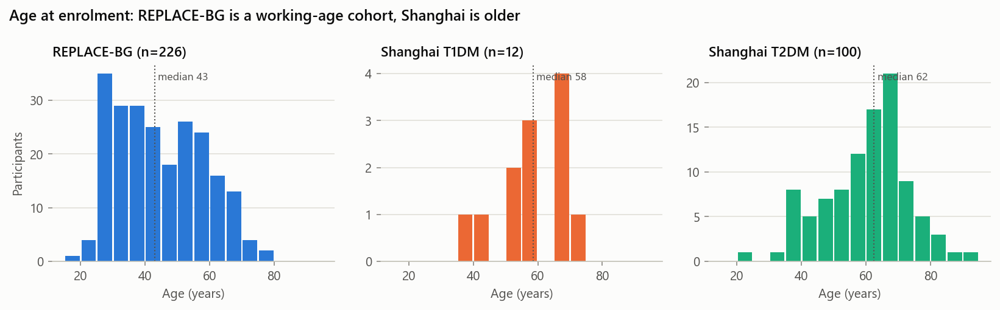
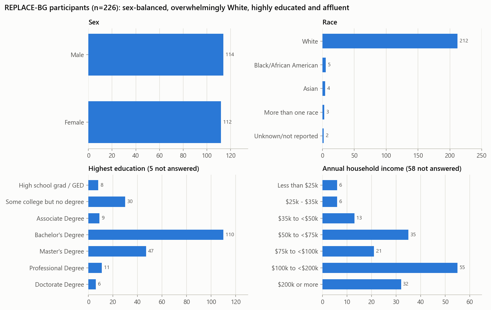
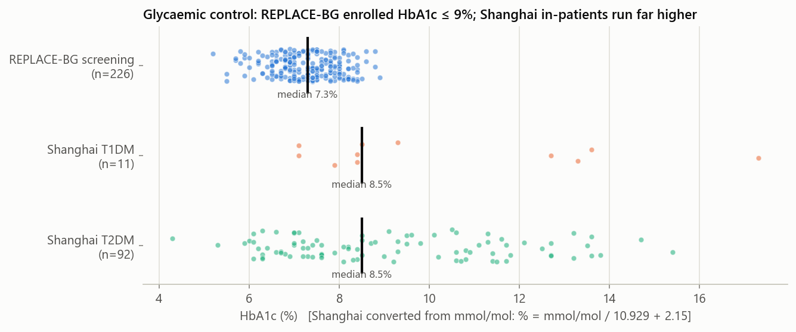
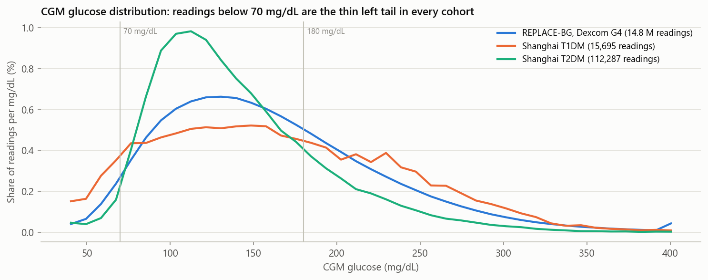
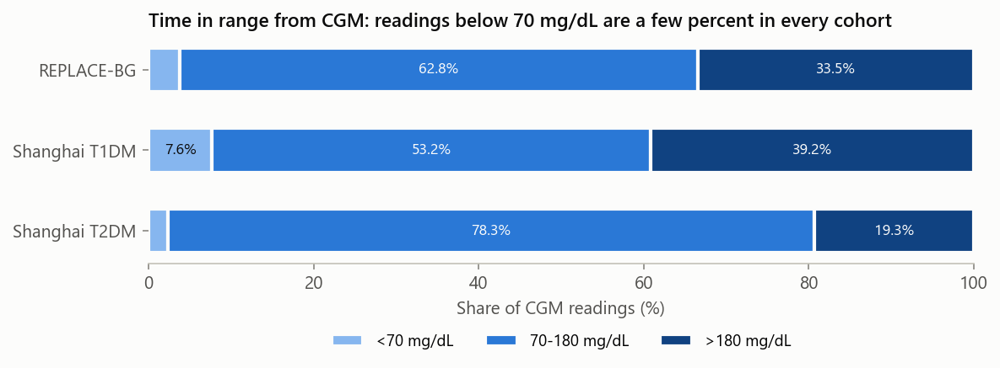
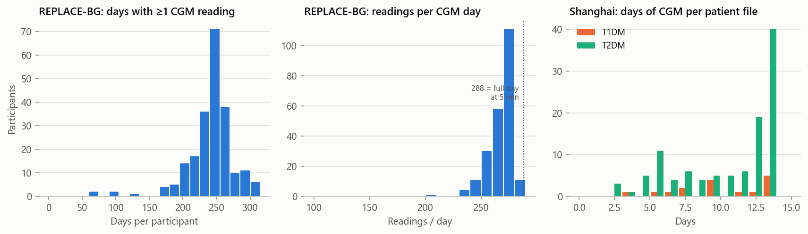
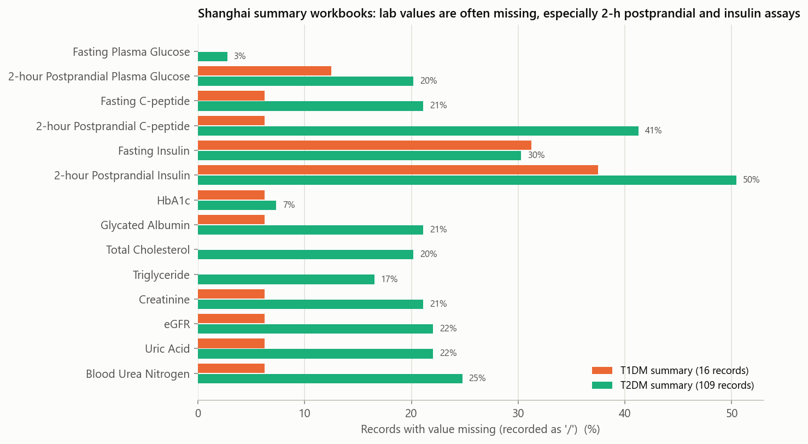
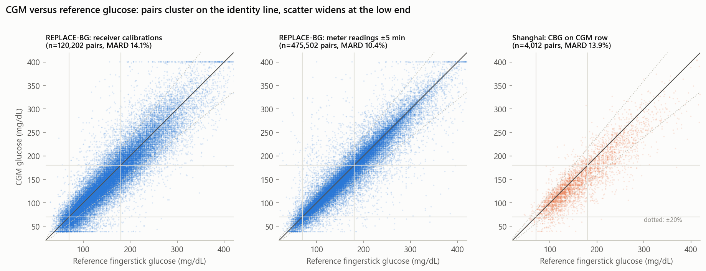
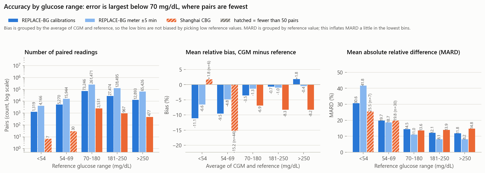
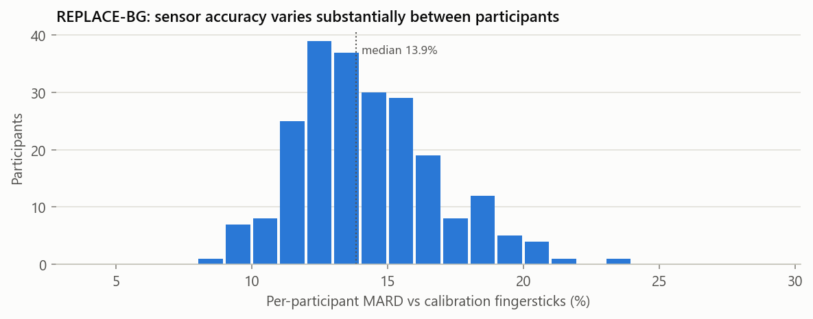

Detailed version. For the plain-language version read RESULTS.md.

# Raw data dump: exploratory analysis

Date: 2026-10-07. Produced by `analysis/explore_raw_data.py`; every number below is also in `analysis/summary_stats.json`.

The `Raw Data Dump/` folder (919 MB, not yet committed) holds two of the three candidate datasets from the README for Project 1 (CGM accuracy vs reference glucose):

| Dataset | Source | What it is | Size |
|---|---|---|---|
| REPLACE-BG | Jaeb Center / T1D Exchange, public study dataset | Randomised trial (2015-16) of 226 adults with type 1 diabetes using Dexcom G4 CGM, with or without confirmatory fingersticks, 26 weeks after a run-in | 30 pipe-delimited tables, 837 MB of which is the CGM table (14.8 M readings) |
| Shanghai T1DM / T2DM | Zhao et al. 2023, Figshare | 12 T1DM and 100 T2DM patients from Shanghai hospitals wearing a flash CGM for roughly two weeks, with fingerstick glucose, diet, insulin and lab panels | 125 Excel files (one per patient-visit) plus two summary workbooks |

OhioT1DM (the third candidate) is not in the dump.

## 1. Headline findings

1. **Both datasets contain CGM readings paired with fingerstick reference glucose, and REPLACE-BG has enough low-range pairs to answer the research question.** REPLACE-BG yields 120 k calibration pairs and 476 k meter pairs, including 6.6 k / 20 k pairs with reference below 70 mg/dL and 1.3 k / 4.2 k below 54 mg/dL. Shanghai yields only 4,012 pairs in total and just 37 below 70 mg/dL, so it cannot support hypoglycaemia-range accuracy claims on its own. This resolves the "biggest uncertainty" in the README in favour of REPLACE-BG.
2. **Across the normal and high ranges, both sensors read systematically low relative to fingerstick.** Dexcom G4 (REPLACE-BG) reads 3-5 % low above 70 mg/dL; the Shanghai flash sensor reads 6-13 % low and the bias grows with glucose. This is the same direction as the Libre 3 recall defect, which makes the datasets a realistic base for the bias simulation.
3. **In the hypoglycaemic range the apparent bias flips sign depending on how pairs are binned**, which is a regression-to-the-mean artefact, not a sensor property. Binned by reference value, CGM reads 23-33 % *high* below 54 mg/dL; binned by CGM value, it reads 23-32 % *low*. The project's error-grid and bias analysis must handle this explicitly (section 6).
4. **MARD is 10-14 % overall and roughly doubles below 70 mg/dL**, with large between-participant spread in REPLACE-BG (per-person MARD 9-23 %, median 13.9 %).
5. **The two cohorts are demographically complementary but each is narrow.** REPLACE-BG is a working-age (median 43), 94 % White, highly educated, well-controlled (HbA1c 7.3 %) US cohort. Shanghai is older (median 58-62), Chinese, hospital in-patients with poor control (HbA1c 8.5 % median, up to 17 %). Neither includes children.
6. **Missing data is modest in REPLACE-BG and substantial in the Shanghai lab panels** (up to 50 % of T2DM records missing an assay). The CGM traces themselves have essentially no missing values in either dataset.

## 2. REPLACE-BG: who is in it





| Characteristic | Value (n = 226) |
|---|---|
| Sites | 14 |
| Status | 217 completed, 9 dropped (withdrawal, lost to follow-up, one adverse event) |
| Randomised arm | CGM only 149, CGM + BGM 77 |
| Age at enrolment | mean 44.0, median 43, range 19-78 |
| Sex | 114 male, 112 female |
| Race | White 212 (93.8 %), Black 5, Asian 4, more than one 3, unknown 2 |
| Ethnicity | Hispanic or Latino 9 (4 %) |
| Education | Bachelor's or higher 174 (77 %); 5 not answered |
| Household income | 58 not answered (26 %); of those who answered, 87 of 168 (52 %) are at or above $100 k |
| Insurance | Private 87.6 % |
| Age at diagnosis | median 18 (0-61) |
| Diabetes duration | median 21.5 years (2-64) |
| BMI | mean 27.3; 25 % at or above 30 |
| Prior CGM use | current 107, past 79, never 40 (Dexcom 77, Medtronic 30) |
| Severe hypoglycaemia history | none in the last 12 months for everyone (entry criterion); 80 had one more than 12 months ago |
| DKA history | 2 participants in the last 6-12 months |
| Fingersticks per day at screening | mean 5.1 |
| Insulin pump | 224 of 226 |
| Common comorbidities | hyperlipidaemia 79, hypertension 60, hypothyroidism 51, depression 40 |

HbA1c was measured at four visits and barely moves: screening mean 7.27 % (range 5.2-8.9), randomisation 7.02 %, week 13 7.02 %, week 26 7.03 %. Four of 890 HbA1c rows are blank.



**Missing data in the participant tables.** The screening table has 43 columns and 226 rows. Only two substantive fields are incomplete: annual income (58 blank) and education (5 blank). Everything else that looks "missing" is structural: checkbox fields that are blank when unchecked (the 13 insurance columns, "approximate" flags) or CGM-history fields that only apply to the 107 current and 79 past CGM users. The small tables are tiny by design: 1 severe hypoglycaemia event, 25 adverse events (9 serious; the device-relatedness field is blank for all of them and one is attributed to a study procedure), 68 device issues (52 of them Dexcom G4 malfunctions).

## 3. REPLACE-BG: the device data

| Table | Rows | Notes |
|---|---|---|
| HDeviceCGM | 14,950,661 | 14,807,435 CGM readings + 143,226 calibration entries; no blank glucose values |
| HDeviceBGM | 583,985 | 580,577 meter readings (Contour Next and Precision Xtra) + 3,408 ketone readings in mmol/L |
| HDeviceBolus, HDeviceBasal, HDeviceWizard | 21-32 MB each | pump bolus, basal and bolus-calculator records; useful for the decision-flip simulation |
| HDeviceUploads | 8,975 | one row per device upload; every participant has a Dexcom G4 receiver and a Contour Next meter |

**CGM readings.** Values are clipped to the G4's 39-401 mg/dL display range (0.2 % of readings sit at 39, 0.3 % at 401). Mean 160, median 150 mg/dL. Median sampling interval is exactly 5 min; only 0.38 % of gaps exceed 10 min and 0.1 % exceed 1 h. 1,356 rows duplicate a participant-timestamp.





Population time in range from CGM: 3.8 % below 70 mg/dL (0.9 % below 54), 62.8 % in 70-180, 33.5 % above 180.

**Coverage per participant.** Median 249 days with at least one reading (range 67-351), median 271 readings per CGM day (94 % of the 288 possible), and median 90 % coverage of each participant's calendar span.



**Data-quality flags to handle before analysis:**

- 7.4 % of CGM readings are dated before enrolment (day 0), and 3.2 % are more than 30 days before, from 93 participants; the earliest is day −595. These are historical readings from participants' own receivers that were uploaded at screening. Analyses should be restricted to each participant's study window: enrolment (day 0) through the run-in (randomisation came 12-144 days after enrolment, median 69) and the 26-week trial, which ends by day 329 at the latest.
- Meter readings include 16 values below 20 mg/dL (probably mmol/L entries) and 34 at or above 600 (the meter's "HI" code). Two calibration values are also out of range. All were excluded from pairing.
- CGM device time and the Dexcom internal clock differ by hours for some uploads (`DeviceTm` vs `DexInternalTm`); device time was used throughout.
- The meter and the CGM receiver have separate clocks. The study verified them against a phone at each visit, but drift between visits is possible, so meter-to-CGM pairs are looser than calibration pairs.

## 4. Shanghai: who is in it

Demographics are taken from the first visit per patient (two T1DM and eight T2DM patients have two or three visits).

| Characteristic | T1DM (12 patients, 16 records) | T2DM (100 patients, 109 records) |
|---|---|---|
| Sex | 7 female, 5 male | 44 female, 56 male |
| Age | mean 57.8, range 37-73 | mean 60.2, range 22-97 |
| BMI | mean 21.1 (13.7-27.5) | mean 24.1 (17.1-36.7) |
| Diabetes duration | median 8.5 years | median 7 years |
| HbA1c (converted from mmol/mol) | median 8.5 %, range 7.1-17.3 (n = 11) | median 8.5 %, range 4.3-15.4 (n = 92) |
| On insulin | 100 % | 50 % |
| Hypoglycaemia flag during monitoring | yes in 14 of 16 records | yes in 10 of 109 records |
| Acute complications | DKA in 4 of 16 records | none |
| Alcohol | 1 drinker | 13 drinkers |

**Missing data.** Missing values are coded as `/`. The clinical-text columns are often blank ("Acute Diabetic Complications" is blank in every T2DM record, macro/microvascular complications in 63-75 %). Among the lab panel, the postprandial and insulin assays are the worst: 50 % of T2DM records lack 2-h postprandial insulin, 41 % lack 2-h C-peptide, 30 % lack fasting insulin, and about 20 % lack lipids, renal markers and glycated albumin. HbA1c is missing in 7 % of T2DM and 1 of 16 T1DM records.



## 5. Shanghai: the CGM files

| Item | Value |
|---|---|
| Files | 125 (16 T1DM, 109 T2DM); 3 Excel lock files (`~$...`) should be deleted |
| CGM readings | 127,982 (15,695 T1DM, 112,287 T2DM) at a fixed 15-min interval |
| Days per file | median 12.7, range 2.6-13.9 |
| CGM range | 39.6-475 mg/dL; values are multiples of 1.8, so they were recorded in mmol/L and converted |
| Time in range | T1DM: 7.6 % below 70, 53.2 % in range, 39.2 % above 180. T2DM: 2.3 % / 78.3 % / 19.3 % |
| Fingerstick (CBG) readings | 4,012 total, median 26 per file; 17 files have none |
| CBG below 70 / below 54 | 37 / 7 in the entire dataset |

The 15-min cadence and the 40-500 mg/dL range are those of the Abbott FreeStyle Libre family (the dataset paper reports FreeStyle Libre H), which makes this the only Abbott sensor in the dump and worth confirming from the paper. Fingerstick values are written on the nearest CGM row, so each pair carries up to ±7.5 min of timing slack.

**Schema inconsistencies to clean:** seven files deviate from the standard 11-column layout. Two have trailing spaces in column names (`CGM `, `CBG `), one has a comma dropped from the insulin column names, three carry a Chinese-only column (`进食量`), and one names the basal column in Chinese (`胰岛素泵基础量`). The dietary column is bilingual (English plus `饮食`). The top-level folder name is mojibake from a Chinese name in a non-UTF-8 zip; renaming it to ASCII will avoid tooling problems.

## 6. CGM accuracy against fingerstick reference

Three pairings were built. All use CGM minus reference, with relative error as a percentage of the reference.

| Pairing | How | Pairs | Mean bias | MARD | Within 20 %/20 mg/dL | Clarke A / B / C / D / E |
|---|---|---|---|---|---|---|
| REPLACE-BG calibrations | fingerstick entered into the receiver, matched to the last CGM reading up to 10 min before it | 120,202 (84 % of calibrations, all 226 participants) | −5.3 mg/dL (−2.8 %) | 14.1 % | 79.7 % | 78.5 / 19.7 / 0.4 / 1.4 / 0.07 |
| REPLACE-BG meter | any meter reading matched to the nearest CGM reading within ±5 min | 475,502 (82 % of meter readings) | −4.0 mg/dL (−1.3 %) | 10.4 % | 88.2 % | 87.5 / 10.9 / 0.3 / 1.2 / 0.1 |
| Shanghai CBG | fingerstick on the same 15-min row | 4,012 | −15.1 mg/dL (−7.4 %) | 13.9 % | 76.8 % | 76.0 / 22.8 / 0.02 / 1.2 / 0.02 |



The calibration pairs are a cleaner timing match but a harsher test, since they are taken just before the receiver is corrected. The meter pairs include the calibrations plus roughly three times as many other fingersticks, and give the lower MARD expected of a calibrated sensor. Shanghai's T1DM subset is markedly worse than its T2DM subset (MARD 18.4 % vs 12.9 %, bias −13 % vs −6 %), consistent with its higher glycaemic variability.

**By reference glucose range:**



| Reference range (mg/dL) | REPLACE-BG calibrations: n, bias, MARD | REPLACE-BG meter: n, bias, MARD | Shanghai: n, bias, MARD |
|---|---|---|---|
| < 54 | 1,319, +22.7 %, 30.6 % | 4,166, +33.4 %, 41.8 % | 7, +24.5 %, 25.5 % |
| 54-69 | 5,270, +3.0 %, 19.8 % | 15,944, +5.8 %, 18.7 % | 30, +12.7 %, 19.8 % |
| 70-180 | 73,246, −3.2 %, 14.5 % | 261,471, −0.9 %, 11.0 % | 2,531, −5.7 %, 13.6 % |
| 181-250 | 27,474, −3.1 %, 12.1 % | 128,495, −2.7 %, 8.1 % | 967, −10.1 %, 13.9 % |
| > 250 | 12,893, −4.5 %, 11.8 % | 65,426, −4.0 %, 8.2 % | 477, −13.0 %, 14.8 % |

**The low-range sign flip.** Binning by reference makes the CGM look like it over-reads in hypoglycaemia; binning the same pairs by CGM value makes it look like it under-reads:

| CGM range (mg/dL) | REPLACE-BG calibrations: n, bias | REPLACE-BG meter: n, bias | Shanghai: n, bias |
|---|---|---|---|
| < 54 | 3,941, −31.9 % | 7,805, −23.3 % | 37, −44.6 % |
| 54-69 | 7,097, −15.6 % | 18,609, −10.4 % | 87, −26.9 % |
| 70-180 | 71,732, −3.2 % | 265,988, −2.4 % | 2,747, −7.7 % |
| > 250 | 12,431, +8.0 % | 61,569, +4.2 % | 294, −3.3 % |

Whichever variable you condition on, the extreme bins collect the pairs where that variable happened to be at the far end of its noise, so the other variable looks closer to the middle. The practical consequences for the project are: report bias against the mean of the two measurements (Bland-Altman style) or in a consensus error grid, not against one axis; and for the decision-flip simulation, note that a sensor already under-reads in the 54-69 band by 10-16 % *as the patient sees it* (the CGM-binned view), before any recall-style bias is added.

**Between-participant variation.** Per-participant MARD on calibration pairs ranges from 8.9 % to 23.2 % (median 13.9 %), so a bias simulation should be run per participant rather than on pooled data.



## 7. What this means for the project plan

- **Primary dataset: REPLACE-BG.** It has the volume (hundreds of thousands of pairs, 226 people, 8 months each), the hypoglycaemia-range sample size, bolus-calculator logs for the decision-flip simulation, and a clean schema. Its limits: Dexcom G4 is a 2015-era sensor, the reference is a home meter rather than a lab analyser, and the cohort is unrepresentative (White, affluent, well controlled, no children).
- **Shanghai as the Abbott comparator and generalisability check.** It is the only Abbott flash sensor in the dump, it has diet and insulin logs on every row, and it covers an older, mostly type 2, non-Western population. It is too small for low-range accuracy and needs schema cleaning first.
- **Sub-questions from the README that the data can answer now:** bias and MARD by range (done above), error-grid zones (done above, Clarke; consensus grid is a small addition), drift with wear day (REPLACE-BG calibrations carry day and time, sensor start dates can be inferred from gaps), rate-of-change dependence (5-min traces allow this), and the bias-flip simulation (bolus wizard inputs are logged).
- **Open items:** confirm the sensor model in the Shanghai paper; decide the study-window cut for REPLACE-BG; decide on the conditioning variable for range-binned accuracy; and rename the mojibake folder and delete the three lock files before committing the dump or adding it to `.gitignore` (919 MB is too large for a normal git push).

## 8. How this was produced

1. Read `README.md`, the REPLACE-BG `ReadMe.rtf` (table descriptions and data glossary) and inspected every table header. The RTF needed the `striprtf` package; a regex approach failed.
2. Profiled the small tables (roster, screening, HbA1c, uploads, events) with pandas; confirmed that pipe-delimited files parse cleanly with no quoting issues.
3. Loaded the full 837 MB CGM table into memory (about 20 s) with typed columns, converted day-plus-time to seconds, and split CGM readings from calibration rows.
4. Built the three pairings with `pandas.merge_asof` (backward within 10 min for calibrations; nearest within 5 min for meter readings; same row for Shanghai). Filtered reference values to 20-600 mg/dL. Computed bias, MARD, the 20/20 agreement rate, Clarke error grid zones, and per-range tables binned both by reference and by CGM value.
5. Loaded the two Shanghai summary workbooks (normalising double-spaced and inconsistent headers, converting HbA1c from mmol/mol to %) and all 125 patient files (matching columns by prefix to survive the header variants, treating `/` as missing).
6. Drew ten figures with matplotlib using a colour-blind-safe three-colour palette (blue = REPLACE-BG, orange = Shanghai T1DM, green = Shanghai T2DM, kept constant across figures), checked each rendered image for overlaps, and fixed four of them.
7. Wrote every statistic to `summary_stats.json` so the numbers in this document can be regenerated and checked.

Reproduce with, from the repo root:

```
python -m pip install pandas numpy matplotlib openpyxl xlrd
python analysis/explore_raw_data.py "Raw Data Dump" analysis
```

Runtime is about 35 s; the CGM table is held fully in memory, so allow several GB of RAM.
