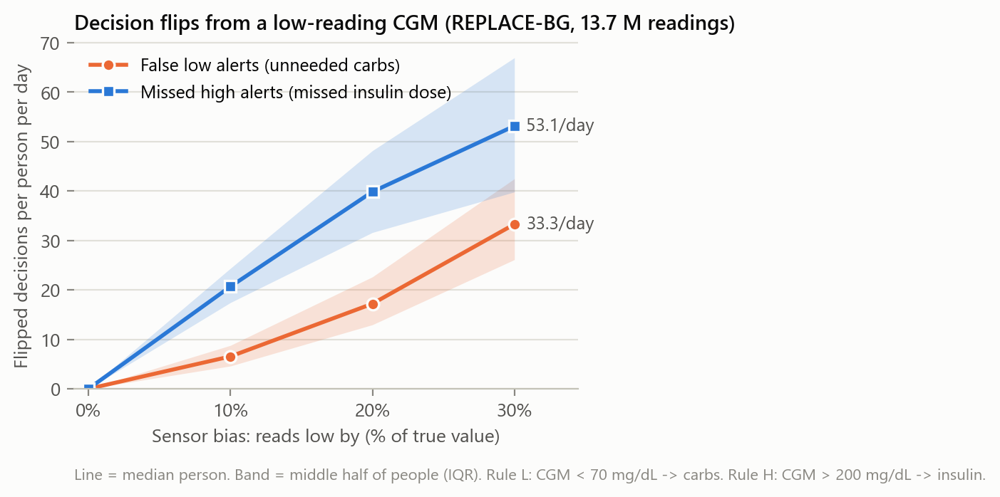

# Decision-flip simulation, version 1 (2026-10-09)

Key terms:
- CGM = continuous glucose monitor. A skin sensor that reads blood sugar every 5 minutes.
- Bias = the sensor reads too low (or too high) by a fixed amount. Here: too low by a percent.
- Flip = a treatment decision that changes because of the bias.
- IQR = interquartile range. The middle half of people, from the 25th to the 75th percentile.

## What we did
- Took every REPLACE-BG CGM reading inside each person's study window (day 0 to day 329).
- Dropped calibration rows and duplicate person-timestamps. Left: 13.7 million readings, 226 people.
- Applied two simple decision rules to each reading (see below). This is the baseline decision.
- Lowered every reading by 10, 20, 30 percent. Re-applied the rules. Counted flips.
- Per-day numbers use each person's days with at least one reading (median 235 days).

## The rules (first, simple choice; thresholds from the lead's description)
| Rule | Condition | Decision | Flip we count |
|---|---|---|---|
| L: treat low sugar | CGM below 70 mg/dL | eat fast carbs | new alert that was not there before = false low alert, unneeded carbs |
| H: correction dose | CGM above 200 mg/dL | take correction insulin | alert that disappears = missed high alert, missed insulin |

## Results: all readings (REPLACE-BG, 13.7 M readings, 226 people)
| Sensor reads low by | False low alerts, % of readings | False low alerts per person per day, median (IQR) | Missed high alerts, % of readings | Missed high alerts per person per day, median (IQR) |
|---|---|---|---|---|
| 0 % | 0 | 0 | 0 | 0 |
| 10 % | 2.6 | 6.5 (4.6 to 8.8) | 7.6 | 20.7 (17.4 to 24.4) |
| 20 % | 6.9 | 17.2 (13.0 to 22.6) | 14.5 | 39.8 (31.6 to 48.1) |
| 30 % | 13.4 | 33.3 (26.1 to 42.5) | 19.5 | 53.1 (39.8 to 66.9) |

Share of readings that changed category (below 70 / 70-200 / above 200):
| Sensor reads low by | Baseline below 70 (0.51 M) | Baseline 70-200 (9.89 M) | Baseline above 200 (3.30 M) |
|---|---|---|---|
| 10 % | 0 % | 3.6 % | 31.7 % |
| 20 % | 0 % | 9.5 % | 60.1 % |
| 30 % | 0 % | 18.5 % | 80.9 % |



## Sanity check: fingerstick-paired subset (460,634 pairs, meter reading within 5 min)
Flip counts on the paired readings match the full data closely:
| Sensor reads low by | False low alerts, % of pairs | Missed high alerts, % of pairs | Biased CGM gives the same decision as the fingerstick (both rules) |
|---|---|---|---|
| 0 % | 0 | 0 | 89.3 % |
| 10 % | 2.9 | 8.7 | 82.6 % |
| 20 % | 7.1 | 16.5 | 72.3 % |
| 30 % | 12.8 | 22.8 | 60.9 % |

- Note: even with no added bias, the real sensor already disagrees with the fingerstick on 10.7 % of pairs.

## Takeaways
- Missed insulin doses are the bigger effect. A 10 % low bias hides 1 in 3 "above 200" readings.
- False low alerts grow faster than the bias. 10 % bias: 2.6 % of readings. 30 %: 13.4 %.
- The flips come from readings near the thresholds. A 10 % bias only flips readings in 70-78 and 200-222 mg/dL.
- People differ a lot. At 30 % bias, missed high alerts run from 40 to 67 per person per day (IQR).
- Per-day counts are 5-minute readings, not real decisions. A real person acts a few times a day, not 50. Treat these as "time spent with a wrong decision", not "doses missed".

## Limits of this first version
- Constant bias only. No drift, noise, dropouts, or lag.
- Fixed thresholds (70 and 200). Real people and pumps use different numbers.
- Bias is applied to the CGM reading, not to a known true value. The sensor already has its own error (MARD 10-14 %).
- Counts every 5-minute reading. It does not model when a person actually looks and acts.
- No real pump decisions yet. The pump dose-calculator logs (HDeviceWizard) are not used.
- No time dimension. A 2-hour stretch of hidden highs counts the same as 24 scattered readings.
- guess: a run with the pump logs would give far fewer, but more realistic, flips per day.

## How to run
From the repo root (takes about 25 seconds; needs several GB of RAM):
```
python analysis/bias_simulation.py "Uncommitted Data/Raw Data Dump" analysis
```
Outputs: `analysis/figures/12_decision_flips.png`, `analysis/simulation_stats.json`. Every number above is in the JSON.
