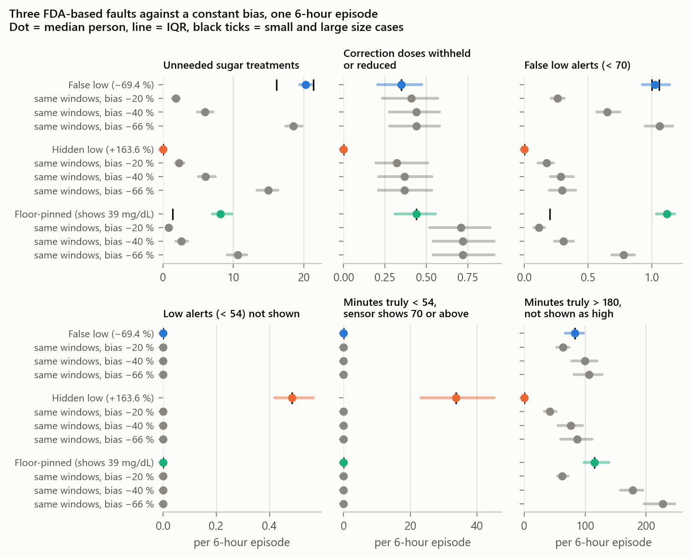
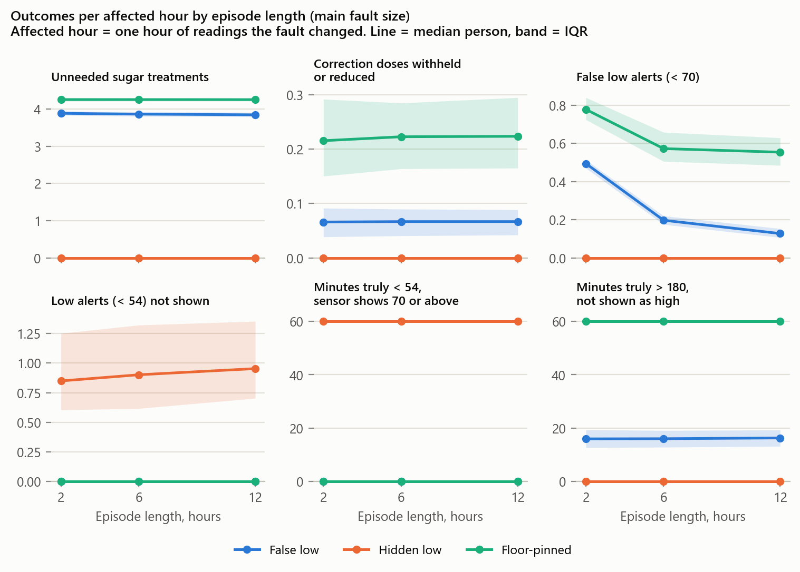

# Three-fault simulation (2026-11-20)

Script: `analysis/simulation_three_faults.py`. All numbers below come from `analysis/simulation_three_faults_stats.json`.

Words used here:
- CGM = continuous glucose monitor. A skin sensor that reads glucose every 5 minutes.
- True glucose = the recorded trial trace (Dexcom G4), as in version 2. Shown glucose = what the faulty sensor would display.
- Episode = one stretch of time (2, 6 or 12 hours) in which the sensor is faulty.
- Affected hour = one hour of readings that the fault changed.
- Correction dose = insulin taken to bring a high glucose down. The pump's calculator proposes it from the typed glucose.
- Pair = an FDA report that states both the sensor value and the fingerstick meter value. Error = sensor minus meter, in % of the meter. Serious = FDA death or injury report. Malfunction-only = report with no harm coded.
- Median (IQR) = the middle person, and the middle half of people. All results are "median (IQR) across participants".

## 1. What was simulated
- Version 2 (`SIMULATION_V2.md`) put one constant bias on the whole trace. The FDA reports describe faults that come in episodes and depend on the true glucose.
- Three faults were simulated on the real traces of 226 participants:

| Fault | Acts when the true glucose is | The sensor shows |
|---|---|---|
| False low | 70 to 250 mg/dL | far too low (true value minus 69.4 %) |
| Hidden low | under 54 mg/dL | normal or high (true value plus 163.6 %) |
| Floor-pinned | over 250 mg/dL | its lowest value, 39 mg/dL |

- One episode at a time. It starts at a random reading where the true glucose is inside the fault's range.
- Inside the episode the fault changes every reading in its range. All other readings show the true value.
- Each episode is compared with the same hours without a fault. Changed decisions are counted.
- Reference rows: a constant bias of -20, -40 and -66 % on every reading in the same episode windows (the version 2 model, limited to an episode).

## 2. Why these three faults
- Malfunction-only reports are one fault, the false low. 191,112 pairs; 74.7 % read low; median sensor 63 mg/dL against meter 178 mg/dL. The meter was 70 to 250 in 77.0 % and under 70 in only 4.7 %. Source: `fda-maude/results/text/tables/h_malf_vs_serious_errors.csv`, `REGEX_V2_FULL_CORPUS.md` s6.
- False-low size: the median error of malfunction-only pairs that read low is -69.4 %. Quartiles -76.7 % and -61.9 % (read from the 10-point bins in `h_error_distribution.csv`). The median over all malfunction pairs is -65.7 %; that is where the -66 % reference comes from.
- The same fault is the main Abbott pattern in serious reports: false low in 35.6 % of Abbott serious pairs (Dexcom 16.1 %), median error -77.2 % when reading low.
- Serious reports add the hidden low. The meter was under 54 in 31.1 % of 18,237 serious pairs. A hidden low (meter under 70, sensor not) is 32.9 % of them. It is the main Dexcom pattern: 37.6 % of Dexcom serious pairs (Abbott 25.9 %). Source: same table, `BRAND_COMPARISON.md` s4.
- Hidden-low size: serious pairs where the sensor read above the meter (8,644 pairs; 75.4 % have a meter under 70; median sensor 144 against meter 45 mg/dL). Median error +163.6 %, quartiles +88.9 % and +328.6 %. Source: `g_brand_error_sizes.csv`.
- Serious reports also add the floor-pinned sensor. The meter was over 250 in 34.9 % of serious pairs. In the error band -100 to -90 % (sensor near its floor, true value high) 41.9 % of Abbott pairs and 78.8 % of Dexcom pairs are serious, against 4.4 % and 28.0 % overall. Source: `h_harm_gradient.csv`, `REGEX_V2_FULL_CORPUS.md` s7.
- Floor value: 39 mg/dL, the lowest value version 2 lets a sensor show (`DEVICE_MIN` in `simulation_v2.py`) and the lowest value in the trial trace. The FDA memo quotes "LO (LESS THAN 40 MG/DL)".
- No FDA table holds the exact groups asked for (for example "meter under 54 and sensor 70 or above"). The sizes above come from the nearest group in the tables. Section 7 says more.

## 3. Settings
| Item | Value |
|---|---|
| Participants | 226 (dose results: the 203 with pump calculator records) |
| Episode lengths | 2, 6, 12 hours |
| Episode starts | 200 per participant, fault and length; random, no repeats; seed 20261120 |
| False low and floor-pinned episodes | 45,200 and 45,021 per length (1 person had fewer than 200 floor-pinned starts; lowest 21) |
| Hidden low episodes | 38,575 at 2 hours. 66 people had fewer than 200 readings under 54 (lowest 3). 1 person had none and is left out |
| Size cases, false low | small -61.9 %, main -69.4 %, large -76.7 % |
| Size cases, hidden low | small +88.9 %, main +163.6 %, large +328.6 % |
| Size cases, floor-pinned | main: shows 39 mg/dL. Small: not pinned, -72.7 % (median of serious pairs that read low). No larger case exists |
| Display range | 39 to 401 mg/dL, as in version 2 |
| Sugar rule | sensor shows under 70: eat 15 g of fast sugar, at most once every 15 minutes while it still shows under 70 |
| "Unneeded" sugar | the true glucose was 70 or above |
| Dose rule | version 2 calculator at the version 2 decision times inside the episode |
| Withheld / reduced | withheld = true dose above 0.5 U, shown-glucose dose 0. Reduced = dose lower by more than 0.5 U |
| Alerts and episodes | version 2 rules: 15 minutes beyond 70, 54 or 180 starts one; a shown alert within 30 minutes of the true start, or inside the true episode, counts as shown |

## 4. Results

### 4a. The three faults, one 6-hour episode, main size (per episode)
| Outcome | False low | Hidden low | Floor-pinned |
|---|---|---|---|
| Hours of readings the fault changed | 5.26 (5.05-5.42) | 0.56 (0.39-0.75) | 1.92 (1.63-2.32) |
| Dose decisions inside the episode | 0.91 | 0.79 | 1.04 |
| Unneeded sugar treatments | 20.3 (19.4-21.2) | 0 | 8.18 (6.99-9.79) |
| Unneeded sugar, grams | 304 (292-318) | 0 | 123 (105-147) |
| Correction doses withheld or reduced (all were withheld completely: the shown glucose is too low for any dose) | 0.35 (0.20-0.47) | 0 | 0.44 (0.31-0.56) |
| Insulin not given, units | 0.52 (0.28-0.84) | 0 | 1.29 (0.74-1.82) |
| Doses raised while the true glucose was under 70 | 0 | 0.00 (0.00-0.005) | 0 |
| Low alerts under 70 not shown | 0 | 0.10 (0.065-0.15) | 0 |
| Low alerts under 54 not shown | 0 | 0.48 (0.42-0.56) | 0 |
| Minutes truly under 54 while the sensor shows 70 or above | 0 | 33.7 (23.1-45.1) | 0 |
| False low alerts under 70 | 1.02 (0.93-1.14) | 0 | 1.12 (1.03-1.18) |
| False low alerts under 54 | 1.38 (1.31-1.47) | 0 | 1.12 (1.04-1.18) |
| High episodes (over 180) never shown as high | 0.33 (0.28-0.38) | 0 | 0.00 (0.00-0.010) |
| Minutes truly over 180 not shown as high | 83.4 (67.4-96.9) | 0 | 115 (98.0-139) |

### 4b. Reference: constant bias in the same 6-hour windows (medians per episode)
| Outcome | Windows of | Bias -20 % | Bias -40 % | Bias -66 % | The fault itself |
|---|---|---|---|---|---|
| Unneeded sugar treatments | false low | 1.83 | 5.99 | 18.5 | 20.3 |
| Doses withheld completely | false low | 0.060 | 0.29 | 0.43 | 0.35 |
| Insulin not given, units | false low | 0.43 | 0.70 | 0.80 | 0.52 |
| False low alerts under 70 | false low | 0.26 | 0.65 | 1.06 | 1.02 |
| Unneeded sugar treatments | floor-pinned | 0.79 | 2.58 | 10.7 | 8.18 |
| Doses withheld completely | floor-pinned | 0.070 | 0.30 | 0.68 | 0.44 |
| Insulin not given, units | floor-pinned | 0.80 | 1.42 | 1.75 | 1.29 |
| False low alerts under 70 | floor-pinned | 0.12 | 0.31 | 0.78 | 1.12 |
| Minutes over 180 not shown as high | floor-pinned | 62.3 | 178 | 227 | 115 |
| Low alerts under 54 not shown | hidden low | 0 | 0 | 0 | 0.48 |
| Minutes under 54 while the sensor shows 70 or above | hidden low | 0 | 0 | 0 | 33.7 |

The no-fault rows are 0 for every outcome. All rows, with quartiles: `simulation_three_faults_lookup.csv`.



### 4c. Small and large size cases (6-hour episode, per episode)
| Fault | What changes with the size | Small | Main | Large |
|---|---|---|---|---|
| False low | Unneeded sugar treatments | 16.2 (14.8-17.8) | 20.3 (19.4-21.2) | 21.4 (20.6-22.0) |
| False low | Doses withheld | 0.35 | 0.35 | 0.35 |
| Hidden low | Minutes under 54 while the sensor shows 70 or above | 33.7 | 33.7 | 33.7 |
| Hidden low | Doses raised while the true glucose was under 70 | 0 | 0.00 (0.00-0.005) | 0.003 (0.00-0.039) |
| Floor-pinned | Unneeded sugar treatments | 1.35 (1.19-1.49) | 8.18 (6.99-9.79) | none |
| Floor-pinned | False low alerts under 70 | 0.20 (0.15-0.25) | 1.12 (1.03-1.18) | none |

### 4d. By episode length, per affected hour (main size, medians)
| Outcome per affected hour | Fault | 2 h | 6 h | 12 h |
|---|---|---|---|---|
| Affected hours per episode | false low / hidden low / floor-pinned | 1.84 / 0.48 / 1.23 | 5.26 / 0.56 / 1.92 | 10.3 / 0.64 / 2.48 |
| Unneeded sugar treatments | false low | 3.88 | 3.86 | 3.84 |
| Unneeded sugar treatments | floor-pinned | 4.25 | 4.25 | 4.25 |
| Doses withheld | false low | 0.066 | 0.067 | 0.067 |
| Doses withheld | floor-pinned | 0.22 | 0.22 | 0.22 |
| Insulin not given, units | false low | 0.094 | 0.10 | 0.10 |
| Insulin not given, units | floor-pinned | 0.62 | 0.64 | 0.66 |
| False low alerts under 70 | false low | 0.49 | 0.20 | 0.13 |
| False low alerts under 70 | floor-pinned | 0.78 | 0.57 | 0.55 |
| Low alerts under 54 not shown | hidden low | 0.85 | 0.90 | 0.95 |

Sugar can exceed 4 per affected hour: every new stretch of faulty readings starts with one treatment.



## 5. Sanity checks
- No fault: the sum of every outcome over all no-fault rows is 0. Passed.
- False low: 0 missed low alerts and 0 hidden minutes under 54. Hidden low: 0 unneeded sugar treatments. Passed.
- Reference -20 % bias (12-hour false-low windows, per hour x 24) against version 2 (per day): false low alerts 0.97 vs 0.86; corrections withheld 0.24 vs 0.23; high episodes not shown 1.20 vs 1.19. Same direction, similar size.

## 6. How to read this
- The false low acts like the old model at -66 %, not at -20 %. In 6 hours: 20.3 unneeded sugar treatments against 1.83 at -20 %, and 0.35 doses withheld against 0.060.
- The floor-pinned sensor changes fewer hours (1.92 of 6) but each hour costs more insulin: 0.64 U not given per affected hour against 0.10 for the false low. The person also eats sugar while the true glucose is over 250.
- The hidden low changes no sugar and no doses. Its effect is on alerts only: 33.7 minutes under 54 with the sensor showing 70 or above, and 0.48 under-54 alerts not shown, per 6-hour episode. A constant low bias gives 0 for both, so the old model cannot show this fault.
- The size of the error matters little inside a fault (table 4c). Once the shown value crosses 70, the decision changes. Where on the glucose scale the fault acts matters more.
- Sugar and withheld doses grow with the affected hours (flat per-hour rates in 4d). False alerts do not: one long episode is one alert.

## 7. Limits
- These are counts of actions under fixed rules. The sugar and the missing insulin do not change the glucose here. A real person would likely stop eating or check with a fingerstick, so the sugar counts are an upper bound.
- The fault sizes come from the nearest groups in the FDA tables, not from exact glucose-band matches. FDA reports are complaints, not failure rates. They do not say how often or how long a fault lasts; the 2, 6 and 12 hours are assumptions.
- The true glucose is itself a CGM reading with its own error, limited to 39 to 401 mg/dL. Because no true reading is under 39, all three hidden-low sizes lift every reading to 70 or above.
- The faults switch on and off sharply at 70, 250 and 54 mg/dL. Real sensors change more smoothly. A hidden low can start in the middle of a low, after the alert was already shown.
- A high episode counts as shown if the sensor shows high at any moment in it, so "never shown as high" understates the floor-pinned fault. Use the minutes row. Hidden-low results rest on fewer episodes for 66 people.

## 8. How to re-run
From the repo root (22.8 s for the full run; the cache in `analysis/cache/` must exist or is built first):
```
python analysis/simulation_three_faults.py "Uncommitted Data/Raw Data Dump" analysis
```
- Set `SIM_3F_QUICK=1` for a test run (20 participants, 50 starts). The script reads the fault sizes from `fda-maude/results/text/tables/` (`h_malf_vs_serious_errors.csv`, `h_error_distribution.csv`, `g_brand_error_sizes.csv`, `h_harm_gradient.csv`).
- Writes `simulation_three_faults_stats.json`, `simulation_three_faults_lookup.csv` (60 rows: fault x length x size case) and figures 36 and 37. No per-participant files.
