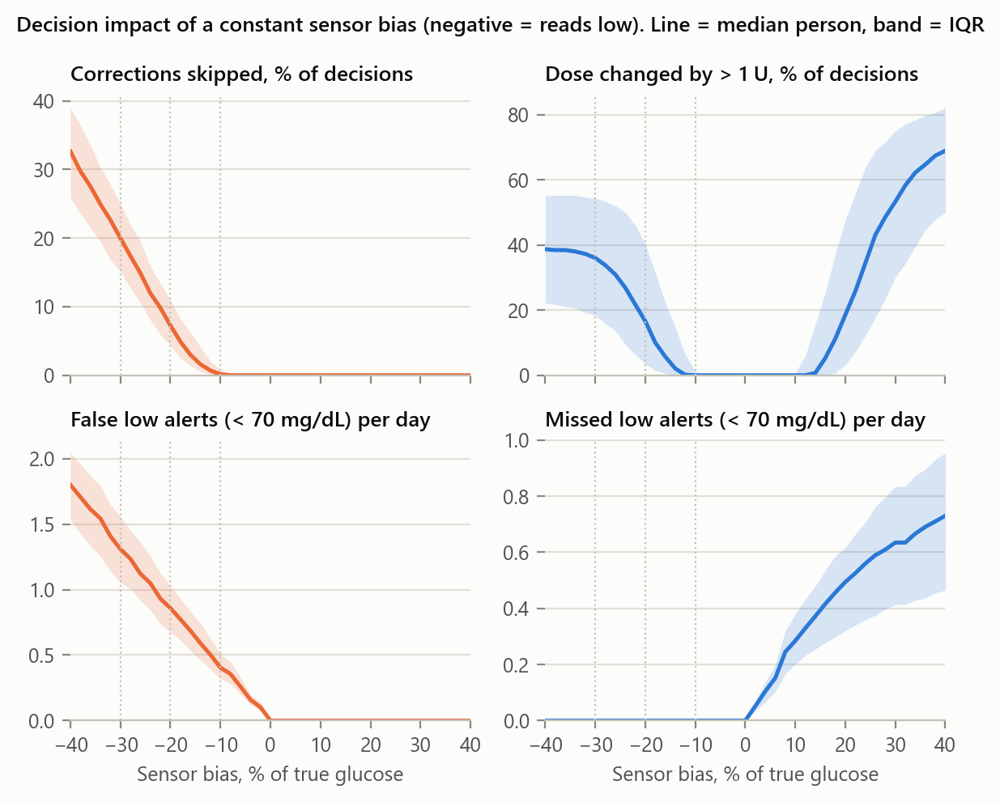
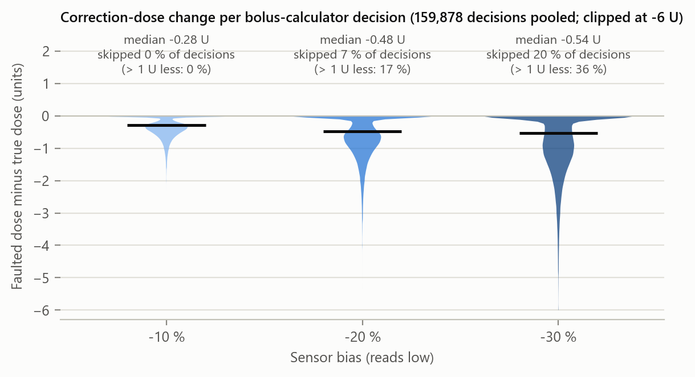
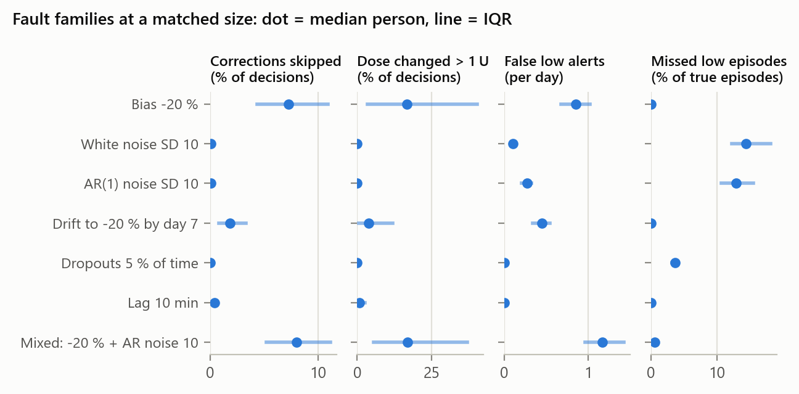
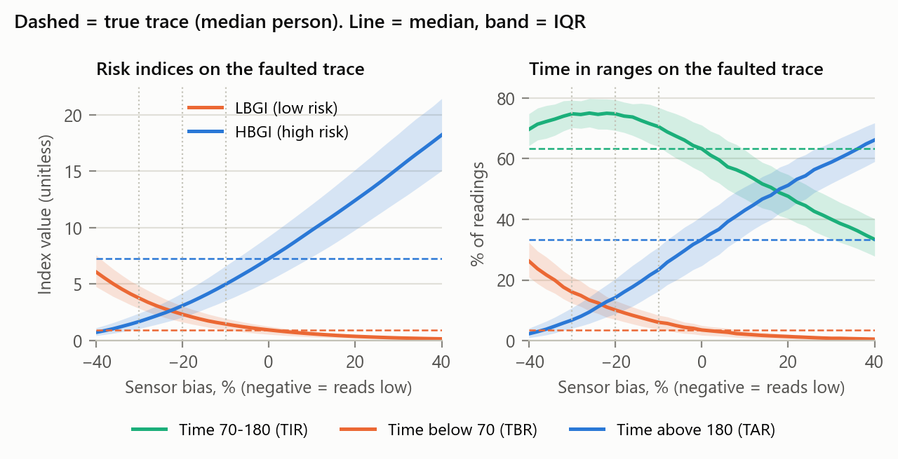

# Fault simulation, version 2 (2026-10-27)

Key terms:
- CGM = continuous glucose monitor. A skin sensor that reads glucose every 5 minutes.
- Bias = the sensor reads too low (negative) or too high (positive) by a fixed percent.
- Wizard = the insulin pump's bolus calculator. The patient types a glucose value; it proposes a dose.
- ISF = insulin sensitivity factor. How many mg/dL one unit of insulin lowers glucose (the patient's own setting).
- IOB = insulin on board. Insulin from earlier doses still working.
- Decision point = a moment where a real choice was made (a wizard use, or the start of a low or high episode).
- Episode = at least 15 minutes (3 readings) below or above a threshold. It ends after 15 minutes back in range.
- IQR = interquartile range. The middle half of people. All results are "median (IQR) across participants" unless said otherwise.
- CI = 95 % confidence interval from resampling participants 1,000 times (bootstrap).
- TIR / TBR / TAR = percent of readings in 70-180 / below 70 / above 180 mg/dL.
- LBGI / HBGI = low and high blood glucose risk index (Kovatchev). Formula in section 6.

## 1. What changed from version 1 and why
- Version 1 lowered every 5-minute reading and counted threshold crossings. With a constant bias the count is fixed by how much time people spend just above 70 or 200. It measured the glucose pattern, not the sensor, and counted readings, not decisions.
- Version 2 counts decisions at decision points, uses the patient's own pump settings, adds 6 fault families, and reports risk indices. It gives a lookup table (bias level to every outcome) that Phase 1 will fill with real-world error sizes from the FDA report texts.

## 2. Data used
| Item | Value |
|---|---|
| Participants / CGM readings in the study window (day 0-329) | 226 / 13,705,193 |
| Participant-days with data | 50,775 (median 235 per person) |
| Wizard records in window / with a typed glucose | 232,329 / 172,929 (all have ISF and target) |
| Decisions analysed: typed glucose + CGM reading within 5 min | 159,878 (203 people; median 777 per person, IQR 421-991) |
| Decisions usable for the fingerstick-as-truth check (section 7) | 15,034 (67 people) |
| True low episodes below 70 / below 54 | 47,250 / 14,823 (0.91 per person-day, IQR 0.53-1.23, below 70) |
| True high episodes above 180 / above 200 | 120,363 / 99,423 (2.46 and 2.00 per person-day) |
| True trace: TIR / TBR 70 / TAR 180 | 63.3 % / 3.5 % / 33.3 % |
| True trace: LBGI / HBGI | 0.95 (0.55-1.26) / 7.25 (5.32-9.24) |

Loading goes only through `analysis/preprocess.py`. The trace is put on a 5-minute grid; 19,280 readings (0.14 %) fell into an already filled slot and were dropped.

## 3. Decision points and rules
1. Correction dose. At each wizard use, "true" glucose = the CGM reading nearest within 5 minutes (assumption: the sensor was right at that moment). Under a fault the patient would have typed the faulted value. Dose = (glucose - target) / ISF - IOB, floored at 0, and only when glucose is above the pump's "correct above" level. Target, "correct above", ISF and IOB come from the record itself. Check: this rule reproduces the pump's own recorded correction within 0.15 U in 90 % of records; most of the rest are negative corrections, which the floor removes.
   - Outcomes: skipped = true dose above 0.5 U but faulted dose 0. Spurious = true dose 0 but faulted dose above 0.5 U. Dose changed by more than 0.5 U or 1 U. Dose change in units.
   - Realism check: in the CGM-only arm, 68 % of typed values are within 5 % of the nearest CGM reading and 25 % are identical (CGM+BGM arm: 45 % and 7 %). Those patients really did type the sensor value into the calculator, which is what this model assumes. It also means a pump "BG" entry is not a fingerstick.
2. Low episodes (below 70, and below 54) on the true trace vs the faulted trace. A true episode is detected if a faulted episode is ongoing anywhere from 30 minutes before its start to its end. Otherwise it is missed. A faulted episode that overlaps no such window is a false alert. Delay = faulted start minus true start (negative = the alert came early).
3. High episodes: the same rule at 180 and at 200.
A faulted sensor still shows only 39-401 mg/dL, so faulted values are clipped there.

## 4. Fault families
| Family | Sizes | Note |
|---|---|---|
| Constant bias | -40 to +40 % in 2 % steps | the lookup table (`simulation_v2_lookup.csv`) |
| White noise | SD 5, 10, 20 mg/dL | fresh random error at every reading |
| AR(1) noise | SD 5, 10, 20 mg/dL, phi 0.8 | each error keeps 80 % of the previous one, so errors come in runs, like real sensors |
| Drift | 0 at sensor start to -10, -20, -30 % at wear day 7 | the clock restarts only at session starts confirmed by a start-up calibration; unconfirmed gaps keep it running |
| Dropouts | 2, 5, 10 % of readings lost in 15-120 min gaps | random gap positions |
| Lag | 5, 10, 15 min | the sensor shows the glucose from that long ago |
| Mixed "recall-like" | -20 % bias + AR(1) noise SD 10 | one combined example |
Noise, dropouts and the mixed fault use 10 random draws per person (fixed seed); results are the mean over draws, then median (IQR) across people.

## 5. Lookup table: headline rows (median, IQR across participants)
| Outcome | -10 % | -20 % | -30 % | +10 % | +20 % |
|---|---|---|---|---|---|
| Corrections skipped, % of decisions | 0.2 (0-0.9) | 7.2 (4.3-11.0) | 20.0 (15.1-25.0) | 0 | 0 |
| Skipped, % of decisions that needed a correction | 0.3 | 13.5 | 37.5 | 0 | 0 |
| Dose changed by more than 0.5 U, % | 18.8 (4.3-44.7) | 53.4 (36.8-66.6) | 54.2 (40.2-67.2) | 19.1 (4.0-47.7) | 67.2 (49.5-79.7) |
| Dose changed by more than 1 U, % | 0.0 (0-1.3) | 16.7 (3.5-40.3) | 36.0 (18.4-54.3) | 0.0 (0-0.8) | 18.5 (3.2-47.6) |
| Spurious corrections, % | 0 | 0 | 0 | 0.1 (0-0.7) | 3.1 (1.5-5.6) |
| Dose change, units (each person's median) | -0.33 | -0.54 | -0.63 | +0.35 | +0.70 |
| False low alerts (below 70) per day | 0.40 (0.32-0.51) | 0.86 (0.68-1.03) | 1.31 (1.05-1.56) | 0 | 0 |
| Missed low episodes (below 70), % of true | 0 | 0 | 0 | 32.6 (28.3-40.7) | 55.1 (49.4-64.5) |
| Low alert timing, min (negative = early) | -10 | -21 | -40 | +5 | +10 |
| Missed high episodes (above 180), % of true | 28.4 (23.2-33.7) | 50.8 (43.4-58.7) | 70.8 (63.5-79.6) | 0 | 0 |
| Missed high episodes (above 180) per day | 0.66 | 1.19 | 1.67 | 0 | 0 |
| False high alerts (above 180) per day | 0 | 0 | 0 | 0.61 (0.51-0.73) | 0.93 (0.74-1.13) |
| Missed high episodes (above 200), % of true | 33.1 | 59.1 | 80.4 | 0 | 0 |
| TIR % (true 63.3) | 70.6 | 74.8 | 74.8 | 55.1 | 47.6 |
| TBR 70 % (true 3.5) | 6.0 | 10.1 | 16.0 | 2.1 | 1.3 |
| TAR 180 % (true 33.3) | 23.4 | 14.2 | 6.8 | 43.0 | 51.2 |
| LBGI (true 0.95) | 1.47 | 2.33 | 3.76 | 0.60 | 0.38 |
| HBGI (true 7.25) | 4.99 | 3.09 | 1.69 | 9.79 | 12.42 |

Bootstrap 95 % CIs for the medians (full set in `simulation_v2_stats.json`, key `bootstrap_ci_headline`):
| Bias | Skipped % | Changed more than 1 U % | False low per day | Missed high 180 per day | LBGI |
|---|---|---|---|---|---|
| -10 % | 0.15 (0.09-0.25) | 0 | 0.40 (0.39-0.44) | 0.66 (0.63-0.68) | 1.47 (1.35-1.58) |
| -20 % | 7.2 (6.6-8.2) | 16.7 (11.1-22.9) | 0.86 (0.81-0.91) | 1.19 (1.14-1.22) | 2.33 (2.16-2.53) |
| -30 % | 20.0 (18.8-21.1) | 36.0 (30.3-40.9) | 1.31 (1.26-1.37) | 1.67 (1.61-1.72) | 3.76 (3.46-4.02) |

Reading the table:
- A 10 % low bias almost never changes a correction by a full unit. 10 % of a typical 200 mg/dL is 20 mg/dL, or 0.4 U at a typical ISF of 50. Skipping starts at about -12 % and reaches 1 in 5 decisions at -30 %.
- A 10 % low bias already hides 28 % of high episodes and adds 0.4 false low alerts per day.
- A low-reading sensor makes control look better: TIR rises from 63 % to 75 % at -20 % while LBGI more than doubles.
- The wide IQR for "changed by more than 1 U" is real: people with a small ISF (a big dose per mg/dL) feel the same bias much more.
- Pooled over all 159,878 decisions, the dose change at -20 % has median -0.48 U, IQR -0.93 to 0, and 10 % of decisions lose more than 1.4 U (figure 27).




## 6. Fault families compared at a matched size
| Fault | Skipped % | Changed more than 1 U % | False low per day | Missed low % | Missed high 180 % | TBR 70 % | LBGI | HBGI |
|---|---|---|---|---|---|---|---|---|
| Bias -20 % | 7.2 (4.3-11.0) | 16.7 (3.5-40.3) | 0.86 (0.68-1.03) | 0 | 50.8 | 10.1 | 2.33 | 3.09 |
| White noise SD 10 | 0.0 | 0.0 | 0.11 (0.08-0.13) | 14.4 (12.3-18.2) | 4.1 | 4.3 | 1.07 | 7.32 |
| AR(1) noise SD 10 | 0.0 | 0.0 | 0.27 (0.21-0.33) | 12.9 (10.7-15.6) | 3.8 | 4.2 | 1.07 | 7.32 |
| Drift to -20 % by day 7 | 1.8 (0.8-3.3) | 3.8 (0.6-12.0) | 0.45 (0.34-0.55) | 0 | 27.6 | 6.6 | 1.56 | 4.89 |
| Dropouts 5 % | 0 (5.0 % of decisions have no reading) | 0 | 0 | 3.6 (3.3-4.1) | 1.5 | 3.5 | 0.94 | 7.26 |
| Lag 10 min | 0.4 (0.1-0.7) | 0.9 (0.3-2.6) | 0.00 | 0 (alerts 10 min late) | 0 | 3.5 | 0.95 | 7.26 |
| Mixed: -20 % + AR noise 10 | 8.0 (5.2-11.2) | 17.0 (5.5-37.1) | 1.17 (0.96-1.43) | 0.5 | 47.3 | 10.8 | 2.57 | 3.16 |

- Bias hurts most at a matched size, and the mixed fault is bias plus a little extra. Drift to -20 % is about half a constant -20 % bias, because the sensor spends most of its week below the full size.
- Noise is the only family that misses low episodes (13-14 % at SD 10, 17-21 % at SD 20). It breaks short episodes into pieces shorter than 15 minutes. Noise barely moves doses (SD 20: 0.7 % skipped, 0.6 % spurious).
- Dropouts miss low episodes in proportion to the share of time lost (2 / 5 / 10 % lost gives 1.4 / 3.6 / 7.4 % missed).
- Lag changes almost nothing except timing: every alert comes exactly that many minutes late, and 0.4-0.7 % of corrections are skipped at 10-15 min.
LBGI / HBGI formula: f = 1.509 x ((ln BG)^1.084 - 5.381) with BG in mg/dL; risk = 10 x f^2; LBGI = mean risk over readings with f below 0, HBGI over readings with f above 0.




## 7. Sensitivity: a fingerstick as the truth
Pump "BG" entries are often CGM values typed into the calculator, so a typed value is not a reference by itself. The subset used here: CGM+BGM arm only (the arm told to dose from fingersticks); typed value equal (within 2 mg/dL) to a meter-device reading within 5 minutes; typed value not identical to the nearest CGM reading; and that fingerstick not used to calibrate the sensor. This leaves 15,034 decisions from 67 people (median 175 each). Of the 59,371 typed values that match a meter reading, 29,965 were dropped as CGM-only arm, 13,592 as calibration fingersticks and 780 as identical to the CGM. The meter is the truth; the (faulted) CGM is what the sensor showed.
| Bias on the CGM | Skipped % | Changed more than 0.5 U % | Changed more than 1 U % |
|---|---|---|---|
| 0 % (the real G4 sensor as it was) | 1.4 (0-3.5) | 19.7 (10.2-36.6) | 4.2 (1.4-10.5) |
| -10 % | 4.6 (2.0-9.5) | 35.1 | 12.5 (4.2-28.4) |
| -20 % | 12.3 (7.3-21.7) | 55.6 | 29.0 (11.7-50.0) |
| -30 % | 24.4 (17.3-32.5) | 59.9 | 41.9 (19.8-59.8) |
- The real sensor's own error already changes about 1 in 25 corrections by more than a unit and skips about 1 in 70. An added bias stacks on top: skipped at -20 % is 12 % here against 7 % in the main table.
- Caveats: dropping values identical to the CGM also removes chance agreements, so this subset slightly overstates the real sensor's effect. 67 people is a small group; the IQRs are wide.

## 8. Link to version 1
| Bias | V1: false low readings per day | V1: missed high (200) readings per day | V2: false low episodes per day | V2: missed high (200) episodes per day | V2: skipped corrections per day |
|---|---|---|---|---|---|
| -10 % | 6.5 | 20.7 | 0.40 | 0.64 | 0.005 |
| -20 % | 17.2 | 39.8 | 0.86 | 1.13 | 0.23 |
| -30 % | 33.3 | 53.1 | 1.31 | 1.53 | 0.69 |
Version 1 counted every 5-minute reading inside the flipped band, so one hidden high lasting 2 hours counted 24 times. Version 2 counts each episode or dose once, so the numbers are 15 to 30 times smaller and mean "events a person would notice".

## 9. Who is hurt most (at -20 % bias, Spearman correlation)
| Outcome | vs time below 70 | vs time above 180 | vs CV | vs mean glucose |
|---|---|---|---|---|
| False low alerts per day (n = 226) | +0.37 (p < 0.001) | -0.73 (p < 0.001) | -0.02 (p = 0.74) | -0.74 (p < 0.001) |
| Corrections skipped % (n = 203) | -0.16 (p = 0.03) | +0.10 (p = 0.16) | -0.11 (p = 0.12) | +0.09 (p = 0.21) |
- False low alerts fall hardest on people with lower average glucose and little time above 180: they spend more time in 70-88 mg/dL, the band a -20 % sensor shows as "low". These are the people with the best control.
- Skipped corrections hardly depend on the glucose pattern. They depend on the person's ISF and target (not tested here).
- The glucose metrics above were computed here from the true trace. The script also merges `analysis/participant_metrics.csv` (the accuracy agent's table) when present; its `pct_below_70`, `pct_above_180`, `cv_pct` and `mean_glucose` give the same correlations to two decimals (JSON key `who_is_hurt_most_at_minus20_vs_participant_metrics_csv`). The per-person table is `simulation_v2_participants.csv`.

## 10. 180 or 200 for the high threshold
- Use 180 as the headline. It is the research question's own number, it is the standard "time above range" boundary, so TAR and the high-episode counts share one definition, and 200 adds nothing new: missed-episode shares at 200 track those at 180 within a few points (33 vs 28 % at -10 %, 59 vs 51 % at -20 %). Report 200 as a sensitivity row; it was the G4's default high alert.
- Note for the paper: real correction decisions are not made at 180 or 200. The pumps' "correct above" level has a median of 120 mg/dL. The high-episode results are about alerts; the wizard results are about doses.

## 11. Limits
- The "true" glucose is itself a CGM reading, with its own error (MARD about 11 % on meter-device pairs not used for calibration, PREPROCESSING.md). Section 7 shows what that error already does. Any reference comparison must use meter-device rows, never pump "BG" entries.
- Pump settings are from 2015-16 pumps (Medtronic Paradigm and 530G, OmniPod, Tandem). ISF and targets may differ today. The Tandem rule matched the pump's own number less often (about half of those 8 % of records).
- Decisions assume the patient types the sensor value and follows the calculator. In the CGM-only arm 68 % of typed values were within 5 % of the CGM; in the CGM+BGM arm 45 %.
- No meal, exercise or insulin-action model: a changed dose is not followed through to a changed glucose. No closed loop.
- Bias is still applied to a fixed threshold, so the "band" effect from version 1 remains inside each episode count.
- Episodes need 3 consecutive readings; the sensor's own warm-up gaps end episodes. Drift relies on inferred sensor sessions.
- Only 203 of 226 people have wizard records with a typed glucose; the glucose-only outcomes use all 226.
- Monte Carlo is 10 draws per person; CIs are for medians across people, not for individuals.

## 12. How to run
From the repo root (about 95 seconds; the parquet cache must exist or it is built first):
```
python analysis/simulation_v2.py "Uncommitted Data/Raw Data Dump" analysis
```
Set `SIM_V2_QUICK=1` for a 20-person test run (10 s). Outputs: `simulation_v2_stats.json`, `simulation_v2_lookup.csv` (41 bias rows; columns = outcome_median / q1 / q3 / mean / n), `simulation_v2_participants.csv`, figures 25-28. Seed 20261027. No Monte Carlo draws or bias steps were reduced.

## 13. Extended lookup (2026-10-30)
- What: the constant-bias lookup on a wider grid, -90 to +90 % in 2 % steps (91 rows), because the errors reported in the MAUDE texts (median -77 % Abbott, -68 % Dexcom; `fda-maude/results/text/TEXT_RESULTS.md` s8) lie far past the -40 % edge. The -40 to +40 rows are identical to `simulation_v2_lookup.csv`; nothing else was rerun and the files above are unchanged.
- Command (53 s) and file: `python analysis/simulation_v2.py "Uncommitted Data/Raw Data Dump" analysis --lookup-min -90 --lookup-max 90 --lookup-step 2 --lookup-only --lookup-out analysis/simulation_v2_lookup_extended.csv` writes `analysis/simulation_v2_lookup_extended.csv` (same columns as the base lookup).
- Caveat, the dose rule saturates (median person): "corrections skipped" rises to 54.2 % of decisions at -70 % and stays there, because 54.2 % is every decision that needed a correction (skipped-of-needed reaches 90 % at -54 % and 100 % at -70 %). "Doses changed by more than 1 U" is flat at 39.4 % from -44 % on (a dose can only fall to zero). "Missed high episodes" is 100 % from -56 % on.
- Caveat, alert counts break down: false low alerts per day peak at 2.1 near -54 % and fall to 0.2 by -84 %, because the faulted trace sits below 70 all day (time below 70 is 100 % from -84 %; the sensor shows its 39 mg/dL floor). Past about -60 %, read time below 70 and LBGI (38 at -90 %), not alert counts.
