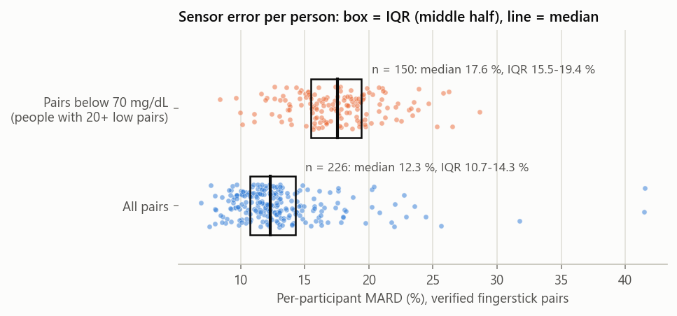
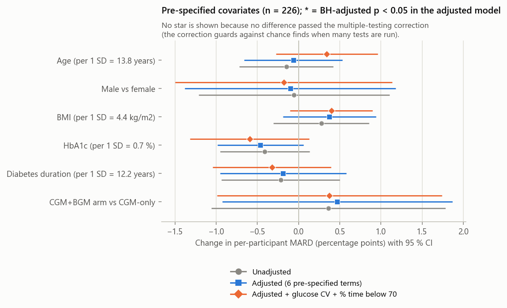
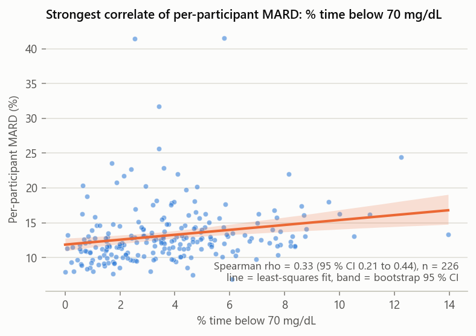
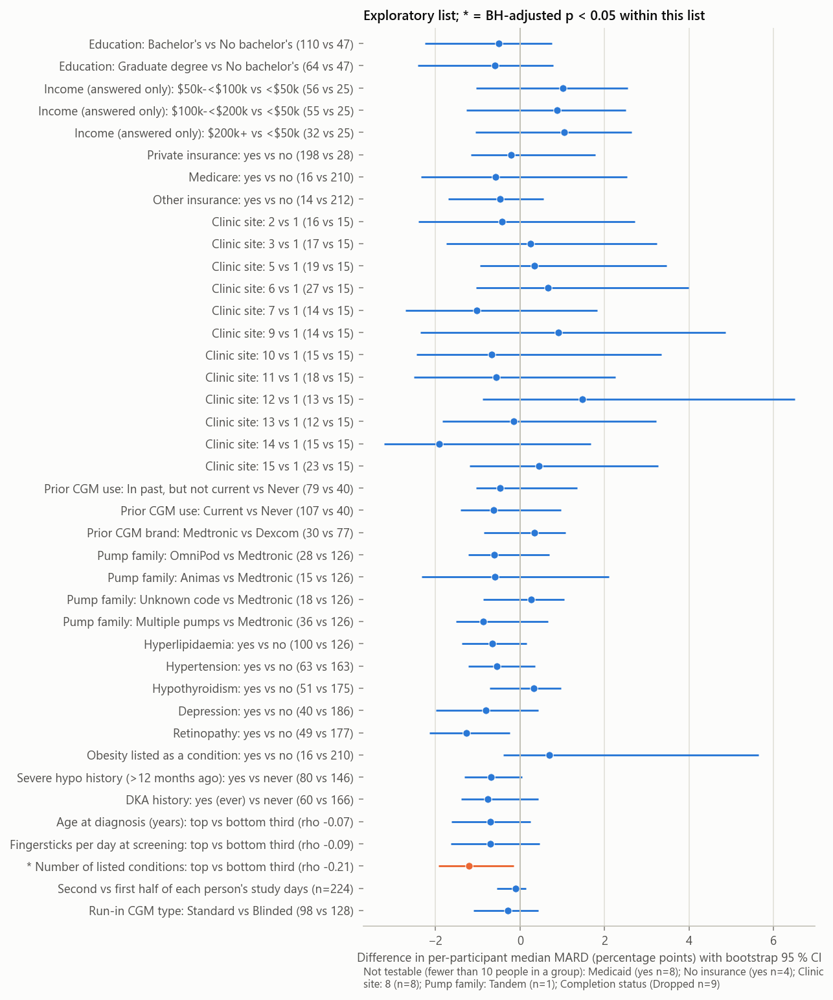

# Who gets worse sensor accuracy? Subgroup analysis of REPLACE-BG (2026-10-30)

Script: `analysis/subgroups.py`. Numbers: `analysis/subgroups_stats.json`. Per-person table: `analysis/participant_metrics.csv`. Figures 21-24 in `analysis/figures/`.

Terms. MARD = mean absolute relative difference: the average size of the sensor error as a percent of the fingerstick value (lower is better). IQR = the middle half of people (25th to 75th percentile). CI = 95 % confidence interval: the range the true value most likely sits in. Bootstrap = re-drawing participants at random 2,000 times to get a CI. p = the chance of a difference this big if there were none. BH = Benjamini-Hochberg: a correction that keeps false "findings" rare when many tests are run; p_bh is the corrected p. Spearman rho = a rank correlation from -1 to +1 (0 = no link). CV = coefficient of variation = glucose SD / mean glucose, how much a person's glucose swings.

## Summary in 6 lines
- Per-participant MARD on verified fingerstick pairs: median 12.3 % (IQR 10.7-14.3), n = 226. Low range (< 70 mg/dL): 17.6 % (IQR 15.5-19.4), n = 150.
- No pre-specified covariate (age, sex, BMI, HbA1c, diabetes duration, study arm) is linked to MARD after BH correction. Every group difference is under 1.3 MARD points.
- What does predict MARD: how much a person's glucose swings (CV, rho 0.33) and how much time they spend below 70 mg/dL (rho 0.33). Both hold in calibration pairs too.
- One exploratory result passed BH (more listed health conditions, lower MARD). It vanishes after adjusting for age and CV. We treat it as chance.
- Data fix that changes the whole project: 45 % of the "independent meter pairs" are BG values typed into the pump. In the CGM-only arm these are mostly the CGM value itself. Dropping them raises MARD from 9.9 % to 12.3 % and removes a false study-arm difference.
- Shanghai (76 patients): no subgroup differences; too small to see anything under about 4 points.

## 1. Data fix: pump "BG" entries are not fingersticks
The pairs table records where each reference value came from: `source = meter` (a glucose-meter upload: Contour Next or Precision Xtra) or `source = pump` (a BG value stored by the insulin pump, typed by hand or sent by a linked meter). In the CGM-only arm people dosed from the CGM and typed its number into the pump's bolus calculator. Those "BG" values are CGM readings, so they agree with the CGM almost perfectly.

| Arm | Reference source | Pairs | People | Pooled MARD | Error exactly 0 | Error within 1 mg/dL |
|---|---|---|---|---|---|---|
| CGM-only | meter upload | 125,735 | 149 | 13.1 % | 2.2 % | 6.5 % |
| CGM-only | pump entry, typed | 92,072 | 135 | 5.9 % | 31.5 % | 40.9 % |
| CGM-only | pump entry, no subtype | 8,517 | 52 | 8.2 % | 18.8 % | 25.9 % |
| CGM+BGM | meter upload | 43,255 | 77 | 13.7 % | 2.1 % | 6.5 % |
| CGM+BGM | pump entry, typed | 32,923 | 69 | 10.4 % | 9.4 % | 15.5 % |
| CGM+BGM | pump entry, no subtype | 3,732 | 23 | 11.6 % | 6.9 % | 12.0 % |

Linked pump entries (619 pairs, MARD 14-19 %) behave like meter readings. A real fingerstick lands exactly on the CGM value about 2 % of the time; typed pump entries do so 10-30 % of the time. The existing `pump_copy_of_meter` flag catches only 12 % of the typed entries in the CGM-only arm.

Filter used in this analysis: a pair counts only if `source == "meter"`, it was not used for calibration (`used_for_calibration == False`), and it lies in the study window (day 0-329). We call these "verified fingerstick pairs": 168,990 pairs, all 226 people, median 719 per person (IQR 517-970). The old set (all independent pairs, 306,853) is kept only as a sensitivity check.

| Outcome | Old set (all independent pairs) | Verified fingerstick pairs |
|---|---|---|
| Per-participant MARD, median (IQR) | 9.9 % (8.0-12.5) | 12.3 % (10.7-14.3) |
| CGM+BGM minus CGM-only, median MARD | +1.9 points (CI +0.5 to +2.9), p < 0.001 | -0.1 points (CI -0.9 to +0.7), p = 0.54 |
| Same contrast on calibration pairs | +0.3 (CI -1.0 to +1.3), p = 0.76 | same |
| Same contrast on pump-entry pairs only | +5.6 points (CI +4.6 to +7.0) | not used |

The arm "effect" was the typed CGM values, not the sensor. Within the same person, pump-entry pairs "agree" with the CGM 6.7 MARD points better than real fingersticks (CI 5.5 to 7.2, n = 198): the signature of typed CGM values.

## 2. Per-participant metrics
Unit of analysis = the participant (226 people), not the pair. Each person's pairs are summarised first, then people are compared. Bias = mean signed error in percent (negative = sensor reads low). Within 20/20 = error within 20 mg/dL when the fingerstick is below 100 mg/dL, else within 20 %. Low range = pairs whose average of CGM and fingerstick is below 70 mg/dL; a person needs at least 20 such pairs (150 people; the other 76 have too few low readings). CGM metrics use every CGM reading in the study window.

| Metric (per person) | Median | IQR | n |
|---|---|---|---|
| Verified pairs | 719 | 517-970 | 226 |
| Pairs per day | 3.3 | 2.4-4.2 | 226 |
| MARD | 12.3 % | 10.7-14.3 | 226 |
| Median ARD (typical single-pair error) | 9.0 % | 7.9-10.1 | 226 |
| Bias | -1.7 % | -2.9 to -0.2 | 226 |
| Within 20/20 | 85.1 % | 81.0-89.0 | 226 |
| Low-range pairs | 36 | 17-59 | 226 |
| Low-range MARD | 17.6 % | 15.5-19.4 | 150 |
| Low-range bias | -4.0 % | -7.6 to -0.1 | 150 |
| Mid-range MARD (70-180 mg/dL) | 12.8 % | 11.3-15.7 | 226 |
| High-range MARD (> 180 mg/dL) | 10.2 % | 8.9-12.3 | 223 |
| Calibration-pair MARD (the other pair type) | 13.9 % | 12.4-15.7 | 226 |
| % time below 70 mg/dL (CGM) | 3.5 % | 1.8-5.0 | 226 |
| % time above 180 mg/dL (CGM) | 33.3 % | 24.7-41.1 | 226 |
| Mean glucose | 160 mg/dL | 148-173 | 226 |
| CV | 37.4 % | 34.6-40.7 | 226 |
| CGM readings per day | 286 | 282-287 | 226 |

A person's MARD agrees moderately with their low-range MARD (rho 0.34) and their calibration-pair MARD (rho 0.41). The two outliers above 30 % are real and kept.

## 3. Pre-specified analysis (every result reported)
Groups compared with Mann-Whitney (2 groups) or Kruskal-Wallis (3 groups). Differences are in medians, group minus the first group, with a bootstrap CI. "Detectable" = the smallest difference in means this group size could find with 80 % power.

| Covariate | Groups: median MARD (IQR), n | Difference vs first group (CI) | p | Detectable |
|---|---|---|---|---|
| Age | <35: 12.8 (11.6-14.1), 69; 35-50: 12.3 (10.9-14.1), 78; >50: 11.6 (10.1-14.5), 79 | 35-50: -0.5 (-1.2 to +0.3); >50: -1.2 (-1.8 to -0.3) | 0.080 | 1.9 |
| Sex | F: 12.3 (10.7-13.8), 112; M: 12.3 (10.9-14.6), 114 | +0.0 (-0.8 to +0.8) | 0.93 | 1.7 |
| BMI | <25: 12.0 (10.3-13.4), 77; 25-30: 12.3 (10.4-14.4), 92; 30+: 12.8 (11.6-14.8), 57 | 25-30: +0.3 (-0.6 to +1.4); 30+: +0.8 (-0.2 to +1.6) | 0.072 | 2.0-2.2 |
| HbA1c at screening | <7: 12.7 (11.3-15.0), 77; 7-8: 12.1 (10.4-13.9), 118; >8: 12.3 (11.0-13.9), 31 | 7-8: -0.7 (-1.3 to +0.4); >8: -0.4 (-1.3 to +0.8) | 0.32 | 1.9-3.1 |
| Diabetes duration (tertiles: 2-17, 17-27, 28-64 years) | 12.4 (11.1-14.0), 75; 12.3 (11.0-14.6), 75; 12.0 (10.4-14.3), 76 | middle: -0.1 (-0.9 to +0.9); longest: -0.3 (-1.2 to +0.7) | 0.55 | 1.9-2.0 |
| Study arm | CGM-only: 12.4 (10.9-14.4), 149; CGM+BGM: 12.3 (10.1-14.1), 77 | -0.1 (-0.9 to +0.7) | 0.54 | 1.7 |

Continuous versions (Spearman rho with MARD): age -0.16 (CI -0.29 to -0.02, p = 0.015); BMI +0.13 (+0.01 to +0.26, p = 0.046); HbA1c -0.08 (-0.21 to +0.05, p = 0.22); duration -0.09 (-0.22 to +0.04, p = 0.20). BH-corrected within this list of 10 tests, the smallest p_bh is 0.15 (age). Nothing passes.

Same tests on low-range MARD (n = 150): nothing for age (p = 0.51), sex (0.97), BMI (0.33), HbA1c (0.58) or arm (0.85). Diabetes duration: shortest third 16.7 %, middle 17.7 %, longest 18.8 % (p = 0.042; longest vs shortest +2.0, CI -0.3 to +3.2; Spearman +0.18, CI +0.02 to +0.35).

Same tests on calibration pairs (the other pair type): age is the only clear one (<35: 15.7 %, 35-50: 13.7 %, >50: 13.1 %; p < 0.001; >50 vs <35 -2.5, CI -3.2 to -1.4). Duration goes the opposite way to the low-range result (longest third 13.1 % vs 14.4 %, p = 0.017). Arm: no difference (p = 0.76).

Multivariable model: one ordinary least-squares regression of per-participant MARD on all six terms, robust (HC3) standard errors, BH over the six terms. n = 226, R squared = 0.02 (the six terms explain 2 % of the spread).

| Term | Change in MARD (points) | CI | p | p_bh |
|---|---|---|---|---|
| Age, per year | -0.005 | -0.048 to +0.039 | 0.84 | 0.88 |
| Male vs female | -0.10 | -1.38 to +1.18 | 0.88 | 0.88 |
| BMI, per kg/m2 | +0.09 | -0.04 to +0.21 | 0.19 | 0.58 |
| HbA1c, per 1 % | -0.66 | -1.41 to +0.09 | 0.083 | 0.50 |
| Duration, per year | -0.02 | -0.08 to +0.05 | 0.63 | 0.88 |
| CGM+BGM vs CGM-only | +0.47 | -0.93 to +1.87 | 0.51 | 0.88 |

log(MARD) gives the same picture (HbA1c -4 % relative per 1 %, p = 0.074; BMI +0.7 % per unit, p = 0.088; nothing passes BH). With low-range MARD as outcome (n = 150, R squared 0.07): duration +0.08 points per year (CI +0.02 to +0.14, p = 0.009, p_bh = 0.053); age -0.05 per year (CI -0.10 to -0.01, p = 0.023, p_bh = 0.068); the other four p > 0.4. With the old all-pairs MARD as outcome, arm (+1.9, p_bh 0.045), age and HbA1c looked "significant"; that was the typed CGM values.

## 4. Confound check: glucose pattern, not demographics
People who swing more or spend more time low have higher MARD whatever the sensor does, because sensor error is larger at low glucose and during fast changes.

| Correlate of per-participant MARD | Spearman rho (CI) | p |
|---|---|---|
| % time below 70 mg/dL | +0.33 (+0.20 to +0.44) | < 0.001 |
| Glucose CV | +0.33 (+0.20 to +0.44) | < 0.001 |
| % of own pairs below 70 mg/dL | +0.27 (+0.13 to +0.39) | < 0.001 |
| Mean rate of change at pairs | +0.23 (+0.09 to +0.36) | < 0.001 |
| % of own pairs fast-changing (> 1 mg/dL per min) | +0.22 (+0.08 to +0.34) | 0.001 |
| Glucose SD | +0.17 (+0.04 to +0.30) | 0.011 |
| % of own pairs at night | +0.15 (+0.03 to +0.28) | 0.023 |
| Mean glucose / % time above 180 | -0.10 / -0.07 | 0.14 / 0.28 |
| Pairs per day / fingersticks per day at screening | -0.00 / -0.09 | 0.98 / 0.16 |

The same two correlates hold in calibration pairs (CV rho 0.38, time low 0.40) and in mid-range MARD (0.29, 0.22), so it is not only the share of low pairs. None of them correlates with low-range MARD (all |rho| < 0.14): once we look only at low readings, the error is similar for everyone.

Model step 2 (six terms + CV + % time below 70; R squared 0.085): CV +0.23 points per 1 % CV (CI +0.01 to +0.44, p = 0.044); % time low +0.08 (CI -0.37 to +0.53, p = 0.73). In log(MARD): +1.5 % relative per 1 % CV (p = 0.014). The demographic terms stay null (all p_bh > 0.35). Step 3 (+ share of low pairs and share of fast pairs; R squared 0.10): still no demographic term. The age link is explained by variability: younger people have higher CV (rho -0.30) and more time low (rho -0.21); adjusting for CV flips the age coefficient to +0.03 per year (p = 0.28). Low HbA1c means more time low (HbA1c < 7: 4.1 % of time; > 8: 2.8 %; p = 0.006) but not higher MARD.

## 5. Exploratory analysis (BH-corrected within this list of 22 tests)
Minimum 10 people per group; smaller groups are listed as not testable. Differences are group minus reference, median MARD, bootstrap CI.

| Variable | Groups: median MARD, n | Difference (CI) | p | p_bh |
|---|---|---|---|---|
| Education | no bachelor's 12.8, 47; bachelor's 12.3, 110; graduate 12.2, 64 | -0.5 (-2.3 to +0.8); -0.6 (-2.4 to +0.8) | 0.25 | 0.49 |
| Income (168 answered) | <$50k 11.6, 25; $50-100k 12.6, 56; $100-200k 12.4, 55; $200k+ 12.6, 32 | +1.0; +0.9; +1.0 (CIs about -1 to +2.6) | 0.59 | 0.76 |
| Private insurance | yes 12.3, 198; no 12.5, 28 | -0.2 (-1.2 to +1.8) | 0.66 | 0.76 |
| Medicare / other insurance | yes 11.7, 16 / yes 11.9, 14 | -0.6 (-2.4 to +2.5) / -0.5 (-1.7 to +0.6) | 0.61 / 0.51 | 0.76 / 0.75 |
| Clinic site (13 sites with 10+) | medians 10.4 (site 14) to 13.8 (site 12) | largest: site 12 vs 1 +1.5 (-0.9 to +6.5) | 0.031 | 0.17 |
| Prior CGM use | never 12.8, 40; past 12.3, 79; current 12.2, 107 | -0.5; -0.6 (CIs -1.4 to +1.4) | 0.65 | 0.76 |
| Prior CGM brand | Dexcom 12.0, 77; Medtronic 12.4, 30 | +0.3 (-0.9 to +1.1) | 0.95 | 0.95 |
| Pump family | Medtronic 12.5, 126; OmniPod 11.9, 28; Animas 11.9, 15; unknown code 12.7, 18; several 11.6, 36 | -0.6; -0.6; +0.3; -0.9 (CIs within -2.3 to +2.1) | 0.87 | 0.95 |
| Hyperlipidaemia | yes 12.0, 100; no 12.6, 126 | -0.7 (-1.4 to +0.2) | 0.022 | 0.16 |
| Hypertension | yes 12.0, 63; no 12.5, 163 | -0.6 (-1.2 to +0.4) | 0.35 | 0.56 |
| Hypothyroidism | yes 12.6, 51; no 12.3, 175 | +0.3 (-0.7 to +1.0) | 0.95 | 0.95 |
| Depression | yes 11.6, 40; no 12.5, 186 | -0.8 (-2.0 to +0.4) | 0.12 | 0.33 |
| Retinopathy | yes 11.3, 49; no 12.6, 177 | -1.3 (-2.1 to -0.3) | 0.009 | 0.10 |
| Obesity listed as a condition | yes 13.0, 16; no 12.3, 210 | +0.7 (-0.4 to +5.7) | 0.042 | 0.19 |
| Severe hypoglycaemia history (> 12 months ago) | yes 11.9, 80; never 12.6, 146 | -0.7 (-1.3 to +0.1) | 0.11 | 0.33 |
| DKA history | yes 11.8, 60; never 12.5, 166 | -0.8 (-1.4 to +0.4) | 0.16 | 0.35 |
| Age at diagnosis | rho -0.07 (-0.20 to +0.08) | top vs bottom third -0.7 (-1.6 to +0.3) | 0.32 | 0.56 |
| Fingersticks per day at screening | rho -0.09 (-0.22 to +0.04) | top vs bottom third -0.7 (-1.6 to +0.5) | 0.16 | 0.35 |
| Number of listed conditions | rho -0.21 (-0.35 to -0.06) | top vs bottom third -1.2 (-1.9 to -0.2) | 0.001 | 0.032 * |
| Second vs first half of the study (within person, n = 224) | 12.2 then 12.0 | -0.1 (-0.6 to +0.2) | 0.063 | 0.23 |
| Run-in CGM type | blinded 12.4, 128; standard 12.1, 98 | -0.3 (-1.1 to +0.4) | 0.33 | 0.56 |

Not testable (under 10 people): Medicaid (8), no insurance (4), site 8 (8), Tandem pump (1), dropped out (9; their median MARD 12.3). The 58 people who skipped the income question: 11.9 % (IQR 10.4-13.9).

The one starred result does not hold up. People with more listed conditions are older (rho 0.38 with age); adjusted for age and CV the effect is -0.10 points per condition (p = 0.41). Retinopathy likewise drops to -0.9 (p = 0.29) after the same adjustment and is not seen in calibration pairs (-0.6, CI -1.6 to +0.6). Site, hyperlipidaemia and retinopathy were p < 0.05 before correction; none repeats in calibration pairs (site p = 0.23) and none passes BH.

Meter model. Contour Next supplied 168,781 verified pairs. Precision Xtra supplied 209 (3 people with 20 or more): it was used as a ketone meter here, and ketone rows are excluded. Not testable. Pump-entered values are not a meter (section 1).

Race and ethnicity (described, not tested; 14 non-White people). Median MARD: White 12.3 % (n 212), Black 14.0 % (5), Asian 11.2 % (4), more than one race 13.1 % (3), unknown 13.0 % (2). Hispanic or Latino 13.1 % (9) vs 12.3 % (216).

## 6. Shanghai comparator (Abbott flash CGM, in-patients)
Per-patient MARD for patients with at least 10 fingerstick pairs: 76 of 98 patients, 3,926 pairs. Median MARD 11.9 % (IQR 9.5-17.3); bias -8.0 % (IQR -14.8 to -1.7), so the sensor reads low.

| Grouping | Groups: median MARD, n | Difference (CI) | p |
|---|---|---|---|
| Diabetes type | T1DM 15.7, 10; T2DM 11.8, 66 | -3.9 (-8.9 to +1.9) | 0.25 |
| Sex | F 11.9, 32; M 11.9, 44 | 0.0 (-3.9 to +3.8) | 0.97 |
| Age tertile | <=57: 10.9, 27; 57-66: 14.9, 26; >66: 13.4, 23 | +3.9 (-0.2 to +7.0); +2.4 (-1.2 to +5.7) | 0.27 |
| HbA1c tertile (72 with HbA1c) | <=8.1: 12.2, 25; 8.1-10.8: 13.3, 24; >10.8: 10.8, 23 | +1.2 (-5.4 to +4.0); -1.3 (-6.9 to +2.6) | 0.31 |

Nothing passes. CIs are 4-9 points wide, so only very large differences could show. T1DM is at the 10-person limit. Patients wore the sensor 3-14 days and the fingerstick sits on a 15-min row (up to 7.5 min off), so Shanghai MARD is not directly comparable to REPLACE-BG MARD.

## 7. Candidate findings (ranked)
1. Data-quality finding, affects every headline number. 45 % of the "independent meter pairs" are pump entries, and in the CGM-only arm these are mostly CGM values typed into the bolus calculator (31.5 % land exactly on the CGM value; real fingersticks 2.2 %). Using only meter-upload pairs moves per-participant MARD from 9.9 % to 12.3 % and removes the +1.9-point arm difference. Survives every check (both arms, calibration pairs, within person).
2. Who gets worse accuracy is set by glucose pattern, not demographics. CV and % time below 70 each correlate with MARD at rho 0.33 (CIs 0.20-0.44), in meter pairs, calibration pairs and mid-range pairs. CV adds +0.23 MARD points per 1 % CV in the model. Link to the question: the people who spend the most time low, who most need the sensor to be right at the low end, have the worst overall accuracy.
3. The low range costs more than any subgroup. Low-range MARD is 17.6 % against 12.3 % overall (+5 points), and it is the same for every age, sex, BMI, HbA1c and arm group (all differences within -1.1 to +1.2). A failing sensor hurts everyone in the low range about equally; no demographic group is protected.
4. Weak lead: younger adults. Under-35s have MARD 12.8 % vs 11.6 % for over-50s (over-50 vs under-35: -1.2, CI -1.8 to -0.3), larger in calibration pairs (-2.5, CI -3.2 to -1.4). It does not pass BH (p_bh 0.15-0.20) and it is explained by their higher CV. Report as "explained by variability", not as an age effect.
5. Weak lead: longer diabetes duration, worse low-range accuracy (+0.08 points per year, p_bh 0.049 after adjustment; longest vs shortest third +2.0, CI -0.3 to +3.2). Fails rule 6: calibration pairs show the opposite direction. Do not report as a finding.

## 8. Null results that matter
- Sex: no difference (0.0 points, CI -0.8 to +0.8; could have detected 1.7).
- Study arm: no difference on real fingersticks (-0.1, CI -0.9 to +0.7) or on calibration pairs. The plan's "CGM+BGM arm as primary" rule is not needed for accuracy; the arm gap was a typed-value artefact.
- HbA1c: no difference (all CIs within -1.3 to +0.8), even though people under 7 % spend more time low.
- BMI: at most +0.8 points for BMI 30+ (CI -0.2 to +1.6); not significant.
- No drift over the 26 weeks: within-person change -0.1 points (CI -0.6 to +0.2).
- Prior CGM experience, prior brand, pump brand, education, income, insurance, comorbidities, past severe hypoglycaemia or DKA: nothing after correction.
- Nothing predicts low-range MARD, not even CV or time low (all |rho| < 0.14).

## 9. Caveats
- Narrow cohort: adults, 94 % White, 77 % with a degree, HbA1c mostly 6.8-7.8 %, no recent severe hypoglycaemia, all on pumps. Groups that might do worse (children, older people with low literacy, people with frequent lows) are not here.
- n = 226 people. Two-group splits can only detect differences of about 1.7-2.2 MARD points; smaller real effects would be missed. Low-range MARD exists for 150 people, and they are the people who go low more often.
- The reference is a home meter, not a lab (ISO 15197 allows 15 mg/dL or 15 % error), and people choose when to test, often when the sensor looks wrong. MARD here includes meter error and that selection, so it is higher than clinic-study MARD (about 9 % for the G4 505).
- Meter and receiver clocks drift; pairs are matched within 5 min.
- Pump-entered values were dropped entirely, including real fingersticks typed into pumps; 5 people keep fewer than 100 pairs (minimum 42).
- Within 20/20 uses a 100 mg/dL split (ISO style), not the FDA iCGM 70 mg/dL split.
- Many tests were run. BH was applied inside each list, but treat p near 0.05 as noise.

## 10. How to run
`python analysis/subgroups.py "Uncommitted Data/Raw Data Dump" analysis` (about 8 s with the preprocess cache; the first run builds the cache, about 40 s more). Seed 600, 2,000 bootstrap resamples. Outputs: `analysis/participant_metrics.csv` and `analysis/cache/participant_metrics.parquet` (226 rows, PtID only, 39 columns), `analysis/subgroups_stats.json`, figures 21-24. Bug report for `preprocess.py` (not changed here): the `independent_meter` view still contains pump entries; add `source == "meter"` to it, or a new `is_verified_fingerstick` flag, and use it for every headline number.
