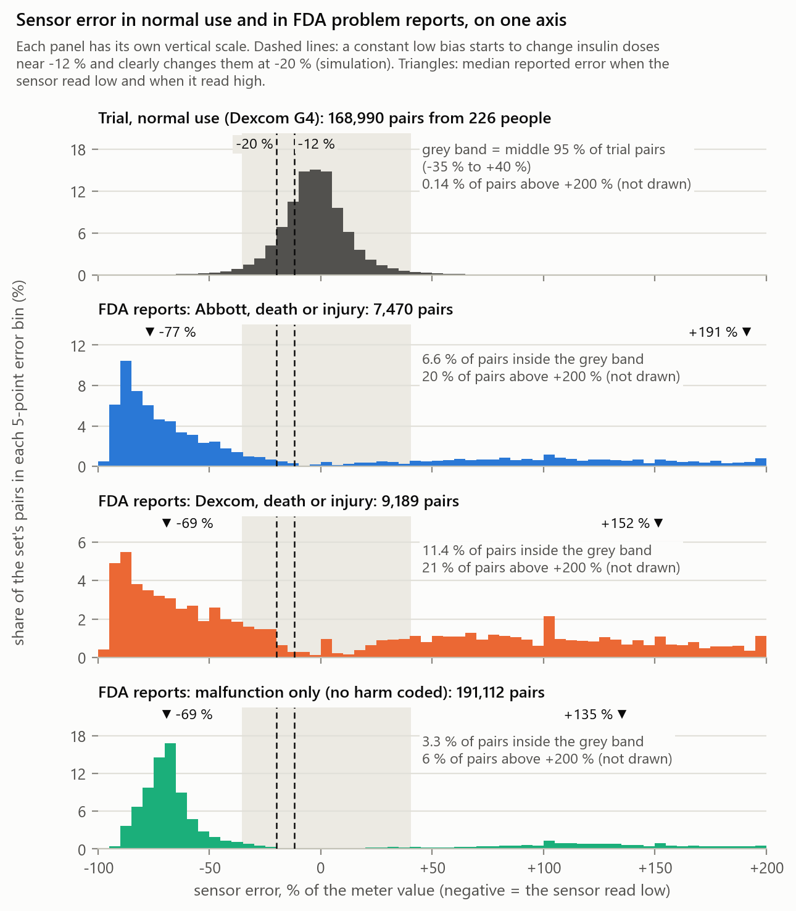

# Trial errors against reported errors, on one axis (2026-11-20)

Script: `analysis/tail_comparison.py`. Every number below comes from `analysis/tail_comparison_stats.json`. Figure: `analysis/figures/38_trial_vs_reported_error.png`.

## 1. What was compared and why
- The paper has two sets of sensor errors. One is from normal use (the REPLACE-BG trial). One is from FDA problem reports (MAUDE).
- One comparison was missing: how often does a normally working sensor make an error as large as the ones in the reports? Both sets were put on one error axis and counted.
- Pair = one sensor value with the fingerstick meter value taken at the same moment. Check = one fingerstick check, which is one pair. Error = (sensor - meter) / meter x 100, in %. Negative = the sensor read low.
- D/I = FDA death-or-injury report. Malfunction-only = FDA report with no harm coded. Arm check = the same count on the 77 people of the trial's CGM+BGM arm.
- 95 % CI = confidence interval, the range the true value most likely sits in. It comes from a bootstrap: the trial participants are re-drawn at random 2,000 times (seed 600) and the count is redone. Percentile = the share of trial pairs with an error at or below a value.

## 2. Pair sets
| Side | Pair set | Pairs | People | Pairs per person, median | Days from a person's first to last pair, median |
|---|---|---|---|---|---|
| Trial | All verified fingerstick pairs (run-in and randomised phase) | 168,990 | 226 | 719 | 244 (about 35 weeks) |
| Trial | Check: CGM+BGM arm, randomised phase | 33,467 | 77 | 399 | 179 (about 26 weeks) |
| Trial | Check: all participants, randomised phase only (26 trial weeks) | 137,662 | 225 | 607 | 181 (about 26 weeks) |
| Reports | FDA reports: Abbott, death or injury | 7,470 | - | - | - |
| Reports | FDA reports: Dexcom, death or injury | 9,189 | - | - | - |
| Reports | FDA reports: malfunction only (no harm coded) | 191,112 | - | - | - |

- Trial: the headline pair set of `accuracy_v2.py` (Set B), sensor Dexcom G4. Checks passed: 168,990 pairs, 226 people, MARD (the mean size of the error) 13.3 %.
- Reports: read from the per-pair files, not from the binned tables. D/I pairs = values read by the language model (`fda-maude/clean/text_extract_v3.jsonl`, filters of `brand_comparison.py`). Malfunction-only pairs = values read by text patterns (`fda-maude/clean/regex_v2_full.csv.gz`, pair rule of `report_regex_v2.py`).
- The three report counts match `BRAND_COMPARISON.md` and `REGEX_V2_FULL_CORPUS.md`. The difference is 0 pairs for all three. 84.8 % of the malfunction-only pairs are Abbott.

## 3. Results
### Table 1. Errors at or beyond a fixed size
| Error | Trial pairs | Share of trial pairs, % (95 % CI) | Per 1,000 checks (95 % CI) | People with at least one: all pairs, of 226 | People with at least one: 26 trial weeks only, of 225 | Arm check: share, % | Abbott D/I, % | Dexcom D/I, % | Malfunction, % |
|---|---|---|---|---|---|---|---|---|---|
| -20 % or lower | 18,209 | 10.8 (10.2 to 11.4) | 107.8 (101.6 to 114.0) | 226 (100 %) | 223 (99 %) | 10.9 | 56.8 | 42.6 | 74.4 |
| -40 % or lower | 2,863 | 1.69 (1.48 to 1.95) | 16.9 (14.8 to 19.5) | 212 (94 %) | 201 (89 %) | 2.00 | 52.8 | 36.4 | 71.7 |
| -50 % or lower | 1,282 | 0.76 (0.62 to 0.92) | 7.59 (6.24 to 9.20) | 183 (81 %) | 162 (72 %) | 0.95 | 48.9 | 32.3 | 68.8 |
| -60 % or lower | 534 | 0.32 (0.24 to 0.41) | 3.16 (2.39 to 4.09) | 130 (58 %) | 113 (50 %) | 0.45 | 43.3 | 27.3 | 61.4 |
| -66 % or lower | 274 | 0.16 (0.12 to 0.22) | 1.62 (1.17 to 2.16) | 91 (40 %) | 78 (35 %) | 0.22 | 39.1 | 23.9 | 49.2 |
| -69 % or lower | 179 | 0.11 (0.073 to 0.15) | 1.06 (0.73 to 1.46) | 67 (30 %) | 57 (25 %) | 0.13 | 36.2 | 22.0 | 38.4 |
| -77 % or lower | 56 | 0.033 (0.018 to 0.052) | 0.33 (0.18 to 0.52) | 30 (13 %) | 25 (11 %) | 0.039 | 28.6 | 16.9 | 16.6 |
| +20 % or higher | 13,042 | 7.72 (7.14 to 8.34) | 77.2 (71.4 to 83.4) | 225 (100 %) | 223 (99 %) | 7.74 | 41.0 | 54.4 | 25.1 |
| +44 % or higher | 3,693 | 2.19 (1.84 to 2.60) | 21.9 (18.4 to 26.0) | 215 (95 %) | 206 (92 %) | 2.45 | 38.9 | 50.1 | 23.9 |
| +100 % or higher | 1,034 | 0.61 (0.47 to 0.79) | 6.12 (4.69 to 7.89) | 148 (65 %) | 134 (60 %) | 0.82 | 31.6 | 38.5 | 19.2 |
| +164 % or higher | 380 | 0.22 (0.16 to 0.30) | 2.25 (1.64 to 2.99) | 100 (44 %) | 85 (38 %) | 0.32 | 23.2 | 26.2 | 9.14 |

### Table 2. Where the median reported error sits in the trial
| Report group | Direction | Report pairs | Median reported error, % | Trial percentile | Trial pairs this extreme or more | Share of trial pairs, % (95 % CI) | 1 check in | People with at least one, of 226 | Arm check: share, % |
|---|---|---|---|---|---|---|---|---|---|
| Abbott death or injury | reads low | 4,315 | -76.8 | 0.034 | 57 | 0.034 (0.018 to 0.053) | 2,965 | 30 (13 %) | 0.039 |
| Abbott death or injury | reads high | 3,126 | +191.2 | 99.85 | 259 | 0.15 (0.11 to 0.20) | 652 | 85 (38 %) | 0.22 |
| Dexcom death or injury | reads low | 4,029 | -69.2 | 0.104 | 175 | 0.10 (0.072 to 0.14) | 966 | 66 (29 %) | 0.13 |
| Dexcom death or injury | reads high | 5,088 | +151.7 | 99.73 | 459 | 0.27 (0.20 to 0.36) | 368 | 109 (48 %) | 0.38 |
| Malfunction only | reads low | 142,817 | -69.4 | 0.102 | 172 | 0.10 (0.070 to 0.14) | 982 | 65 (29 %) | 0.12 |
| Malfunction only | reads high | 48,295 | +135.2 | 99.65 | 590 | 0.35 (0.26 to 0.46) | 286 | 116 (51 %) | 0.47 |

### Table 3. Summary of the error, and report pairs inside the trial's central 95 % range
| Set | Signed error, %: 2.5th | 25th | Median | 75th | 97.5th | Absolute error, %: 2.5th | 25th | Median | 75th | 97.5th | Pairs inside the trial range, % (interval) |
|---|---|---|---|---|---|---|---|---|---|---|---|
| Trial, all pairs | -35 | -11 | -2.8 | +5.9 | +40 | 0.4 | 4.1 | 9.0 | 16.6 | 50.2 | - |
| Trial, arm check | -37 | -11 | -2.9 | +5.9 | +43 | 0.4 | 4.2 | 9.1 | 16.7 | 53.9 | - |
| Abbott death or injury | -92 | -80 | -47 | +146 | +981 | 21.3 | 66.7 | 85.5 | 146.3 | 980.7 | 6.63 (6.17 to 7.38) |
| Dexcom death or injury | -92 | -64 | +44 | +172 | +900 | 17.5 | 58.5 | 86.7 | 172.2 | 900.0 | 11.4 (10.3 to 12.8) |
| Malfunction only | -87 | -73 | -66 | +22 | +287 | 33.3 | 64.9 | 72.4 | 85.0 | 286.7 | 3.25 (2.85 to 3.75) |

### Table 4. The same fault rule on both sides
| Fault | Share of | Trial: pairs | Trial, % (95 % CI) | Arm check, % | Abbott D/I, % (pairs) | Dexcom D/I, % (pairs) | Malfunction, % (pairs) |
|---|---|---|---|---|---|---|---|
| False low: sensor under 70 while the meter is 70 or above | pairs with meter 70 or above | 4,797 of 158,886 | 3.02 (2.75 to 3.29) | 3.44 | 49.5 (2,657 of 5,370) | 31.9 (1,591 of 4,987) | 60.4 (110,119 of 182,219) |
| False low, strict: sensor under 70 while the meter is 70 to 250 | pairs with meter 70 to 250 | 4,771 of 138,231 | 3.45 (3.15 to 3.75) | 3.92 | 43.8 (1,141 of 2,605) | 32.9 (619 of 1,882) | 60.4 (89,020 of 147,318) |
| Hidden low: sensor 70 or above while the meter is under 70 | pairs with meter under 70 | 3,177 of 10,104 | 31.4 (29.3 to 33.7) | 28.2 | 92.7 (1,946 of 2,100) | 85.5 (3,592 of 4,202) | 97.0 (8,624 of 8,893) |
| Hidden low, strict: sensor 70 or above while the meter is under 54 | pairs with meter under 54 | 395 of 2,174 | 18.2 (15.5 to 20.9) | 15.2 | 92.5 (1,507 of 1,629) | 84.5 (3,082 of 3,647) | 96.5 (4,167 of 4,319) |
| Floor reading: sensor 40 or below while the meter is over 250 | pairs with meter over 250 | 2 of 20,655 | 0.010 (0.000 to 0.024) | 0.025 | 7.56 (209 of 2,765) | 7.31 (227 of 3,105) | 7.99 (2,787 of 34,901) |

## 4. How to read this
- A working sensor does make large errors, but rarely. -20 % or lower: 10.8 % of checks. -40 % or lower: 1.69 %. -66 % or lower: 0.16 %, which is 1.62 per 1,000 checks. The arm check gives slightly larger shares (2.00 % at -40 %).
- The median reported reads-low error (-69.2 to -76.8 %) sits at the 0.034 to 0.104 percentile of the trial. That is 1 check in 966 to 2,965. The median reads-high error (+135.2 to +191.2 %) sits at the 99.65 to 99.85 percentile: 1 check in 286 to 652.
- Rare per check is not rare per person. People made a median of 607 checks in the 26 trial weeks. 25 % of them had at least one error of -69 % or lower, and 11 % had one of -77 % or lower.
- Reported errors sit outside normal use. The range that holds 95 % of trial pairs is -35.3 % to +40.4 %. Only 3.25 to 11.4 % of report pairs fall inside it. The interval in Table 3 redoes the trial range in each bootstrap resample. Report values have no CI: they are all the pairs found, not a sample.
- Fault by fault. False low: 3.02 % in the trial against 31.9 to 60.4 % in reports. Floor reading: 2 of 20,655 trial pairs against 7.31 to 7.99 %. The hidden low is different. It was observed often in normal use: 31.4 % of pairs with a meter value under 70, and 18.2 % under 54. In reports it is 85.5 to 97.0 % (meter under 70).

## 5. Limits
- Main limit: the reports are a selected set of failures, not a sample of sensors. Their shares are not failure rates. They are also about other and newer sensors (Abbott Libre, later Dexcom models) than the trial's Dexcom G4.
- The trial reference is a home meter, matched to the nearest sensor reading within 5 minutes. guess: some of the largest trial errors come from the meter or from fast-changing glucose, not from the sensor.
- Both sides lose the most extreme values. The trial sensor displayed 39 to 401 mg/dL only. Reports that state "LO" or "HI" instead of a number are not pairs.
- Fingerstick checks are not random moments, and "people with at least one" grows with the number of checks (median 719 per person). guess: people check more when the sensor looks wrong, which would raise the trial shares. The report values were read by a model or by patterns; not all were checked by eye.

## 6. How to re-run
- From the repo root (about 10 s): `python analysis/tail_comparison.py "Uncommitted Data/Raw Data Dump" analysis`. It uses the cache in `analysis/cache/` (built first if missing). `fda-maude/clean/` must be on the machine; it is not in git.
- The script stops if the trial set is not 168,990 pairs from 226 people with MARD 13.3 %, or if a per-pair report file is missing. It writes the stats file and figure 38, and prints the four tables. No per-participant or per-report files.
