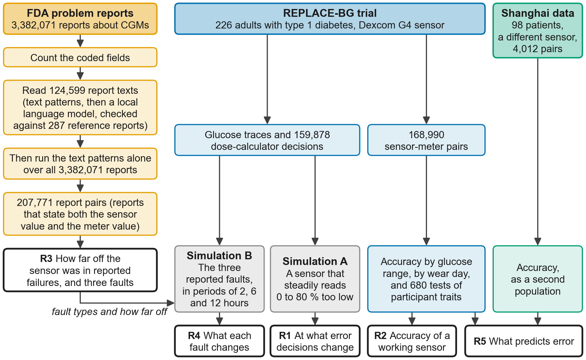
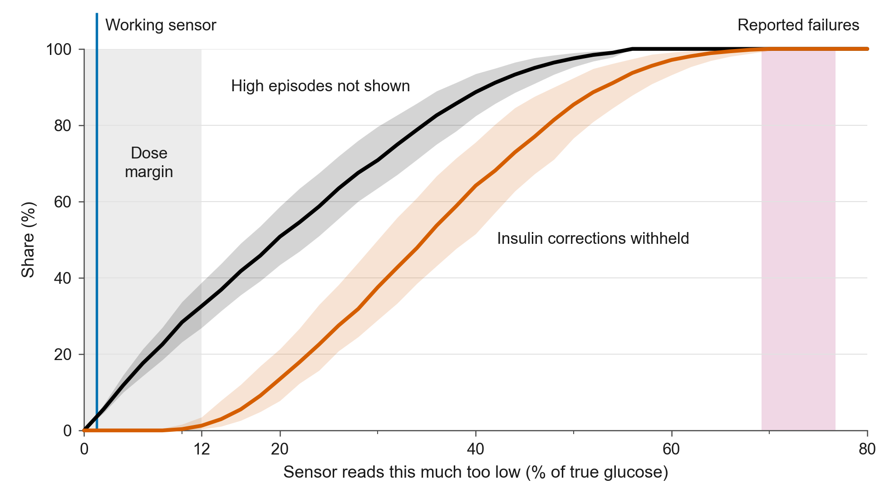
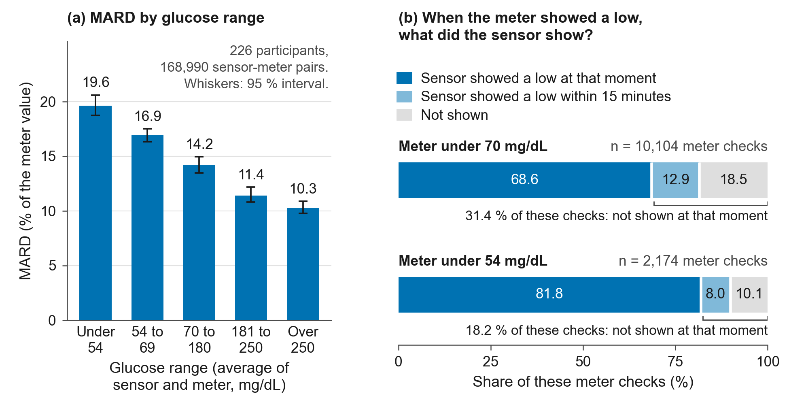
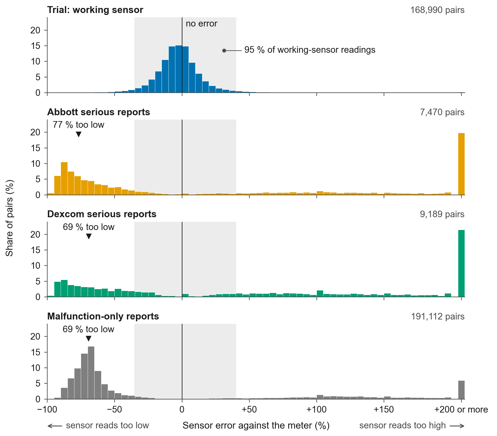
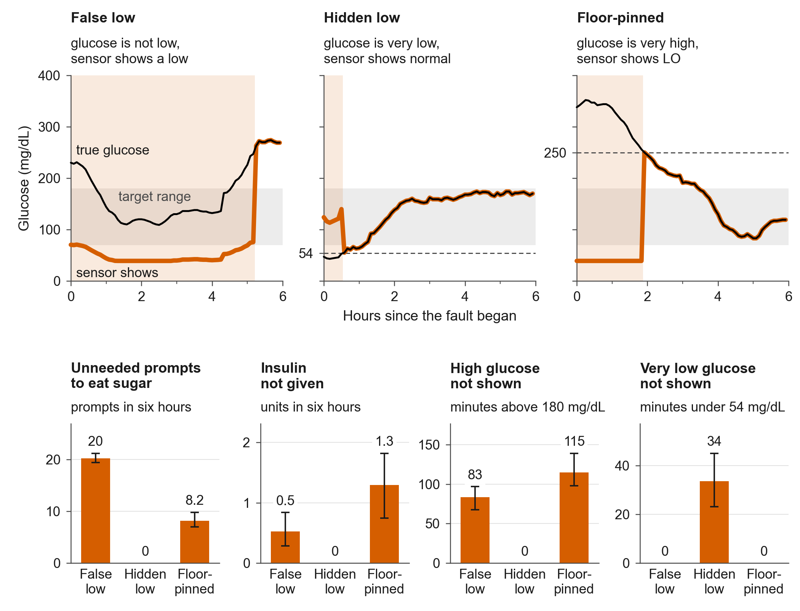

# How Large Must a Glucose Sensor Error Be to Change a Treatment Decision? Evidence from a Clinical Trial, FDA Problem Reports and Simulation

Draft state, 2026-11-21: all sections drafted except AI-Assisted Work and Author Contributions, which the team writes. The Abstract, Introduction, Methods, Discussion and Conclusion build on the teammates' working draft of Nov 20. Reference numbers are those of `REFERENCES.md`. The PDF build renumbers them in order of first use.

## Abstract

Continuous glucose monitors (CGMs) give near-real-time glucose readings that guide diabetes treatment, so a wrong reading can lead to a wrong treatment decision. This study asks how large a CGM error must be before it changes a treatment decision, and how large CGM errors are in practice, both in reported failures and in normal use.

We analysed 173,002 pairs of a CGM reading and a fingerstick meter value from 226 adults with type 1 diabetes (REPLACE-BG trial) and 98 hospital patients (ShanghaiT1DM/T2DM). We also analysed 3.38 million FDA problem reports, of which 207,771 state both values. We added sensor errors to the trial's glucose traces and recalculated 159,878 insulin dose decisions.

Insulin corrections began to be withheld when the CGM read about 12 % too low. At 20 % too low, about 1 in 7 needed corrections was withheld, and half of high-glucose episodes were not shown as high. In normal use the CGM read 1.3 % too low on average, but it did not show 31.4 % of the lows that a meter confirmed. In reported failures, a CGM that read low was typically 69 to 77 % too low. The reported failures formed three kinds of fault, and each changed a different decision.

Which decision fails depends on the direction and kind of the error, so CGM accuracy should be reported by direction, glucose range and kind of fault. The reports cannot give failure rates, and the simulations count changed decisions, not harm.

## 1. Introduction

Diabetes is a chronic condition in which the body cannot regulate blood glucose [1], and it affects about 830 million people worldwide [2]. Treatment aims to keep glucose within a target range of 70 to 180 mg/dL, because both low glucose (under 70 mg/dL) and high glucose (over 180 mg/dL) have immediate and long-term consequences [3]. A continuous glucose monitor (CGM) is a small sensor worn on the body that reads glucose under the skin every few minutes. People use its readings for treatment decisions such as insulin doses and carbohydrate intake [3]. In this paper we call the CGM the sensor, and we call the fingerstick blood glucose meter the meter. The display is what the wearer sees and hears. It shows the current glucose number and its trend, and it sounds an alert when the number crosses a low line or a high line. Since 2016 the FDA has allowed insulin to be dosed from a sensor without a confirming fingerstick [4]. People with diabetes rely on sensor readings for frequent decisions, so a reading that differs from the true blood glucose can lead to a wrong treatment decision and to harm [5], [6].

Recent recalls of one sensor family show how sensor failures can put patients at risk. In February 2023, a software fault in the FreeStyle Libre 3 app (45,173 units in the FDA record) could cause long losses of signal, which can delay the detection and treatment of abnormal glucose [7]. In July 2024, Abbott recalled 8,174 sensors that read too high, which can lead to too much insulin or a missed low [8]. On 24 November 2025, Abbott began a recall of about 3 million FreeStyle Libre 3 and Libre 3 Plus sensors that could read too low [9], [10]. A reading that is too low can lead to unneeded carbohydrate or delayed insulin. The FDA put this recall in Class I, its most serious class, and listed 860 serious injuries and 7 deaths reported as of 7 January 2026 [11]. Among the reports in the FDA's database of problem reports [12] that name these sensors and were received between the start of the recall and the end of September 2026, we counted 71 reports of a death and 6,714 reports of an injury. Of these reports, 2,638 were coded as "Low Readings". Reports can be repeated or unverified [13], so these counts cannot be set directly against the 7 deaths in the FDA notice.

The clinical reliability of a sensor depends on its accuracy [14]. Accuracy is usually reported as the mean absolute relative difference (MARD), which is the average distance between the sensor reading and a reference value, as a percentage of the reference [15]. A systematic review of 22 studies with 2,294 participants found an average MARD of 9.4 %, with larger errors at low glucose [15]. MARD does not show the direction of an error or what the error does to treatment [16], [17]. Sensors can also be wrong without a software or manufacturing defect. A sensor measures glucose in the fluid under the skin and not in blood, so its reading runs behind blood glucose, most of all when glucose changes fast [18], [19], [20]. Pressure on the sensor, its placement, a failing adhesive and some medicines can disturb it further [21], [22]. These weaknesses matter most at low glucose, where sensors are least accurate [15] and where a timely reading is needed for treatment.

How sensor error affects treatment has been studied by simulation. Kovatchev et al. [6] replayed the records of 56 pump users through a model of the body at seven levels of sensor error, and low and high glucose events rose sharply once MARD passed 10 %. Breton and Kovatchev [23] and Campos-Náñez et al. [24] did similar work for meters. These studies model the error of a working device, mostly random error, and none of them simulates a sensor that reads far too low for hours.

Shapiro [25] found 25,966 complaints about the accuracy of two Dexcom sensors in the FDA's reports from 2015 and 2016. Of the 415 complaints that gave both the sensor value and the meter value, 55 % were off by 100 mg/dL or more. Krouwer [26] counted 281,963 problem reports for four sensors in 2022 and found that a wrong reading was a leading cause. Neither study links how far off the sensors were to treatment decisions.

We found no study that says how far a sensor has to read too low before a dose or an alert changes, and none that places the error of a working sensor and the error in reported failures on one scale of treatment decisions. We therefore asked how large a sensor error must be before it changes a treatment decision, and how large sensor errors are in practice, both in reported failures and in normal use. To answer this we used paired sensor and meter data from the REPLACE-BG trial and the ShanghaiT1DM and ShanghaiT2DM datasets, together with FDA recall records and problem reports. The paper makes three contributions. First, it gives a curve from sensor error to changed decisions, built from the recorded glucose traces and dose decisions of the trial participants. Second, it reads how far off the sensor was, and which kinds of fault occur, from 207,771 FDA problem reports that state both the sensor value and the meter value, and it puts them on the same scale as the errors in the trial. Third, it simulates the three reported faults on real glucose traces to show which decision each one changes.

## 2. Dataset and Methods

### 2.1 Study design

Our study has three parts, and each answers one part of the question. Figure 1 shows the three data sources behind them, of which the Shanghai data serve only as a second population. Problem reports sent to the FDA show how far off a sensor is when a failure is reported. A clinical trial shows how far off a working sensor is in everyday use. Simulations on the trial's glucose traces show which treatment decisions change as the sensor error grows. Together they let us compare the working sensor and the reported failures with the error at which decisions change. All three parts use one measure, which is the sensor error as a percentage of the meter value. In the trial the devices recorded the sensor value and the meter value. In the reports a person wrote the two values into the report text. This difference limits how directly the trial and the reports can be compared.

*Figure 1. How the three data sources (coloured columns) lead to the five findings (white boxes R1 to R5, reported in Sections 3.1 to 3.5). The grey boxes are the two simulations. Both run on the glucose traces of the trial, and Simulation B takes its three faults from the FDA reports.*

### 2.2 Dataset

Table 1 describes the three data sources, and Appendix A gives more detail.

The trial data come from REPLACE-BG, a trial that tested whether insulin can be dosed from the sensor alone [27], [28]. After a run-in phase, one arm was asked to dose from the sensor alone for 26 weeks, and the other arm was asked to confirm with a meter first. We did not compare the arms but used the trial's records of every sensor reading (one every 5 minutes), every meter value and every use of the pump's dose calculator. A pair is one meter value together with the sensor reading of the same person at most 5 minutes away. Of 475,502 candidate pairs we kept the 168,990 whose meter value came from the meter's own memory, lay inside the study period (the run-in phase and the 26 weeks) and had not been used to calibrate the sensor. Values typed into the pump were left out because many of them are sensor readings, and calibration values were left out because the sensor has just been adjusted to match them. The ShanghaiT1DM and ShanghaiT2DM data [29], [30] are a smaller second population with a different sensor. We compared them with the trial only by description, because the sensor, the patients and the measuring conditions differ. We downloaded the trial data and the Shanghai data on 7 October 2026.

The problem reports come from the FDA's Manufacturer and User Facility Device Experience (MAUDE) database, which holds public problem reports for medical devices [13]. Makers, clinicians and patients file a report when a device may have caused harm or has malfunctioned. We downloaded every report filed under the 13 product codes for glucose sensors through openFDA [12], using the FDA's data of 21 October 2026. A serious report is a report of a death or an injury, and a malfunction-only report has neither. Many reports state in their free text what the sensor showed and what a meter showed at the same moment, and we call such a report a report pair.

*Table 1. The data sources.*

| Source | What it holds | Device | Size | What counts as one case | Who is in it | What we used it for |
|---|---|---|---|---|---|---|
| REPLACE-BG trial | US adults with type 1 diabetes on insulin pumps, 2015 to 2016. Sensor readings, meter values and dose-calculator records. | Dexcom G4 Platinum sensor, Contour Next meter | 226 participants, 168,990 pairs | One participant, who gives many pairs (median 719) | Age 19 to 78, 50 % are women, 94 % are White | Accuracy of a working sensor, what predicts error, and the glucose traces and dose decisions for the simulations |
| Shanghai data | Adult in-patients of two Shanghai hospitals, 12 with type 1 and 100 with type 2 diabetes. Sensor readings and meter values. | Abbott FreeStyle Libre H sensor, meter not named | 112 patients, 98 of them with pairs, 4,012 pairs | One patient (median 37.5 pairs) | Age 22 to 97, 46 % are women, all are Chinese | Accuracy in a second population |
| FDA MAUDE problem reports | Reports of sensor problems sent to the US FDA from March 1992 to September 2026, with coded fields and free text | All brands under 13 sensor product codes | 3,382,071 reports, 123,607 of them serious. 207,771 report pairs (16,659 in Abbott and Dexcom serious reports, 191,112 in malfunction-only reports). | One report. One event can produce several reports. | 64 % of reports come from the US. Age is filled in for about 73 % of reports, sex for 46 %, race or ethnicity for 0.3 %. | How far off the sensor was in reported failures, and the three faults for the second simulation |

All three sources are public and de-identified. The trial data come under the terms of use of the Jaeb Center for Health Research, the Shanghai data under a CC BY 4.0 licence, and the FDA reports are public government data. We made no attempt to identify anyone, and we keep no participant-level data in our repository (Appendix A). None of the sources represents everyone who wears a sensor. The trial has only adults, most of them White, and one sensor model from 2015, and the Shanghai patients are Chinese adults in hospital. A report exists only when someone noticed a problem and filed it, so the reports show which failures get reported and how far off the sensor was, but not how often sensors fail.

### 2.3 Computational workflow

**Reading the reports.** We first counted the coded fields of all reports by maker, problem named, year, country and outcome. We then read the report texts in two steps to find the report pairs. First, text patterns, which are fixed search rules that we wrote, picked out the two values wherever the wording is standard. Second, a language model read each text and filled in a fixed form of 12 fields, among them the sensor value, the meter value, the kind of fault and the outcome. The model was Qwen 2.5 with 7 billion parameters [31], an openly available model that we ran on our own computer with fixed settings (temperature 0 and a fixed seed). A number was kept only if it appears word for word in the text. We read 124,599 texts with both steps. These texts are all 118,462 serious reports with a text that the FDA had received by 21 July 2026, and a random sample of 6,137 of the 2.94 million malfunction-only reports received by the same date. We stopped at 21 July because the texts of newer reports are often still missing. We used the model's reading of these texts to improve the text patterns, and then ran the patterns alone over all 3,382,071 reports, which is how the 191,112 malfunction-only report pairs were found. Among serious reports we analysed the report pairs of Abbott and Dexcom (16,659 pairs) and not the 914 of other makers.

We checked the reading in three ways. First, we compared it with 287 reference reports. Two runs of the model with the same settings gave the same form for 91 % of these reports. An AI assistant (Claude Opus 5.5) had labelled these reports by a written rubric, and one author then read 100 of them one by one and changed no label. The 287 reference reports are the newest reports for three makers and not a random sample. Our reading agreed with the labels with a kappa of 0.77 for the kind of fault and 0.75 for the outcome, where kappa measures agreement beyond chance and 1 is perfect agreement. Second, the text patterns found 89 % of the report pairs that the model found. Third, an AI assistant (Claude) compared a random 100 of the malfunction-only report pairs with their texts and judged 97 right, 3 unclear and none wrong.

**Measuring the working sensor.** For each trial pair, the error is the sensor value minus the meter value, as a percentage of the meter value. The average error keeps its direction, and we write it in words, for example "reads 1.3 % too low". The MARD is the average of the same errors after the direction of each error is ignored. We report both for all pairs and for five glucose ranges (under 54, 54 to 69, 70 to 180, 181 to 250 and over 250 mg/dL). A pair is placed in a range by the average of its sensor value and its meter value, and Section 3.2 gives the reason. A true low is a meter value under 70 mg/dL, and for each true low we recorded whether the sensor showed under 70 at that moment. We also calculated other common measures, such as the share of readings within 20 % of the meter value. Table S1 lists these analyses, and the repository holds their values.

We then looked for what moves the error. We measured the sensor's delay by shifting the sensor readings in time and finding the shift with the lowest MARD. For the day of wear we took a break of 115 minutes or more in the readings as the start of a new sensor, because the records do not mark it. We tested whether participant traits predict the error with 680 comparisons that we listed before running any of them. They set traits such as age, sex, body size and diabetes control against measures of sensor error, with one trait at a time (407 comparisons), two traits together (133), and the participants with the largest errors against the rest (140). We corrected for the number of tests with the Benjamini-Hochberg method [32]. Every 95 % interval comes from a bootstrap that redraws whole participants at least 1,000 times, so that the many pairs of one person are not counted as independent.

**Simulating decisions.** The simulations ask what a person would do differently if the sensor showed a wrong value. We took each participant's recorded sensor trace as their true glucose and changed only what the display shows. We used the common alert lines, which are a low alert under 70 mg/dL, an urgent low alert under 54 and a high alert over 180. A stretch of 15 minutes or more beyond a line is one episode.

Each time a participant used the pump's dose calculator, the pump stored the glucose value entered, the person's target, their insulin sensitivity and the insulin still active. From these the calculator works out a correction, which is the extra insulin given when glucose is above target [33]. The records of 203 of the 226 participants hold a glucose value, and we recalculated each of their 159,878 decisions with the wrong displayed value and the person's own settings. A correction is needed if it is more than 0.5 units at the true glucose, which happened at least once for 202 of the 203 participants. It is withheld if it becomes zero at the displayed value.

Simulation A applies a steady error, in which every reading is too low by the same percentage, from 0 to 90 % in steps of 2 points (Figure 2 shows 0 to 80 %). Simulation B applies the three faults found in the reports (Section 3.3), with values taken from the medians of the report pairs. The false low makes the sensor read 69 % too low while the true glucose is between 70 and 250 mg/dL. The hidden low makes the sensor read 164 % too high while the true glucose is under 54 mg/dL, so a true 50 is shown as 132. The floor-pinned fault makes the sensor show the bottom of its range (39 mg/dL in the simulation, which a display gives as "LO") while the true glucose is over 250 mg/dL. Each fault lasts for a period of 2, 6 or 12 hours, with 200 random starting moments per participant. When the display showed under 70, we counted a prompt to eat 15 g of sugar, at most once every 15 minutes, which is the standard advice [34]. In both simulations the true glucose does not respond to the changed treatment, so they count changed decisions and not health outcomes. We also simulated six other kinds of fault, among them random noise, slow drift, loss of signal and a longer delay (Table S1).

### 2.4 Evaluation

The primary result is the curve from Simulation A (Figure 2). It gives, for each sensor error, the share of needed corrections that are withheld and the share of high episodes that are not shown as high. We chose this curve because it expresses a sensor error as changed treatment decisions, which MARD does not show. We then compare where the working sensor and the reported failures fall on that curve. For the simulations we report the typical (median) participant and the middle half of participants, and for the accuracy measures we report 95 % intervals.

We tested our main choices with sensitivity checks. For the simulations these were a high line at 200 instead of 180 mg/dL, the meter value instead of the sensor trace as the true glucose, a smaller and a larger version of the false low and the hidden low, a smaller version of the floor-pinned fault, and three lengths of the fault period. The arm that dosed from the sensor alone was not asked to check with a meter routinely. Its participants made 2.8 meter tests per day, compared with 5.4 in the routine-check arm [27], so their checks more likely followed a symptom or an alert. For the accuracy measures we therefore repeated the analysis in the 77 participants of the routine-check arm (33,467 pairs). Table S1 lists every analysis we ran, including those that changed nothing. Our midterm plan asked how sensor error varies across glucose ranges and how often it puts a reading on the wrong side of the 70 and 180 mg/dL lines. Section 3.2 answers that question. We added the report reading and the simulations later, because accuracy alone does not show what an error does to a treatment decision. All analyses were run in Python 3.11 with pandas, NumPy, SciPy, statsmodels, scikit-learn and Matplotlib, and the language model was run with Ollama. The main scripts are `preprocess.py` (builds the pairs), `accuracy_v2.py` (measures the working sensor), `simulation_v2.py` (the curve of Figure 2), `simulation_three_faults.py` (Figure 5 and Table S2) and `llm_extract.py` (reads the report texts). The scripts, the prompt for the language model and the package versions are in the repository.

## 3. Results

Small raised letters point to Table S3 at the end of the paper, which gives the exact values.

### 3.1 Insulin corrections start to be withheld when the sensor reads about 12 % too low

A sensor that reads slightly too low does not cause insulin corrections to be withheld. Take a person whose glucose is 200 mg/dL and whose sensor reads 12 % too low, so the display shows 176 mg/dL. The dose calculator still adds a correction, but a smaller one. The correction disappears only when the displayed value falls to about the person's target, and that takes a larger error. To find out how large this margin is, we made every sensor reading too low by the same steady amount and recalculated the 159,878 dose-calculator decisions that 203 of the 226 participants made during the trial (Figure 2). When the sensor read up to 8 % too low, the typical participant (the median) lost no corrections. At 12 % too low they lost about 1 in 80 of the corrections they needed.a At 20 % too low they lost about 1 in 7.b At 70 % too low they lost all of them.

*Figure 2. What a sensor that reads too low does to decisions. The black line is the share of high-glucose episodes that are not shown as high (226 participants). The orange line is the share of needed insulin corrections that are withheld (202 participants). Each line shows the typical participant (the median), and the shaded band around it shows the middle half of participants. The grey zone is the dose margin, where the sensor reads up to 12 % too low and almost no corrections are withheld. The blue line marks the working sensor, which reads 1.3 % too low on average. The pink band marks the typical reported failure that reads low, from 69 % too low (Dexcom and malfunction-only reports) to 77 % too low (Abbott).*

The display has no such margin. The same person at 200 mg/dL, whose display shows 176, is not told that their glucose is high, because the display's high line is at 180. An episode that sits only a little above that line is lost to even a small error. When the sensor read just 2 % too low, about 1 high episode in 18 was not shown as high.c At 12 % too low, about 1 high episode in 3 was not shown as high.d At 20 % too low, half were not shown.e False low alerts, where the display shows a low while glucose is not low, rose from about one every ten days when the sensor read 2 % too low to almost one a day when it read 20 % too low.

Two checks support these numbers. The first check moves the display's high line from 180 to 200 mg/dL. With the line at 200, a sensor reading 20 % too low kept about 6 in 10 high episodes from being shown as high, compared with half of them when the line was at 180,f so the finding does not rest on where the line is drawn. For the second check we changed what counts as the true glucose. Our simulation assumes that the recorded sensor trace is the true glucose, although that sensor has errors of its own. In one arm of the trial, participants were asked to check with a meter before dosing, so many of their dose decisions come with a meter value. The other arm was asked to dose from the sensor alone. For the 15,034 decisions that come with a meter value not used to calibrate the sensor, from 67 participants, we used the meter value as the true glucose instead. There, a sensor reading 20 % too low withheld about 1 in 4 of the needed corrections, compared with 1 in 7 in the main simulation.g These decisions come from fewer participants, but the share of corrections withheld was not smaller than in the main simulation.

### 3.2 A working sensor reads only 1.3 % too low on average, but about 3 in 10 true lows are not shown as low

Across 168,990 pairs from 226 participants, the trial sensor read 1.3 % too low on average (95 % interval 0.9 to 1.6 %). At a true glucose of 150 mg/dL that is a reading of 148, about a tenth of the error at which corrections begin to be withheld (Figure 2). Single readings were much further off than this average suggests, in both directions. Ignoring direction, a reading was on average 13.3 % away from the meter value (the MARD, 95 % interval 12.7 to 13.9 %), which is about 20 mg/dL at a true 150. About 1 reading in 9 was 20 % or more too low.h For comparison, a published study that also measured this sensor model in home use against a meter found a MARD of 11.3 % [35]. The FDA later wrote a rule for sensors that feed automated dosing (the iCGM criteria [36]). We could test seven of its accuracy limits, and the trial sensor fails all seven, although the rule is written for a laboratory reference and not for a home meter.

The sensor and the meter disagreed most when glucose was low (Figure 3a). To show this, each pair has to be placed in a glucose range, and the result depends on which value is used to place it. Placed by the meter value, the pairs in the range under 54 mg/dL make the sensor look 29.8 % too high. Placed by the sensor value, they make it look 22.5 % too low. The reason is that when either device shows a very low value, that device has often read too low itself. We therefore placed each pair by the average of its two values, and we do not conclude whether the sensor reads too high or too low at low glucose. Under all three methods, MARD was largest in the range under 54 mg/dL, at 1.4 to 2.8 times the MARD of the 70 to 180 range.

*Figure 3. The working sensor in the trial (226 participants). (a) MARD by glucose range. The whiskers show the 95 % interval. (b) Meter checks that read low, split by what the sensor showed. The upper bar holds the 10,104 checks with the meter under 70 mg/dL, and the lower bar holds the 2,174 checks with the meter under 54 mg/dL. In both bars the sensor shows a low when it reads under 70 mg/dL.*

The sensor often did not show a low that the meter confirmed. The meter read under 70 mg/dL on 10,104 checks. On 3,177 of these true lows (31.4 %, 95 % interval 29.3 to 33.7 %), the sensor showed 70 or above at that moment. In the arm that checked with a meter routinely, the share was 28 % (95 % interval 24 to 33 %). Part of this is timing, because the sensor runs 5 to 7 minutes behind the blood. Welsh et al. [37] count a low as shown if the sensor reads under 70 within 15 minutes of the reference value, which allows for such a delay. We made the same kind of count, with a window of 15 minutes before or after the meter check. Counted this way, 18.5 % of true lows were still not shown (Figure 3b). High readings were missed less often. The meter read over 180 mg/dL on 61,788 checks, and on 17.2 % of them (95 % interval 16.1 to 18.3 %) the sensor showed 180 or below.

### 3.3 When a reported sensor reads low it is typically 69 to 77 % too low, and the failures are three distinct faults

A wrong reading is the most common problem in the 123,607 serious reports and is named in 33.1 % of them. Report pairs, in which the text states both the sensor value and the meter value, numbered 7,470 in Abbott serious reports, 9,189 in Dexcom serious reports and 191,112 in malfunction-only reports.

In the report pairs the sensor was far from the meter. The sensor read lower than the meter in 58 % of the Abbott serious pairs, 44 % of the Dexcom serious pairs and 75 % of the malfunction-only pairs. Take a meter value of 200 mg/dL. In the typical (median) Abbott serious pair that read low, the sensor would show 46, which is 77 % too low. In the typical Dexcom serious pair it would show 62, which is 69 % too low, and the typical malfunction-only pair was also 69 % too low. These errors are about six times the 12 % at which corrections begin to be withheld. In the remaining pairs the sensor read higher than the meter, in most of them by more than 100 %.

A working sensor almost never reads 69 % too low (Figure 4). In the 26 randomised weeks of the trial, a reading 69 % or more too low came up about once in every 870 meter checks.i That is rare for a single check but less rare for a person, because 57 of the 225 participants with meter checks in those weeks had at least one such reading. In the trial, 19 of every 20 errors lay between 35 % too low and 40 % too high. Only 3 to 11 % of the report pairs, depending on the group, fell inside that range.j

*Figure 4. Sensor error against the meter in the trial and in reports to the FDA, on one scale. Bars show the share of each panel's pairs at each error. The last bar on the right holds all pairs that read more than 200 % too high. The grey band holds 19 of every 20 errors in the trial. Each triangle marks the median of the pairs in which the sensor read lower than the meter.*

The report pairs show three different faults. We sorted each report pair by what the meter said and what the sensor showed. In a false low, glucose is not low (meter at 70 mg/dL or above) and the sensor shows a low. Across the malfunction-only pairs, for example, the median meter value was 178 and the median sensor value was 63. In a hidden low, glucose is low (meter under 70) and the sensor shows 70 or above. Across the serious pairs in which the sensor read higher than the meter, the median meter value was 45 and the median sensor value was 144. A floor-pinned reading is the extreme case of a false low, where glucose is very high (meter over 250) and the sensor is at the bottom of its range, 40 mg/dL or below. About 6 in 10 report pairs in each group show one of these three faults.k In the remaining pairs the sensor value and the meter value were on the same side of the low line.

All three faults are far more common in the report pairs than in the trial. When the meter was not low, the trial sensor showed a low in 3 % of checks, and the reported sensors did so in 32 to 60 % of pairs, depending on the group. When the meter was low, the trial sensor failed to show a low in 31 % of checks, and the reported sensors in 85 to 97 % of pairs. When the meter was over 250, the trial sensor showed its lowest value on 2 of 20,655 checks, and the reported sensors in 7 to 8 % of pairs.l The groups differ in which fault is most common. False lows make up about 6 in 10 malfunction-only pairs, and hidden lows fewer than 1 in 20. Hidden lows are more common in the serious reports, at about 4 in 10 Dexcom serious pairs and 1 in 4 Abbott serious pairs.m All of these shares count only report pairs, so they show what gets reported and not how often sensors fail.

### 3.4 Each fault breaks a different decision

To see what each fault does to a person's decisions, we placed it on the participants' real glucose traces for six hours and counted what someone who follows the standard rules would do differently (Figure 5). The numbers below are for the typical (median) participant in one six-hour period, and Table S2 gives the exact values.

*Figure 5. What each of the three reported faults does in six hours. The top row shows one real example of each fault from the trial traces. The black line is the true glucose, the orange line is what the faulty sensor shows, and the fault acts in the shaded stretch. The grey band is the target range, 70 to 180 mg/dL. The bottom row shows four outcomes for the typical participant (the median), with whiskers for the middle half of participants. A bar marked 0 means the fault cannot cause that outcome.*

The false low makes a person eat sugar they do not need and miss insulin they do need. Glucose is normal or high, say 150 mg/dL, and the sensor shows a value 69 % lower, here 46. The display says "low", and the standard advice for a low is to eat 15 g of fast-acting sugar and check again after 15 minutes [34]. Over the six hours the display called for sugar about 20 times, nearly once every 15 minutes, which adds up to about 300 g. A real person would very likely stop or check with a meter well before that, so 300 g is an upper limit. In the same six hours about half a unit of correction insulin was not given, and 83 minutes of truly high glucose were not shown as high. A smaller or a larger false low, between 62 and 77 % too low, changed only the number of sugar prompts, from about 16 to about 21. A steady error that is about as large, 66 % too low at every glucose level, makes the display call for sugar almost as often (18.5 times), so the false low behaves like the very large steady errors at the far right of Figure 2.

The hidden low takes away the warning. Glucose is dangerously low, say 50 mg/dL, and the sensor shows a normal value, here 132. The display says nothing, so there is no alert and no reason to eat. In six hours that contained this fault, the typical participant spent about 34 minutes under 54 mg/dL while the display showed 70 or above, and about one alert for glucose under 54 was lost in every two six-hour periods. Unlike the false low, the hidden low rarely causes a wrong action. In a hidden low the sensor reads too high, so a sensor that reads too low can never produce one. The curve in Figure 2 therefore does not contain this fault.

Of the three faults, the floor-pinned fault leaves out the most insulin. Glucose is very high, say 300 mg/dL, and the display shows "LO", the bottom of its range. The person is told they are very low at the moment they most need insulin. In the typical six-hour period glucose was above 250 for about 2 hours, so this fault acted for much less time than the false low, which acted for about 5 hours. Even so, 1.3 units of insulin were not given, two and a half times as much as with the false low. For each hour that the fault acted, 0.64 units were not given with the floor-pinned fault and 0.10 units with the false low. The correction a person needs is largest when their glucose is highest, which is why a fault that acts only at very high glucose leaves out so much.

### 3.5 Error follows wear day and glucose range, not who the patient is

Three things clearly moved the sensor's accuracy. The first is the glucose range (Section 3.2). The second is the sensor's delay, which raised MARD to about 18 % when glucose was changing by more than 2 mg/dL per minute, compared with 12 % when it was changing by less than 1. The third is the day of wear, with a MARD of 15.2 % on the first day a sensor was worn and 11.8 % on the seventh. The gap to the later days halved about every 24 hours.

Who the participant is did not predict the error. Of the 680 planned comparisons (Methods), about 34 would pass the usual significance test by chance alone, and 69 did. After the correction for running many tests, 1 remained, which was sex in the low range (average of sensor and meter under 70 mg/dL). In that range the sensor read 6.4 % too low for women and 2.2 % too low for men (a gap of 4.2 points, 95 % interval 2.0 to 6.0). At 60 mg/dL that gap is about 2.5 mg/dL, which is too small to change a dose. The gap can shift low alerts a little, by at most one more false low alert about every six days for women. In the Shanghai data, from a different sensor worn by Chinese hospital patients, patient traits did not predict the error either (60 comparisons in the 76 patients with at least 10 pairs). Across the 98 patients with a pair, MARD was 13.9 %, compared with 13.3 % in the trial. The Shanghai sensor read 7.4 % too low on average, compared with 1.3 % in the trial.

The reports cover people that the trial does not. Of the 2.48 million reports that record an age, 17.5 % concern a child under 18 and 28 % concern a person aged 65 or over. The trial had no children, and only 8 % of its participants were 65 or over.n In the serious report pairs, the age and sex on record made little difference to how far off the sensor was. However, many reports do not record who the patient was. Only half of the serious reports about a wrong reading record an age, and race and ethnicity are each recorded in only about 3 of every 1,000 reports.o The reports therefore show that failures reach children and older adults, but they cannot show whether any group's sensors fail more often.

Several other analyses did not change the conclusions, among them the time of day, the study site, the country of the report and six other kinds of simulated fault (Table S1).

## 4. Discussion

A sensor error does not need to be large to change a treatment decision. In the dosing simulation, insulin corrections began to be withheld when the sensor read about 12 % too low, and what the display showed changed with an error of only a few percent. In normal use the sensor's average error was small, at 1.3 % too low, and well under the 12 % point. A single reading was much further off than the average. Ignoring direction, a reading was on average 13.3 % away from the meter value (the MARD), and the sensor did not show 31.4 % of true lows at the moment of the meter check. In reported failures, a sensor that read low was typically 69 to 77 % too low, about six times the 12 % point, although these reports are not failure rates.

The reported failures also differ from a working sensor in kind, and this limits what one error percentage can tell us. A false low is the kind of fault behind the 2025 recall, in which sensors read too low [11]. The person is told to eat sugar they do not need, insulin is withheld and truly high glucose is not shown as high. In a hidden low the sensor reads too high, as the sensors recalled in 2024 did [8], and a real low goes untreated. The floor-pinned fault acts only at very high glucose, where it leaves out the most insulin per hour. Which decision fails therefore depends on where the true glucose is and in which direction the sensor is wrong. For a fault as large as the false low, how far off the sensor is mattered less. Making the false low smaller or larger, between 62 and 77 % too low, changed its outcomes little. A fourth kind of failure, the loss of signal behind the 2023 recall [7], is not covered by our three faults.

Our results for a working sensor agree with earlier work. Sensors are known to be least accurate at low glucose [15], and MARD alone does not show the direction of an error [16], [17]. The trial sensor's MARD of 13.3 % is 2 points above the 11.3 % that Bailey et al. [35] found for the same sensor model in home use against a meter. Our MARD by day of wear, 15.2 % on the first day and 11.8 % on the seventh, is close to the 16.7 % and 11.9 % that Christiansen et al. [38] measured for the earlier version of this sensor against a laboratory reference. Welsh et al. [37] report that two later Dexcom sensors showed 86 and 91 % of true lows within 15 minutes, and the trial sensor, counted with the same 15-minute window, showed 81.5 %. Earlier simulations looked at the random error of a working device and found that low and high glucose events rise sharply once MARD passes 10 % [6]. Our curve adds the case they left out, which is a sensor that is wrong in one direction for hours. Campos-Náñez et al. [24] showed for meters that the direction of a steady error matters, and the three faults show the same for sensors.

For people who wear a sensor, these results support checking with a meter whenever a reading does not match how the person feels, most of all when the reading is low, because one fingerstick corrects both a false low and a hidden low. They also support extra care on the first day of a new sensor, when MARD was about 3 points higher than on the seventh day. For those who assess sensors, the results argue for reporting the direction of the errors, the glucose range and the kind of fault next to MARD, because a single accuracy number does not show which decision will fail.

The reports cannot show how often sensors fail, and makers differ in how they file reports, so differences between Abbott and Dexcom should be read with care. The report texts were read by a language model, and its reading agreed with the reference labels with a kappa of 0.77 for the kind of fault and 0.75 for the outcome. An AI assistant wrote those labels, and one author checked 100 of the 287. The trial used the Dexcom G4, an older sensor, in adults on insulin pumps, 94 % of them White, with no children. The reference was a home meter and not a laboratory method, so part of every difference between sensor and meter is the meter's own error. Meter error at the limit that the ISO standard allows [39] changed MARD in the routine-check arm by 1.9 points, from 13.8 to 15.7 %. Meter checks are also not random moments, because people test when they feel low or doubt the sensor, and this may raise the share of true lows that were not shown. The simulation follows a dose calculator and does not model a person who notices a wrong reading and acts differently, so it counts changed decisions and not harm. The error at which corrections begin to be withheld, about 12 %, also depends on the dosing rule used.

The most useful next steps are to repeat the accuracy analysis on a current sensor and in children, to use a laboratory reference in place of a home meter, and to study what people do when a reading looks wrong. The three faults could also be run through a model of the body, such as the one Kovatchev et al. [6] used, so that changed decisions become glucose outcomes.

## 5. Conclusion

This study asked how large a sensor error must be before it changes a treatment decision, and how large sensor errors are in practice. Insulin corrections began to be withheld when the sensor read about 12 % too low. The display changed with a smaller error, because about 1 high episode in 18 was not shown as high when the sensor read 2 % too low. In normal use the sensor's average error was small, at 1.3 % too low, so a working sensor stayed well below the 12 % point on average. Reported failures were far larger, at 69 to 77 % too low when the sensor read low.

The weak point in normal use is low glucose. The error was largest there, and 31.4 % of true lows were not shown as low at the moment of the meter check. Reported failures also differ in kind. They come as three faults, and each breaks a different decision. A false low leads to unneeded sugar and withheld insulin, a hidden low removes the warning of a real low, and a floor-pinned sensor leaves out the most insulin.

The contribution of this study is one scale of changed decisions that holds both the working sensor and the reported failures. One accuracy percentage cannot show these differences, so reports of sensor accuracy should give the direction of the errors, the glucose range and the kind of fault next to MARD. Our findings rest on adults, one older sensor model and a simulated dose calculator, and the reports cannot show how often failures happen. The most useful next steps are to repeat the analysis on current sensors, in children and against a laboratory reference, and to study what people do when a reading looks wrong.

## Data and Code Availability

All three data sources are public. The REPLACE-BG trial data are available from the public dataset page of the Jaeb Center for Health Research [28]. The ShanghaiT1DM and ShanghaiT2DM data are available from Figshare under a CC BY 4.0 licence [30]. The FDA problem reports are available through openFDA [12]. Our code, the prompt for the language model, the package versions and all summary results are at https://github.com/Artematix/BME-600-Group-24 (graded commit to be filled in at submission). The repository holds no trial data, no Shanghai data and no table with one row per participant, because we keep participant-level data out of a public repository. Both datasets can be downloaded from their sources. It holds the 287 public FDA report texts of the reference set. The files `analysis/REPRODUCIBILITY.md` and `fda-maude/README.md` in the repository explain where to get the data and how to rerun the analyses.

## AI-Assisted Work

(not written yet)

## Author Contributions

(not written yet)

## References

[1] M. Z. Banday, A. S. Sameer, and S. Nissar, "Pathophysiology of diabetes: An overview," *Avicenna J. Med.*, vol. 10, no. 4, pp. 174-188, Oct.-Dec. 2020, doi: 10.4103/ajm.ajm_53_20.

[2] World Health Organization, "Diabetes," WHO health topics. Accessed: Nov. 20, 2026. [Online]. Available: https://www.who.int/health-topics/diabetes

[3] T. Battelino et al., "Clinical Targets for Continuous Glucose Monitoring Data Interpretation: Recommendations From the International Consensus on Time in Range," *Diabetes Care*, vol. 42, no. 8, pp. 1593-1603, Aug. 2019, doi: 10.2337/dci19-0028.

[4] U.S. Food and Drug Administration, "Summary of Safety and Effectiveness Data (SSED): Dexcom G5 Mobile Continuous Glucose Monitoring System," PMA P120005/S041, approved Dec. 20, 2016. Accessed: Nov. 20, 2026. [Online]. Available: https://www.accessdata.fda.gov/cdrh_docs/pdf12/P120005S041B.pdf

[5] D. C. Klonoff, D. Ahn, and A. Drincic, "Continuous glucose monitoring: A review of the technology and clinical use," *Diabetes Res. Clin. Pract.*, vol. 133, pp. 178-192, Nov. 2017, doi: 10.1016/j.diabres.2017.08.005.

[6] B. P. Kovatchev, S. D. Patek, E. A. Ortiz, and M. D. Breton, "Assessing sensor accuracy for non-adjunct use of continuous glucose monitoring," *Diabetes Technol. Ther.*, vol. 17, no. 3, pp. 177-186, Mar. 2015, doi: 10.1089/dia.2014.0272.

[7] U.S. Food and Drug Administration, "Class 2 Device Recall FreeStyle Libre 3 App," recall no. Z-0734-2024, Medical Device Recalls database, posted Jan. 16, 2024. [Online]. Available: https://www.accessdata.fda.gov/scripts/cdrh/cfdocs/cfres/res.cfm?id=204243

[8] U.S. Food and Drug Administration, "Class 1 Device Recall FreeStyle Libre 3 sensor, a component of the FreeStyle Libre 3 Continuous Glucose Monitoring System," recall no. Z-2692-2024, Medical Device Recalls database, posted Aug. 27, 2024. Accessed: Nov. 20, 2026. [Online]. Available: https://www.accessdata.fda.gov/scripts/cdrh/cfdocs/cfres/res.cfm?id=209214

[9] Abbott, "Abbott Initiates Medical Device Correction for Certain FreeStyle Libre 3 and FreeStyle Libre 3 Plus Sensors in the U.S.," company announcement, Nov. 24, 2025. Accessed: Nov. 20, 2026. [Online]. Available: https://www.fda.gov/safety/recalls-market-withdrawals-safety-alerts/abbott-initiates-medical-device-correction-certain-freestyle-librer-3-and-freestyle-libre-3-plus

[10] U.S. Food and Drug Administration, "Class 1 Device Recall FreeStyle Libre" (four records, recall nos. Z-1020-2026 to Z-1023-2026, recall event 98049), Medical Device Recalls database, posted Jan. 14, 2026. Accessed: Nov. 20, 2026. [Online].

[11] U.S. Food and Drug Administration, "Glucose Monitor Sensor Recall: Abbott Diabetes Care Removes Certain FreeStyle Libre 3 and FreeStyle Libre 3 Plus Sensors," FDA, content current as of Feb. 5, 2026. Accessed: Nov. 20, 2026. [Online]. Available: https://www.fda.gov/medical-devices/medical-device-recalls-and-early-alerts/glucose-monitor-sensor-recall-abbott-diabetes-care-removes-certain-freestyle-libre-3-and-freestyle

[12] U.S. Food and Drug Administration, "Device Adverse Event Overview," openFDA. Accessed: Nov. 20, 2026. [Online]. Available: https://open.fda.gov/apis/device/event/

[13] U.S. Food and Drug Administration, "About Manufacturer and User Facility Device Experience (MAUDE) Database," FDA, content current as of Dec. 8, 2025. Accessed: Nov. 20, 2026. [Online]. Available: https://www.fda.gov/medical-devices/mandatory-reporting-requirements-manufacturers-importers-and-device-user-facilities/about-manufacturer-and-user-facility-device-experience-maude-database

[14] J. R. Castle and P. G. Jacobs, "Nonadjunctive Use of Continuous Glucose Monitoring for Diabetes Treatment Decisions," *J. Diabetes Sci. Technol.*, vol. 10, no. 5, pp. 1169-1173, Sep. 2016, doi: 10.1177/1932296816631569.

[15] V. Dávila-Ruales, L. F. Gilón, A. M. Gómez, O. M. Muñoz, M. N. Serrano, and D. C. Henao, "Evaluating the precision and reliability of real-time continuous glucose monitoring systems in ambulatory settings: a systematic review," *Ther. Adv. Endocrinol. Metab.*, vol. 15, Art. no. 20420188241304459, Dec. 2024, doi: 10.1177/20420188241304459.

[16] L. Heinemann et al., "Benefits and Limitations of MARD as a Performance Parameter for Continuous Glucose Monitoring in the Interstitial Space," *J. Diabetes Sci. Technol.*, vol. 14, no. 1, pp. 135-150, Jan. 2020, doi: 10.1177/1932296819855670.

[17] D. C. Klonoff et al., "The Diabetes Technology Society Error Grid and Trend Accuracy Matrix for Glucose Monitors," *J. Diabetes Sci. Technol.*, vol. 18, no. 6, pp. 1346-1361, Nov. 2024, doi: 10.1177/19322968241275701.

[18] A. Basu et al., "Time lag of glucose from intravascular to interstitial compartment in humans," *Diabetes*, vol. 62, no. 12, pp. 4083-4087, Dec. 2013, doi: 10.2337/db13-1132.

[19] S. Pleus et al., "Rate-of-Change Dependence of the Performance of Two CGM Systems During Induced Glucose Swings," *J. Diabetes Sci. Technol.*, vol. 9, no. 4, pp. 801-807, Jul. 2015, doi: 10.1177/1932296815578716.

[20] S. Vaddiraju, D. J. Burgess, I. Tomazos, F. C. Jain, and F. Papadimitrakopoulos, "Technologies for continuous glucose monitoring: current problems and future promises," *J. Diabetes Sci. Technol.*, vol. 4, no. 6, pp. 1540-1562, Nov. 2010, doi: 10.1177/193229681000400632.

[21] American Diabetes Association Professional Practice Committee, "7. Diabetes Technology: Standards of Care in Diabetes-2025," *Diabetes Care*, vol. 48, suppl. 1, pp. S146-S166, Jan. 2025, doi: 10.2337/dc25-S007.

[22] B. D. Mensh, N. A. Wisniewski, B. M. Neil, and D. R. Burnett, "Susceptibility of interstitial continuous glucose monitor performance to sleeping position," *J. Diabetes Sci. Technol.*, vol. 7, no. 4, pp. 863-870, Jul. 2013, doi: 10.1177/193229681300700408.

[23] M. D. Breton and B. P. Kovatchev, "Impact of blood glucose self-monitoring errors on glucose variability, risk for hypoglycemia, and average glucose control in type 1 diabetes: an in silico study," *J. Diabetes Sci. Technol.*, vol. 4, no. 3, pp. 562-570, May 2010, doi: 10.1177/193229681000400309.

[24] E. Campos-Náñez, K. Fortwaengler, and M. D. Breton, "Clinical Impact of Blood Glucose Monitoring Accuracy: An In-Silico Study," *J. Diabetes Sci. Technol.*, vol. 11, no. 6, pp. 1187-1195, Nov. 2017, doi: 10.1177/1932296817710474.

[25] A. R. Shapiro, "Nonadjunctive Use of Continuous Glucose Monitors for Insulin Dosing: Is It Safe?," *J. Diabetes Sci. Technol.*, vol. 11, no. 4, pp. 833-838, Jul. 2017, doi: 10.1177/1932296816688303.

[26] J. S. Krouwer, "Adverse Event Causes From 2022 for Four Continuous Glucose Monitors," *J. Diabetes Sci. Technol.*, vol. 19, no. 1, pp. 80-83, Jan. 2025, doi: 10.1177/19322968231178525.

[27] G. Aleppo et al., "REPLACE-BG: A Randomized Trial Comparing Continuous Glucose Monitoring With and Without Routine Blood Glucose Monitoring in Adults With Well-Controlled Type 1 Diabetes," *Diabetes Care*, vol. 40, no. 4, pp. 538-545, Apr. 2017, doi: 10.2337/dc16-2482.

[28] Jaeb Center for Health Research, "A Randomized Trial Comparing Continuous Glucose Monitoring With and Without Routine Blood Glucose Monitoring in Adults with Type 1 Diabetes" (public dataset), JCHR Public Study Websites. Accessed: Nov. 20, 2026. [Online]. Available: https://public.jaeb.org/dataset/546

[29] Q. Zhao et al., "Chinese diabetes datasets for data-driven machine learning," *Sci. Data*, vol. 10, no. 1, Art. no. 35, Jan. 2023, doi: 10.1038/s41597-023-01940-7.

[30] Q. Zhao, J. Zhu, C. Wang, and W. Rao, "Diabetes Datasets, ShanghaiT1DM and ShanghaiT2DM," figshare, collection, ver. 2, Jan. 4, 2023, doi: 10.6084/m9.figshare.c.6310860.

[31] A. Yang et al., "Qwen2.5 Technical Report," arXiv:2412.15115, Dec. 2024.

[32] Y. Benjamini and Y. Hochberg, "Controlling the false discovery rate: a practical and powerful approach to multiple testing," *J. R. Stat. Soc. Ser. B (Methodol.)*, vol. 57, no. 1, pp. 289-300, 1995, doi: 10.1111/j.2517-6161.1995.tb02031.x.

[33] G. Aleppo et al., "A Practical Approach to Using Trend Arrows on the Dexcom G5 CGM System for the Management of Adults With Diabetes," *J. Endocr. Soc.*, vol. 1, no. 12, pp. 1445-1460, Dec. 2017, doi: 10.1210/js.2017-00388.

[34] American Diabetes Association Professional Practice Committee for Diabetes, "6. Glycemic Goals, Hypoglycemia, and Hyperglycemic Crises: Standards of Care in Diabetes-2026," *Diabetes Care*, vol. 49, suppl. 1, pp. S132-S149, Jan. 2026, doi: 10.2337/dc26-S006.

[35] T. S. Bailey, A. Chang, and M. Christiansen, "Clinical accuracy of a continuous glucose monitoring system with an advanced algorithm," *J. Diabetes Sci. Technol.*, vol. 9, no. 2, pp. 209-214, Mar. 2015, doi: 10.1177/1932296814559746.

[36] *Integrated continuous glucose monitoring system*, 21 C.F.R. § 862.1355 (2025). [Online]. Available: https://www.ecfr.gov/current/title-21/section-862.1355

[37] J. B. Welsh, S. Psavko, X. Zhang, P. Gao, and A. K. Balo, "Comparisons of Fifth-, Sixth-, and Seventh-Generation Continuous Glucose Monitoring Systems," *J. Diabetes Sci. Technol.*, vol. 18, no. 1, pp. 143-147, Jan. 2024, doi: 10.1177/19322968221099879.

[38] M. Christiansen et al., "A new-generation continuous glucose monitoring system: improved accuracy and reliability compared with a previous-generation system," *Diabetes Technol. Ther.*, vol. 15, no. 10, pp. 881-888, Oct. 2013, doi: 10.1089/dia.2013.0077.

[39] N. Jendrike, A. Baumstark, U. Kamecke, C. Haug, and G. Freckmann, "ISO 15197: 2013 Evaluation of a Blood Glucose Monitoring System's Measurement Accuracy," *J. Diabetes Sci. Technol.*, vol. 11, no. 6, pp. 1275-1276, Nov. 2017, doi: 10.1177/1932296817727550.

## Supplementary material

- Appendix A. More detail on the three data sources and on responsible use (`build/appendixA_numbered.md`).
- Table S1. Every analysis we ran (`tables/tableS1_analyses.md`).
- Table S2. What each fault changes in six hours (`tables/tableS2_three_faults.md`).
- Table S3. Exact values behind the rounded numbers in the Results (below, and `tables/tableS3_exact_values.md`).

### Table S3. Exact values

Each small raised letter in the Results has one row here.

| Letter | What the text says | Exact value |
|---|---|---|
| a | Sensor 12 % too low. The typical participant lost about 1 in 80 of the corrections they needed. | 1.24 % of the corrections that were needed. The middle half of participants lay between 0.3 and 3.5 %. 202 participants. |
| b | Sensor 20 % too low. They lost about 1 in 7. | 13.5 % of the corrections that were needed. The middle half of participants lay between 7.8 and 21.3 %. 202 participants. |
| c | Sensor 2 % too low. About 1 high episode in 18 was not shown as high. | 5.6 % of the high episodes. The middle half of participants lay between 4.6 and 6.7 %. 226 participants and 120,363 high episodes. |
| d | Sensor 12 % too low. About 1 high episode in 3 was not shown as high. | 32.6 % of the high episodes. The middle half of participants lay between 26.9 and 38.7 %. 226 participants. |
| e | Sensor 20 % too low. Half of the high episodes were not shown as high. | 50.8 % of the high episodes. The middle half of participants lay between 43.4 and 58.7 %. 226 participants. |
| f | High line at 200 and sensor 20 % too low. About 6 in 10 high episodes were not shown as high, compared with half when the line was at 180. | 59.1 % of the episodes above 200 mg/dL. The middle half of participants lay between 52.5 and 67.9 %. With the line at 180 it was 50.8 % (43.4 to 58.7 %). 226 participants and 99,423 episodes above 200. |
| g | Meter value used as the true glucose, sensor 20 % too low. About 1 in 4 of the needed corrections were withheld, compared with 1 in 7 in the main run. | 23.8 % of the corrections that were needed. The middle half of participants lay between 13.6 and 34.5 %. 67 participants and 15,034 decisions. In the main run it was 13.5 % (7.8 to 21.3 %, 202 participants). |
| h | About 1 reading in 9 was 20 % or more too low. | 10.8 % of the sensor-meter pairs, which is 18,209 of 168,990. The 95 % interval is 10.2 to 11.4 %. 226 participants. |
| i | A reading 69 % or more too low came up about once in every 870 meter checks. | 159 of the 137,662 meter checks in the 26 randomised weeks. That is 0.12 %, or 1 check in 866 (95 % interval 0.08 to 0.16 %). 225 participants. |
| j | Only 3 to 11 % of the report pairs fell inside the range that holds 19 of every 20 errors in the trial. | 3.3 % of the malfunction-only pairs (6,220 of 191,112), 6.6 % of the Abbott serious pairs (495 of 7,470) and 11.4 % of the Dexcom serious pairs (1,052 of 9,189). The range runs from 35.3 % too low to 40.4 % too high and comes from the 168,990 trial pairs of 226 participants. |
| k | About 6 in 10 report pairs in each group show one of the three faults. | 61.6 % of the Abbott serious pairs (4,603 of 7,470), 56.4 % of the Dexcom serious pairs (5,183 of 9,189) and 62.1 % of the malfunction-only pairs (118,743 of 191,112). Each count is the false lows plus the hidden lows, and the floor-pinned readings are already inside the false lows. |
| l | Meter not low. The trial sensor showed a low in 3 % of checks, and the reported sensors in 32 to 60 % of pairs. | In the trial it was 3.0 % of the checks with the meter at 70 mg/dL or above (4,797 of 158,886, 95 % interval 2.8 to 3.3 %, 226 participants). In the report pairs it was 49.5 % for Abbott serious (2,657 of 5,370), 31.9 % for Dexcom serious (1,591 of 4,987) and 60.4 % for malfunction-only (110,119 of 182,219). |
| l | Meter low. The trial sensor failed to show a low in 31 % of checks, and the reported sensors in 85 to 97 % of pairs. | In the trial it was 31.4 % of the checks with the meter under 70 mg/dL (3,177 of 10,104, 95 % interval 29.3 to 33.7 %, 225 participants). In the report pairs it was 92.7 % for Abbott serious (1,946 of 2,100), 85.5 % for Dexcom serious (3,592 of 4,202) and 97.0 % for malfunction-only (8,624 of 8,893). |
| l | Meter over 250. The trial sensor showed its lowest value on 2 of 20,655 checks, and the reported sensors in 7 to 8 % of pairs. | In the trial it was 2 of the 20,655 checks with the meter over 250 mg/dL, which is 0.010 % (95 % interval 0 to 0.024 %, 226 participants). In the report pairs it was 7.6 % for Abbott serious (209 of 2,765), 7.3 % for Dexcom serious (227 of 3,105) and 8.0 % for malfunction-only (2,787 of 34,901). |
| m | False lows make up about 6 in 10 malfunction-only pairs, and hidden lows fewer than 1 in 20. Hidden lows are about 4 in 10 Dexcom serious pairs and 1 in 4 Abbott serious pairs. | False lows are 57.6 % of the malfunction-only pairs (110,119 of 191,112), and hidden lows are 4.5 % (8,624). Hidden lows are 39.1 % of the Dexcom serious pairs (3,592 of 9,189) and 26.1 % of the Abbott serious pairs (1,946 of 7,470). |
| n | In the trial only 8 % of participants were 65 or over. | 8.4 % of the trial participants, which is 19 of 226. The youngest participant was 19 and the oldest was 78. |
| o | Only half of the serious reports about a wrong reading record an age. Race and ethnicity are each recorded in only about 3 of every 1,000 reports. | 49.1 % of the 39,667 reports record an age, which is 19,462 reports. Race is recorded in 0.26 % of all reports (8,798) and ethnicity in 0.34 % (11,646), out of 3.38 million reports. |
