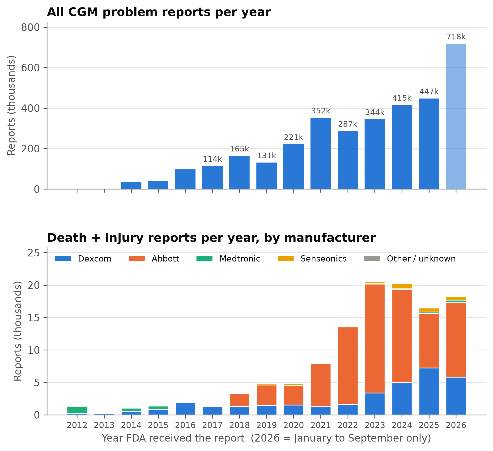
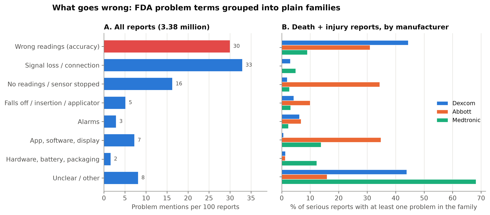
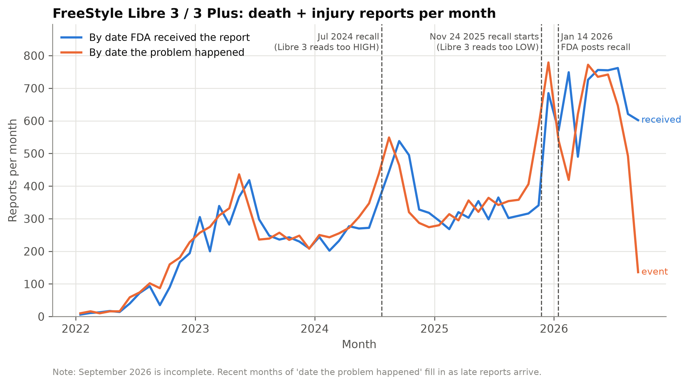
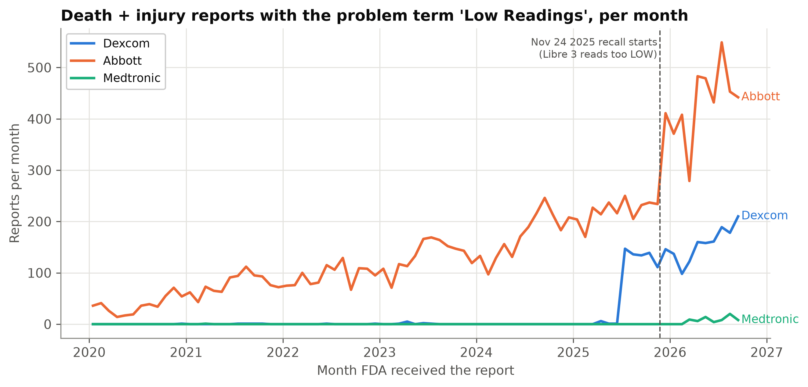
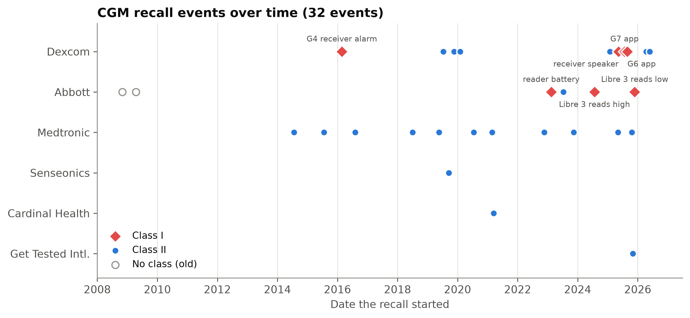
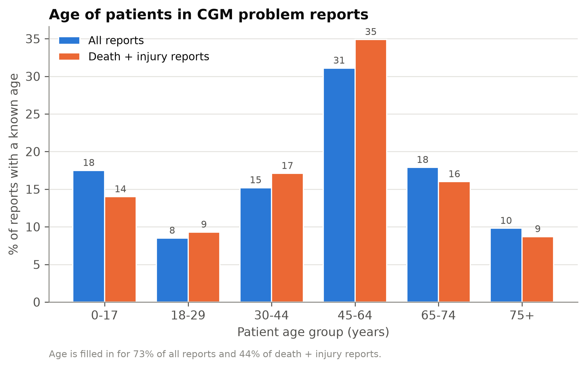

# CGM problem reports and recalls: results for the report
Made by `fda-maude/scripts/report_results.py` on 2026-10-19. Tables: `tables/`. Figures: `figures/`.
- **CGM** = continuous glucose monitor (a sensor worn on the body that reads glucose every few minutes).
- **MAUDE** = FDA database of reports about medical device problems. Report counts are NOT failure rates.
- **Serious reports** = reports filed as a death or an injury.
## a. Scope
- Sources: FDA MAUDE (via openFDA) and FDA recall database. 13 CGM product codes (FDA device-type labels).
- Reports received 1992-03 to 2026-09. Pulled 2026-10-19. FDA data last updated 2026-10-07.
- All CGM reports: 3,382,071
- Death + injury reports downloaded: 123,607
- Not used here: the malfunction sample and the full pull (both finished; counts already cover all reports). Full scope: `tables/a_scope.csv`.
## b. Reports by manufacturer
We grouped 2,600+ messy brand spellings by keyword. Totals: FDA brand counts. Deaths and injuries: downloaded serious reports. All families: `tables/b_reports_by_product_family.csv`.

| Manufacturer | All reports | Deaths | Injuries | Malfunction (and other) | Share of all reports % | Share of injury reports % |
|---|---|---|---|---|---|---|
| Dexcom | 2,503,048 | 354 | 33,435 | 2,469,259 | 74.0 | 27.2 |
| Abbott | 722,536 | 162 | 77,585 | 644,789 | 21.4 | 63.1 |
| Medtronic | 128,785 | 103 | 8,791 | 119,891 | 3.8 | 7.1 |
| Senseonics | 7,754 | 1 | 3,006 | 4,747 | 0.2 | 2.4 |
| Other / unknown | 20,008 | 3 | 167 | 19,838 | 0.6 | 0.1 |

| Product family | All reports | Deaths | Injuries | Malfunction (and other) | Injuries per 100 reports |
|---|---|---|---|---|---|
| Dexcom G4 | 131,118 | 130 | 2,714 | 128,274 | 2.1 |
| Dexcom G5 | 334,114 | 25 | 3,175 | 330,914 | 1.0 |
| Dexcom G6 | 1,351,070 | 68 | 13,045 | 1,337,957 | 1.0 |
| Dexcom G7 | 680,526 | 56 | 13,395 | 667,075 | 2.0 |
| Abbott Libre 14-day / original | 133,828 | 14 | 16,462 | 117,352 | 12.3 |
| Abbott Libre 2 / 2 Plus | 306,971 | 48 | 41,441 | 265,482 | 13.5 |
| Abbott Libre 3 / 3 Plus | 271,057 | 94 | 18,198 | 252,765 | 6.7 |
| Medtronic Guardian and older | 113,925 | 103 | 8,521 | 105,301 | 7.5 |

What it means:
- Dexcom has the most reports overall. Abbott has the most injury reports.
- Injuries per 100 reports (share of a product's reports that are injuries, NOT a rate per sensor): Abbott Libre about 7 to 14; Dexcom G5/G6/G7 about 1 to 2.
- guess: part of this gap is how each company files reports (what it labels 'injury'), not only the sensors.
## c. Reports per year
By the year FDA received the report (not the year the problem happened). Every year: `tables/c_reports_per_year.csv`.

| Year received | All reports | Deaths | Injuries |
|---|---|---|---|
| before 2021 | 818,169 | 341 | 25,912 |
| 2021 | 352,301 | 5 | 8,009 |
| 2022 | 286,649 | 11 | 13,726 |
| 2023 | 344,344 | 22 | 20,598 |
| 2024 | 415,499 | 32 | 20,231 |
| 2025 | 447,015 | 94 | 16,410 |
| 2026 (Jan-Sep) | 718,185 | 118 | 18,163 |

What it means:
- From 2018 on, Abbott products have the most death + injury reports every year.
- Dexcom death + injury reports grew fast: 1,616 in 2022 to 7,256 in 2025.
## d. Problem types
Each report lists one or more FDA 'problem terms' (fixed labels). Top 5 terms over all reports:

| Problem (FDA term) | Reports | Family | % of all reports |
|---|---|---|---|
| Wireless Communication Problem | 1,057,609 | Signal loss / connection | 31.3 |
| Incorrect, Inadequate or Imprecise Result or Readings | 602,892 | Wrong readings (accuracy) | 17.8 |
| No Device Output | 325,299 | No readings / sensor stopped | 9.6 |
| Low Readings | 174,493 | Wrong readings (accuracy) | 5.2 |
| Imprecision | 171,362 | Wrong readings (accuracy) | 5.1 |

We grouped the 391 terms into 8 plain families (full mapping: `tables/d_problem_family_mapping.csv`).
All reports: one report can list several terms, so 'mentions per 100' is an upper limit on the share of reports. Serious reports: exact % of reports.

| Problem family | Main FDA terms | All reports: mentions per 100 | Serious: All serious % | Serious: Dexcom % | Serious: Abbott % | Serious: Medtronic % |
|---|---|---|---|---|---|---|
| Wrong readings (accuracy) | Incorrect...Readings, Low Readings, Imprecision | 30.0 | 33.1 | 44.4 | 31.0 | 9.0 |
| Signal loss / connection | Wireless Communication Problem, Communication or Transmission Problem, Connection Problem | 32.9 | 1.3 | 3.0 | 0.1 | 4.9 |
| No readings / sensor stopped | No Device Output, Premature End-of-Life Indicator, Unable to Obtain Readings | 16.3 | 22.4 | 1.9 | 34.4 | 2.7 |
| Falls off / insertion / applicator | Detachment of Device or Device Component, Retraction Problem, Detachment Of Device Component | 5.1 | 8.0 | 4.2 | 10.0 | 3.1 |
| Alarms | Device Alarm System, No Audible Alarm, Defective Alarm | 2.9 | 6.2 | 6.2 | 6.8 | 2.3 |
| App, software, display | Device Displays Incorrect Message, Unintended Application Program Shut Down, Display or Visual Feedback Problem | 7.2 | 23.1 | 0.6 | 34.8 | 13.8 |
| Hardware, battery, packaging | Break, Battery Problem, Component Missing | 1.6 | 2.2 | 1.3 | 1.2 | 12.3 |
| Unclear / other | Device Operates Differently Than Expected, Use of Device Problem, Adverse Event Without... | 8.1 | 28.1 | 43.9 | 15.9 | 68.2 |

What it means:
- All reports: signal loss is the biggest family, wrong readings second. Death + injury reports: wrong readings is the top family (33.1%).
- Abbott serious reports often pair 'Unable to Obtain Readings' with 'Device Displays Incorrect Message' (sensor error message). So 'App, software, display' is high for Abbott.
- Problem counts per manufacturer for ALL reports are not possible: FDA counts split only by product code, and codes mix brands. Per-code tables: `tables/d_top5_problems_by_product_code.csv`.
## e. Death + injury reports
123,607 reports (623 deaths, 122,984 injuries). Patient outcomes (a report can have several); manufacturer columns = number of reports:

| Patient outcome | All serious | % of serious reports | Dexcom | Abbott | Medtronic | Senseonics |
|---|---|---|---|---|---|---|
| Required Intervention | 64,888 | 52.5 | 1,109 | 62,938 | 781 | 4 |
| Other | 43,254 | 35.0 | 30,830 | 10,508 | 642 | 1,252 |
| Hospitalization | 17,194 | 13.9 | 7,253 | 2,912 | 6,577 | 413 |
| Life Threatening | 1,541 | 1.2 | 1,114 | 270 | 43 | 8 |
| Death | 632 | 0.5 | 359 | 164 | 105 | 2 |

What it means:
- Most serious reports say the person 'required intervention' (needed treatment to prevent harm).
- Companies fill this field differently. Abbott mostly uses 'Required Intervention'. Dexcom mostly uses 'Other'. Compare manufacturers with care.
- A death report does not mean the device caused the death. It means someone reported a death while using it.
- Top patient problem terms (% of serious reports; full list in `tables/e_top_patient_problems_serious.csv`):
  - Hypoglycemia: 40.8%
  - Loss of consciousness: 27.8%
  - Hyperglycemia: 19.0%
## f. Libre 3 and the recall timeline
Libre 3 / 3 Plus death + injury reports (found by brand name) per month, by date FDA received them and by date the problem happened.

| Item | Value |
|---|---|
| Libre 3 / 3 Plus serious reports (all time) | 18,292 |
|     deaths (all time) | 94 |
|     injuries (all time) | 18,198 |
|   of these, received on or after Nov 24 2025 | 6,785 |
|     deaths (received on or after Nov 24 2025) | 71 |
|     injuries (received on or after Nov 24 2025) | 6,714 |
|   of these, with problem term 'Low Readings' | 5,347 |
|     deaths ('Low Readings', all time) | 32 |
|     injuries ('Low Readings', all time) | 5,315 |
|   received on or after Nov 24 2025 AND 'Low Readings' | 2,638 |
|     deaths (on or after Nov 24 2025 AND 'Low Readings') | 21 |
|     injuries (on or after Nov 24 2025 AND 'Low Readings') | 2,617 |
| Peak month by date received | 2026-07 (762) |
| Peak month by date of event | 2025-12 (779) |

- Deaths + injuries add up to the row above each pair. The 5,347 'Low Readings' row counts ALL time, not only after Nov 24 2025. The after-Nov-24 'Low Readings' count is the 2,638 row.

What it means:
- Look at both lines. A jump 'by date received' with no jump 'by date of event' means late reports, not new problems.
- Libre 3 reports peak around both Class I recalls (Jul 2024, Nov 2025), by both dates. guess: recall news also makes people report more.
- Dexcom almost never used the term 'Low Readings' before mid-2025, then about 100-200 per month. guess: a change in how Dexcom codes reports, not a sudden new fault.
- Not possible from our counts (no API calls made): monthly ALL reports for Libre 3 alone (FDA monthly counts are by product code, which mixes brands), and monthly 'Low Readings' for ALL reports. Both figures use serious reports only. Monthly ALL reports for codes QBJ and QLG: `tables/f_QBJ_QLG_all_reports_per_month.csv`.
## g. Recalls
A recall event = one FDA action (it can have several records, one per product model).
- **Class I** = most serious (use may cause serious injury or death).
- **Class II** = use may cause temporary or reversible harm.

Recall events by firm (3 more firms have 1 each; `tables/g_recalls_by_firm.csv`):
- Medtronic: 11 (0 Class I)
- Dexcom: 11 (4 Class I)
- Abbott: 7 (3 Class I)

Recall type (our plain grouping of the FDA reason; `g_recalls_by_type.csv`):
- Software / app (no or late readings, data): 14 (2 Class I)
- Wrong readings: 8 (2 Class I)
- Missed alarms (receiver/app): 4 (2 Class I)
- Hardware / sensor stops: 3 (1 Class I)
- Sterility / unapproved / stolen: 3 (0 Class I)

The 7 Class I recalls (all 32: `tables/g_recall_events.csv`). Quantity = sum of numbers in the FDA records; units differ; rough size only.

| Date started | Firm | Product | Reason (plain words) | Quantity (approx.) |
|---|---|---|---|---|
| 2016-02-23 | Dexcom | Dexcom G4 PLATINUM receiver | Alarm may not sound | 270,111 |
| 2023-02-13 | Abbott | FreeStyle Libre readers | Reader battery may swell, overheat, or catch fire | 3,243,928 |
| 2024-07-24 | Abbott | FreeStyle Libre 3 sensors | Readings falsely HIGH | 8,174 |
| 2025-05-12 | Dexcom | Dexcom G6/ONE receivers | Speaker fault; audible alarms missed | 703,687 |
| 2025-07-24 | Dexcom | Dexcom G7 / ONE+ apps | App software fault; alerts or readings missed | 2,429,443 |
| 2025-08-28 | Dexcom | Dexcom G6 Android app | App closes unexpectedly; no readings or alarms | 333 |
| 2025-11-24 | Abbott | FreeStyle Libre 3 / 3 Plus sensors | Readings falsely LOW (carbon build-up in sensor) | 2,990,939 |

What it means:
- Nov 2025 Libre 3 recall: FDA lists 860 injuries and 7 deaths (as of 2026-01-07). Other recalls: harm numbers not typed in yet.
- 6 of the 7 Class I recalls started in 2023 or later.
- Wrong-reading recalls: 2 for the drug hydroxyurea (falsely high), 2 for Libre 3 (high in 2024, low in 2025), plus cold exposure, a Guardian 4 sensing-layer defect, and 2 old Navigator recalls.
## h. Demographics
| Measure | All reports | Serious reports |
|---|---|---|
| Age filled in (%) | 73.4 | 44.5 |
| Median age (years) | 52.0 | 51.0 |
| Under 18 (% of known age) | 17.5 | 14.0 |
| Female (% of all) | 23.0 | 15.3 |
| Male (% of all) | 22.7 | 14.0 |
| Sex missing (% of all) | 53.4 | 70.6 |

What it means:
- The age mix is about the same in all and serious reports. About 1 in 6 reports with a known age is for a child.
- More than half of reports have no sex recorded. Race and ethnicity are almost always blank (under 3%), so we do not report them. Tables: `h_age_groups.csv`, `h_sex.csv`.
## i. Keyword signals in serious reports (keyword counts, NOT AI labels)
Simple word patterns in the event text. Misses other wordings; can wrongly match (e.g. 'no low readings'). More groups: `tables/i_keyword_signals_serious.csv`.

| Keyword group | Serious reports | % of serious | Dexcom % | Abbott % | Medtronic % |
|---|---|---|---|---|---|
| Low reading words (e.g. 'low reading', 'falsely low', 'lower than') | 15,002 | 12.1 | 6.1 | 16.5 | 1.0 |
| High reading words (e.g. 'high reading', 'falsely high') | 10,104 | 8.2 | 3.4 | 11.4 | 0.7 |
| Fingerstick / meter mentioned | 13,043 | 10.6 | 29.2 | 3.7 | 1.4 |
| Low reading words AND fingerstick/meter | 2,530 | 2.0 | 3.3 | 1.8 | 0.1 |

What it means:
- Each company writes reports from its own template. Dexcom texts often say 'an inaccuracy between the CGM and ...'. So differences between manufacturers partly reflect wording, not events.
- Low reading words appear in more Abbott serious reports than Dexcom ones. This fits the Libre 3 'reads too low' recall, but is not proof.
## j. Caveats (read before using any number)
| Caveat | Why it matters |
|---|---|
| Voluntary reporting | Many problems are never reported. Some are reported many times. |
| Counts, not rates | No count of sensors used. A brand with more users gets more reports. Never call these rates or risk. |
| Date received vs date of event | Reports can arrive months or years late. Jumps by date received can be backlogs. |
| Duplicates | The same event can be reported by the patient and by the maker. 65 double-coded serious reports were removed; others may remain. |
| Brand-name cleaning | We grouped 2,600+ brand spellings by keyword. A few may be in the wrong family. MDS brand list was cut at 999 spellings (about 170 reports lost). |
| Product codes mix brands | QBJ holds Dexcom G6/G7 and Libre 2 Plus/3. So all-report problem and monthly counts cannot be split by brand. |
| Missing demographics | Age is missing in about 1 in 4 reports, sex in about half. Race and ethnicity almost always missing. |
